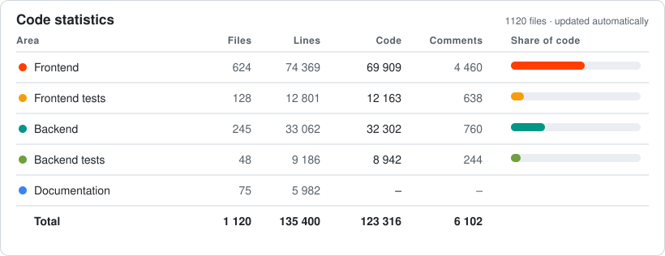

<div align="center">

# Examance

Privacy-first anonymous exam grading. Teachers write LaTeX exams, print QR-coded sheets, scan and grade the submissions against a pseudonym rather than a name, and analyse the results. Student identities, scans and annotations are encrypted in the browser before they reach a server. Teacher select between end-to-end encrypted student data stored on the server or only their computer. 

<p align="center">
  <!-- Project -->
  <a href="https://github.com/ValentinHerrmann/Examance/releases"></a>
  <a href="https://github.com/ValentinHerrmann/Examance/blob/main/LICENSE"></a>

  
  <a href="https://github.com/ValentinHerrmann/Examance/issues"></a>
  <a href="https://github.com/ValentinHerrmann/Examance/pulls?q=is%3Apr+is%3Aclosed"></a>

  <a href="https://docs.examance.de/user/"></a>
  <a href="https://docs.examance.de/"></a>
</p>


### Code Stats
<p align="center">
  <!-- Code size -->
  <a href="https://github.com/ValentinHerrmann/Examance"></a>
</p>
<p align="center">
  <!-- Project -->
  <a href="https://github.com/ValentinHerrmann/Examance/commits"></a>
  <a href="https://github.com/ValentinHerrmann/Examance/graphs/commit-activity"></a>
  <a href="https://github.com/ValentinHerrmann/Examance/stargazers"></a>
  <a href="https://github.com/ValentinHerrmann/Examance/graphs/contributors"></a>
  <a href="https://github.com/ValentinHerrmann/Examance/issues"></a>
  <a href="https://github.com/ValentinHerrmann/Examance/pulls?q=is%3Apr+is%3Aclosed"></a><a href="https://github.com/ValentinHerrmann/Examance"></a>
  <a href="https://github.com/ValentinHerrmann/Examance"></a>
  <a href="https://github.com/ValentinHerrmann/Examance"></a>
</p>

</div>


## Information & Documentation

**<https://valentin-herrmann.com/examance/>**: Information page

**<https://docs.examance.de/>**: Documentation built from `/docs` of latest Release

- [User guide](https://docs.examance.de/user/) and [info material](https://docs.examance.de/user/material) (slide decks and posters, German)
- [Host Examance](https://docs.examance.de/hosting) on your own server
- [Develop](https://docs.examance.de/data_flow_and_security): architecture, encryption, API, data model
- [Legal and compliance](https://docs.examance.de/legal_audit_dsgvo) (DSGVO): audit, records of processing, DPIA, DPA template, breach response

## Development quickstart

```bash
make install            # backend dependencies (uv)
make install-frontend   # frontend dependencies (npm)
make dev-up             # docker compose: postgres + redis + backend
make migrate            # apply database migrations
cd frontend && npm run dev
```

API docs at `http://localhost:8000/api/docs`, frontend at `http://localhost:5173`. All commands and conventions: [`CLAUDE.md`](CLAUDE.md).

| Path | What |
|---|---|
| `backend/` | FastAPI + SQLAlchemy + PostgreSQL API |
| `frontend/` | SvelteKit (Svelte 5) static app, client-side crypto |
| `deploy/` | `docker compose` stack and env templates |
| `docs/` | Documentation site sources (VitePress) |


<div align="center">

### Tech Stack

<p align="center">
  <!-- Stack -->
  <a href="#"></a>
  <a href="#"></a>
  <a href="#"></a>
  <a href="#"></a>
  <a href="#"></a>
  <a href="#"></a>
  <a href="#"></a>
  <a href="#"></a>
  <a href="#"></a>
  <a href="#"></a>
  <a href="#"></a>
  <a href="#"></a>
  <a href="#"></a>
</p>

### Security
<p align="center">
  <!-- Privacy -->
  <a href="https://docs.examance.de/data_flow_and_security"></a>
  <a href="https://docs.examance.de/data_flow_and_security"></a>
  <a href="https://docs.examance.de/legal_audit_dsgvo"></a>
  <a href="https://github.com/ValentinHerrmann/Examance/security/policy"></a>
  </p>

### SonarQube | CI

  

<p align="center">
<a href="https://github.com/ValentinHerrmann/Examance/actions/workflows/ci.yml"></a>
  <a href="https://github.com/ValentinHerrmann/Examance/actions/workflows/docs.yml">
  <!-- Quality (SonarCloud) -->
  <a href="https://sonarcloud.io/summary/overall?id=ValentinHerrmann_Examance"></a>
  <a href="https://sonarcloud.io/summary/overall?id=ValentinHerrmann_Examance"></a>
  <a href="https://sonarcloud.io/summary/overall?id=ValentinHerrmann_Examance"></a>
  <a href="https://sonarcloud.io/summary/overall?id=ValentinHerrmann_Examance"></a>
  <a href="https://sonarcloud.io/summary/overall?id=ValentinHerrmann_Examance"></a>
  <a href="https://sonarcloud.io/summary/overall?id=ValentinHerrmann_Examance"></a>
  <a href="https://sonarcloud.io/summary/overall?id=ValentinHerrmann_Examance"></a>
  <a href="https://sonarcloud.io/summary/overall?id=ValentinHerrmann_Examance"></a>
</p>


</div>