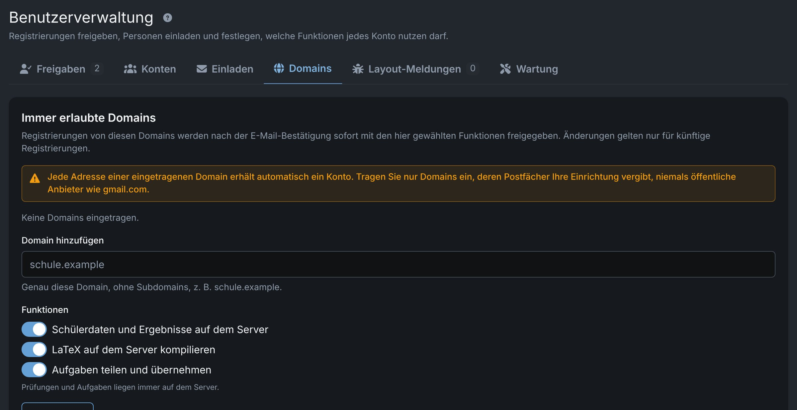
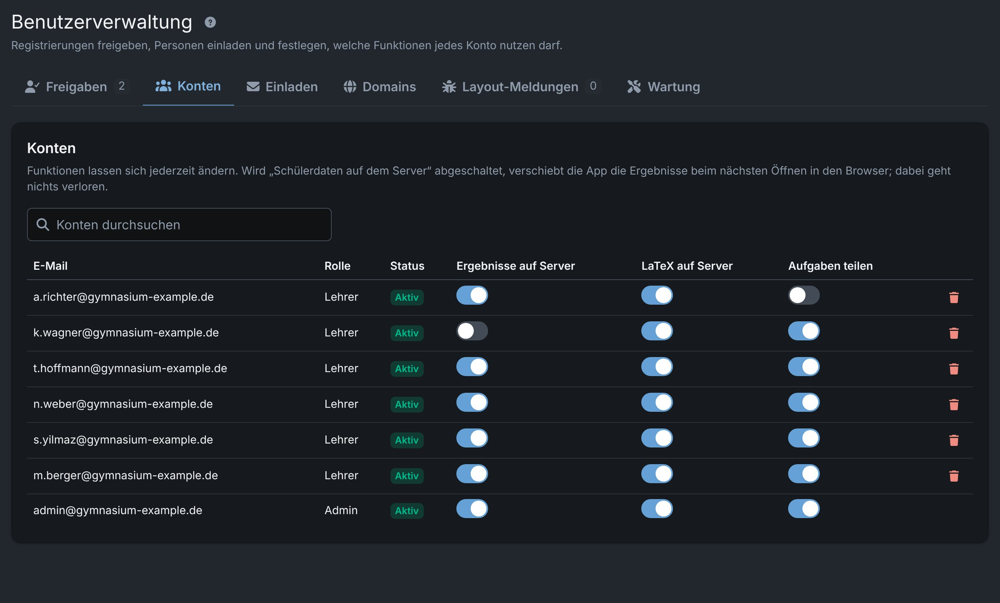
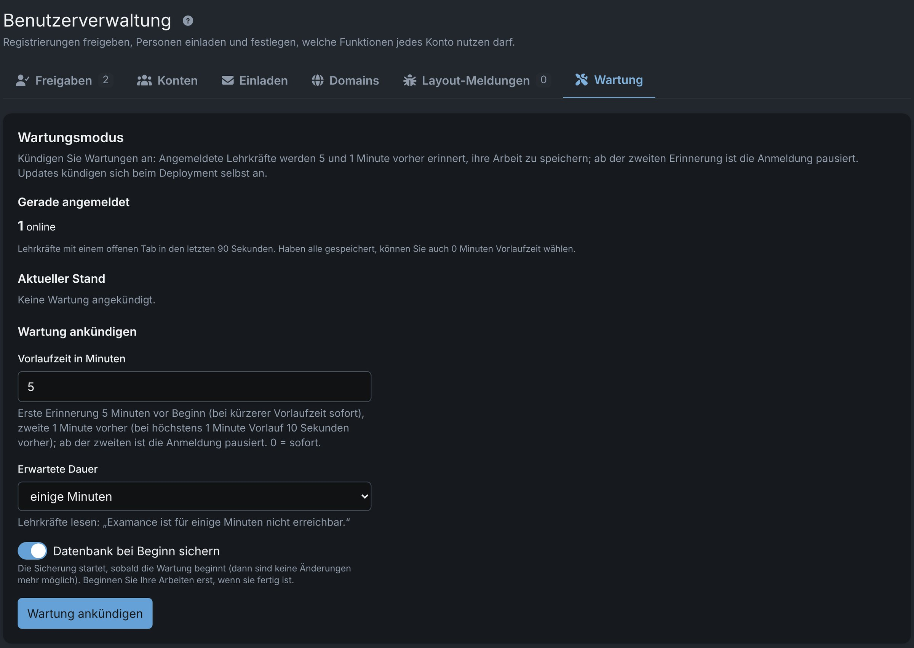

# Für Administratorinnen und Administratoren

Die Administration einer Examance-Installation verwaltet **Konten und den Server**, sonst nichts. Diese Seite behandelt die Benutzerverwaltung in der App; Installation und Betrieb des Servers sind in [Einrichtung und Updates (Englisch)](../../hosting) und [Konten und Verwaltung (Englisch)](../../account_creation_and_management) beschrieben.

## Rollen {#roles}

- **Lehrkräfte** arbeiten mit Prüfungen, Aufgaben und Ergebnissen und sehen ausschließlich ihre eigenen.
- **Administratorinnen und Administratoren** verwalten nur Konten und den Server. Sie können keine Prüfungen oder Aufgaben anlegen oder öffnen; die App zeigt ihnen nur Benutzerverwaltung, Einstellungen und Hilfe. Wer verwaltet und selbst unterrichtet, nutzt **zwei Konten**.

Auch die Administration erhält keinen Zugriff auf die Prüfungsinhalte anderer, denn diese sind im Browser der Lehrkraft verschlüsselt. Die einzige Ausnahme sind [Layout-Meldungen](#layout-reports), die eine Lehrkraft bewusst sendet.

## Jemanden einladen {#invite}

**Benutzerverwaltung → Einladen**: Geben Sie eine E-Mail-Adresse ein und wählen Sie **Einladung senden**. Das Konto ist sofort freigegeben, und die Adresse gilt als bestätigt; die Person wählt über den Link in der E-Mail ein Passwort.

## Registrierungen freigeben {#approvals}

Personen können auch auf der Anmeldeseite ein **Konto beantragen**. Nachdem sie ihre E-Mail-Adresse bestätigt und ein Passwort gewählt haben, wartet die Registrierung unter **Freigaben** (es sei denn, ihre Domain ist immer erlaubt, siehe unten). **Freigeben** aktiviert das Konto und benachrichtigt die Person per E-Mail; **Ablehnen** löscht die Registrierung und sendet eine kurze Mitteilung.

## Immer erlaubte Domains {#domains}

Registrierungen von Domains, die unter **Domains** aufgeführt sind, werden nach der Bestätigung der Adresse automatisch freigegeben, mit den dort gewählten Funktionen. Änderungen gelten nur für künftige Registrierungen.

Tragen Sie nur Domains ein, deren Postfächer Ihre Einrichtung selbst vergibt (zum Beispiel die eigene Domain der Schule), **nie öffentliche E-Mail-Anbieter**.

## Funktionen pro Konto {#features}

Unter **Konten** legen Sie für jedes Konto fest, was es nutzen darf:

| Funktion | Wenn aus |
|---|---|
| **Schülerdaten und Ergebnisse auf dem Server** | Ergebnisse bleiben im Browser der Lehrkraft (nur Hybrid-Modus) |
| **LaTeX auf dem Server kompilieren** | der Browser kompiliert |
| **Aufgaben teilen und übernehmen** | kein Teilen, kein Übernehmen geteilter Aufgaben |

Prüfungen und Aufgaben liegen immer auf dem Server. Optionen, die ein Konto nicht nutzen darf, zeigt die App der Lehrkraft als „nicht freigeschaltet“ an. Funktionen lassen sich jederzeit ändern; schalten Sie „Schülerdaten auf dem Server“ ab, verschiebt die App die Ergebnisse dieser Lehrkraft beim nächsten Öffnen in ihren Browser. Dabei geht nichts verloren.

Hier können Sie auch Konten löschen (mit der Option, die Aufgaben ohne Namen zu behalten).

## Layout-Meldungen {#layout-reports}

Meldet eine Lehrkraft ein LaTeX-Layoutproblem, erhält die Administration eine E-Mail ohne Inhalt, und der Tab **Layout-Meldungen** zeigt die Beschreibung, den mitgesendeten LaTeX-Code, die PDFs und wer gemeldet hat.

- Hat die Lehrkraft der Veröffentlichung zugestimmt, enthält der Text unter **Für GitHub** keine personenbezogenen Daten und lässt sich in ein neues GitHub-Issue einfügen; ziehen Sie dann die PDFs hinein. Andernfalls darf die Meldung nicht veröffentlicht werden.
- **Als gelöst markieren** benachrichtigt die Lehrkraft per E-Mail, wahlweise mit einer Notiz.

## Wartungsmodus {#maintenance}

**Benutzerverwaltung → Wartung** kündigt ein Wartungsfenster mit Vorlaufzeit (auch 0 Minuten) und erwarteter Dauer an:

- Angemeldete Lehrkräfte werden **5 Minuten und 1 Minute** vorher erinnert (bei höchstens 1 Minute Vorlauf: sofort und 10 Sekunden vorher).
- Ab der zweiten Erinnerung ist die Anmeldung für alle außer der Administration pausiert.
- Ab Beginn können keine Prüfungsdaten mehr geändert werden, bis Sie die Wartung beenden.
- Auf Wunsch wird die Datenbank bei Beginn der Wartung gesichert; beginnen Sie Ihre Arbeiten erst, wenn die Sicherung fertig ist.

Die Zähler zeigen, wie viele Lehrkräfte online sind, wie viele die Ankündigung gesehen und wie viele bestätigt haben, dass sie gespeichert haben. Ist niemand mehr angemeldet, verkürzt **Jetzt beginnen** den Countdown.

Updates beim Deployment kündigen sich genauso an (5 Minuten vorher) und sichern die Datenbank immer vorher. Einzelheiten für den Betrieb: [Wartungsmodus (Englisch)](../../dev/maintenance_mode).
