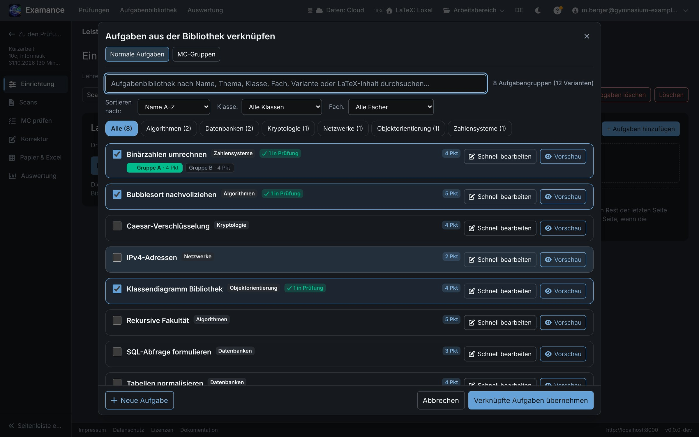
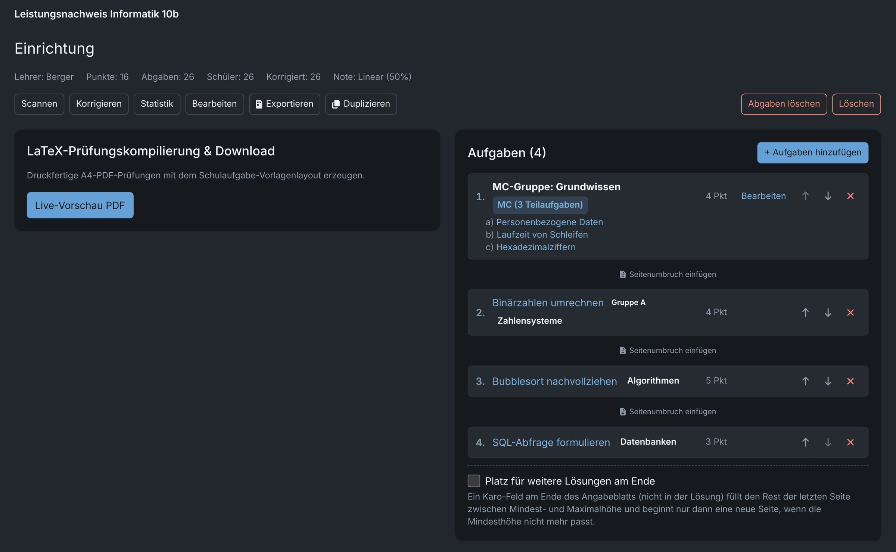
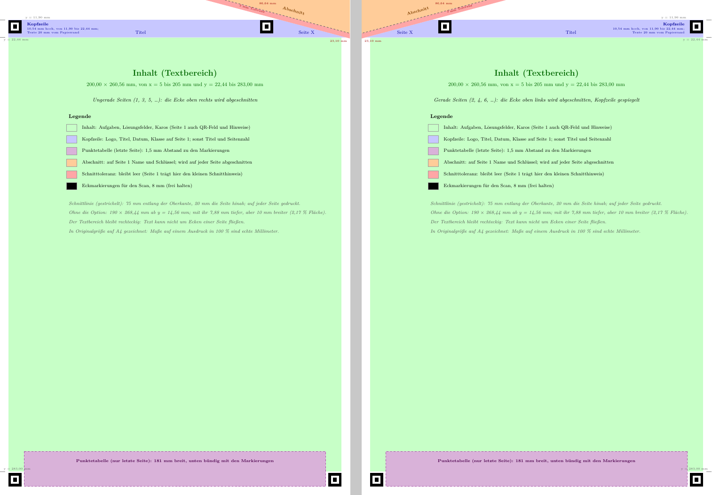
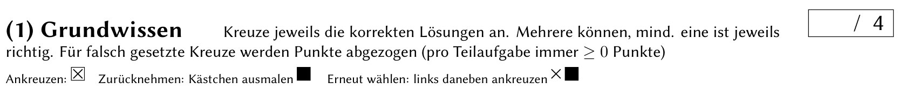
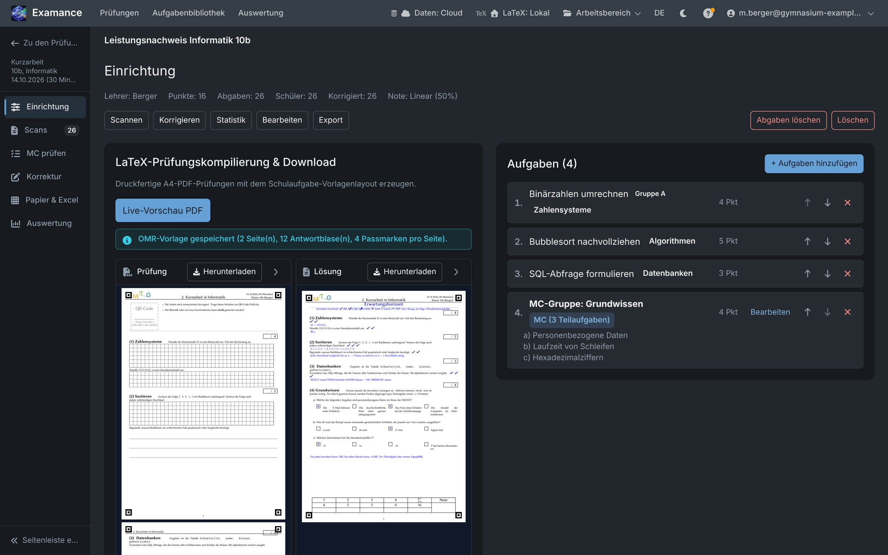
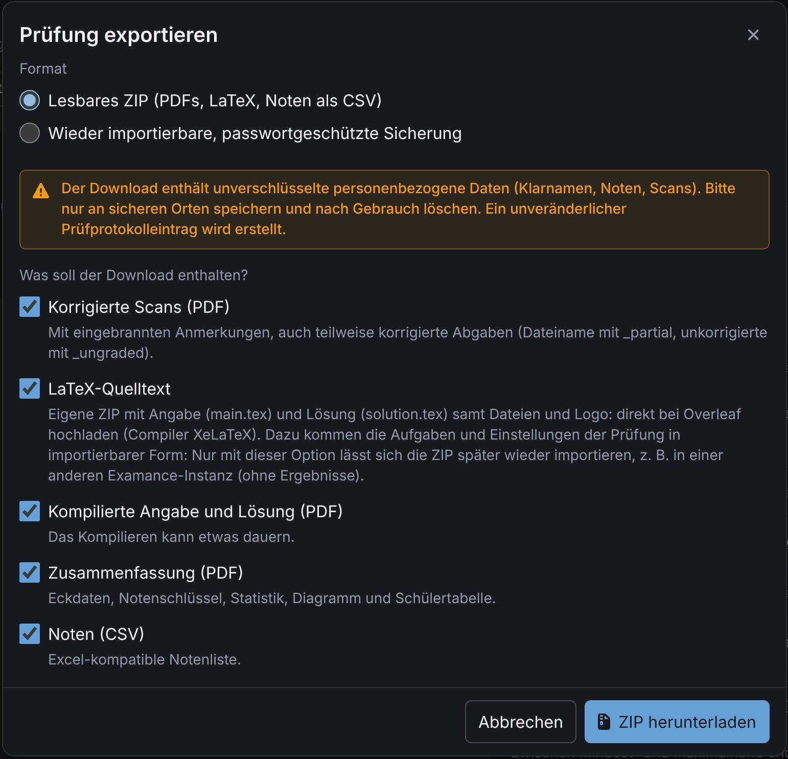

# Prüfung erstellen

Eine Prüfung besteht aus einer Auswahl von Aufgaben aus Ihrer Bibliothek, Kopfdaten, einem Notenschlüssel und einigen Layout-Optionen. Examance setzt sie als druckfertiges PDF, dessen Deckblatt ein leeres Feld **QR Code** hat: Jede Schülerin und jeder Schüler klebt dort einen QR-Namensaufkleber ein (siehe [QR-Aufkleber](./students#qr-stickers)), sodass sich die Scans später automatisch und anonym zuordnen lassen.

## Eine neue Prüfung anlegen {#new-exam}

**Neue Prüfung** (auf der Startseite) fragt nur die Kopfdaten ab, legt die Prüfung an und öffnet sie im Schritt **Prüfung** mit der Aufgabenbibliothek. Alles Weitere (Aufgaben, Reihenfolge, MC-Gruppen, Layout, Logo, Pakete, Vorschau) erledigen Sie dort.

### Kopfdaten {#header}

**Fach**, **Klasse**, **Testart**, **Datum** und **Nummer** erscheinen auf dem Deckblatt. Sie sind Prüfungsinhalt und werden deshalb immer auf Deutsch gedruckt, unabhängig von der Sprache der Oberfläche.

Der **Titel** entsteht aus diesen Angaben (zum Beispiel „Kurzarbeit 1 · Informatik 10a · 05.11.2026“) und ändert sich beim Bearbeiten mit. Er ist nur in Examance zu sehen und wird nicht gedruckt. Mit dem Stift daneben setzen Sie einen eigenen Titel: Er ist dann als **eigener Titel** markiert und ändert sich nicht mehr mit den Angaben; ↺ lässt ihn wieder automatisch entstehen.

Die **gedruckte Klasse** (`\Klasse` auf dem Deckblatt) entsteht aus Jahrgangsstufe und Klasse (10 und a ergeben „10a“) und steht als kleine Zeile unter dem Feld **Klasse** („Gedruckt: 10a“). Ein Klick darauf lässt Sie stattdessen etwas anderes drucken, zum Beispiel „Q11 Inf“; das ist dann als eigene Angabe markiert, und ↺ kehrt zu Jahrgangsstufe und Klasse zurück.

**Speichern** und **Änderungen verwerfen** erscheinen erst, wenn Sie etwas geändert haben.

Das optionale **Thema** (zum Beispiel „Rekursion“) ordnet Ihre Prüfungen in der Übersicht, wo Sie danach filtern und suchen können. Es wird nie gedruckt. Die Übersicht lässt sich außerdem nach Datum, Titel, Jahrgang oder Fach sortieren.

Um die Kopfdaten später zu ändern, bearbeiten Sie sie direkt in der Karte **Angaben** der **Übersicht** und wählen **Speichern** (**Änderungen verwerfen** nimmt sie zurück; wer die Seite mit ungespeicherten Änderungen verlässt, wird vorher gefragt). Die Karte enthält nur die Angaben der Prüfung: Titel, Testart, Jahrgang/Klasse, Datum, Dauer, Nummer, Fach, Lehrkraft, Thema und das Aufbewahrungsdatum. Layout-Einstellungen finden Sie auf dem [Reiter Layout](#layout), den Notenschlüssel unter [Ergebnisse](./results#grading-key).

## Die Schritte einer Prüfung {#steps}

Jede Prüfung hat eine Seitenleiste (auf dem Handy: das Menü) mit nummerierten Schritten. Jeder Schritt trägt ein Abzeichen, das zeigt, wo Sie stehen: Zahl der Aufgaben, Schüler oder Scans, korrigiert x/y, offene MC-Prüfungen, geteilte Ergebnisse (rot: die Zahl der Ergebnis-E-Mails, die nicht angekommen sind). Oben rechts auf jeder Schrittseite, neben Prüfungsname und Schritttitel, führt eine Schaltfläche **Weiter: …** zum nächsten Schritt; Erklärungen liegen hinter den ⓘ-Symbolen.

| Schritt | Was Sie dort tun |
|---|---|
| **Übersicht** | Angaben und Kennzahlen der Prüfung, siehe [unten](#overview) |
| 1 **Prüfung** | Aufgaben, Layout und Vorschau, siehe [Aufgaben zusammenstellen](#assemble) und [Layout-Optionen](#layout) |
| 2 **Schüler** | Die Klassenliste, siehe [Schülerdaten](./students#student-data) |
| 3 **Drucken** | PDFs und QR-Codes erstellen, siehe [Drucken](#print) |
| 4 **Scans** | Die gescannten Bögen einlesen, siehe [Scannen und Zuordnen](./scanning) |
| 5 **MC prüfen** | Multiple-Choice-Erkennungen prüfen, siehe [MC-Erkennungen prüfen](./scanning#mc-verification) |
| 6 **Scankorrektur** | Abgaben korrigieren, siehe [Korrigieren](./grading) |
| 7 **Papierkorrektur** | Punkte für ohne Scan korrigierte Arbeiten eintragen, siehe [Auf Papier korrigierte Klassen](./grading#paper) |
| 8 **Ergebnisse & Export** | Reiter **Statistik**, **An Schüler senden** und **Archivieren**, siehe [Ergebnisse und Auswertung](./results) |

## Übersicht {#overview}

Die **Übersicht** (erster, nicht nummerierter Eintrag der Seitenleiste) zeigt die Angaben der Prüfung, einige Kennzahlen (Punkte, Durchschnitt, Notenschlüssel) und unten den **Ablauf**: alle Schritte der Reihe nach mit ihrem Abzeichen, jeder ein Link; der Schritt, den Sie am ehesten als Nächstes brauchen, ist hervorgehoben. **Weiter mit: …** (gefolgt vom Namen des Schritts) öffnet diesen Schritt. Die Karte **Angaben** ändert die Kopfdaten direkt. **Sichern / Weitergeben** packt die Prüfung als lesbares ZIP oder als passwortgeschützte Sicherung, die Examance wieder importieren kann, zum Umziehen oder Weitergeben (siehe [Exportieren](#export)); zum Aufbewahren der Ergebnisse für Ihre Unterlagen nutzen Sie stattdessen **Ergebnisse & Export → Archivieren**. Das Menü **⋯** (**Weitere Aktionen**) enthält **Duplizieren**, **Abgaben löschen** und **Löschen** (die Prüfung).

## Aufgaben zusammenstellen {#assemble}

Im Schritt **Prüfung** listet der Reiter **Aufgaben** die Aufgaben der Prüfung. Dort wählen Sie Aufgaben aus der Bibliothek (**Aufgaben hinzufügen**), jeweils mit der gewünschten Variante. Mit **Neue Aufgabe** schreiben Sie direkt dort eine neue; sie wird in Ihrer Bibliothek gespeichert und sofort ausgewählt.

- Mit den Pfeilen ändern Sie die Reihenfolge der Aufgaben.
- Die Gesamtpunktzahl wird laufend neu berechnet.
- Eine lange Aufgabe läuft einfach auf der nächsten Seite weiter; ihre Überschrift bleibt dabei immer mit den ersten Zeilen zusammen.

### Seitenumbrüche zwischen Aufgaben {#page-breaks}

Soll eine Aufgabe auf einer neuen Seite beginnen, fügen Sie zwischen zwei Aufgaben **Seitenumbruch einfügen** ein. Der Umbruch gehört zur Aufgabe darunter und wandert beim Verschieben mit. Seitenumbrüche *innerhalb* einer Aufgabe legen Sie in der Aufgabe selbst fest, siehe [Seitenumbrüche](./exercises#page-breaks).

Ändern Sie Seitenumbrüche, nachdem Sie die Antwortbogen-Vorlage für die MC-Erkennung erstellt haben, erzeugen Sie die Vorlage neu.

### MC-Gruppen {#mc-groups}

Mehrere Ankreuzaufgaben können gemeinsam als **MC-Gruppe** gedruckt werden. Gruppen legen und bearbeiten Sie auf dem Reiter **Aufgaben** (**MC-Gruppen**). Eine Prüfung kann beliebig viele Gruppen beliebiger Größe enthalten; jede Frage gehört zu höchstens einer Gruppe.

Haken Sie im Aufgabendialog auf dem Reiter **MC-Gruppen** die Fragen an und geben Sie der Gruppe einen Titel. **Aufgaben und MC-Gruppe übernehmen** fügt die Gruppe zusammen mit den übrigen Aufgaben hinzu. Für mehrere Gruppen auf einmal klicken Sie nach jeder Gruppe auf **MC-Gruppe zur Prüfung hinzufügen**.

Gruppen betreffen nur das Layout: Korrektur und Statistik bleiben strikt pro Frage.

## Layout-Optionen {#layout}

Layout-Einstellungen liegen auf dem Reiter **Layout** im Schritt **Prüfung**: Infotext, Namenszeile, Hinweis zur Abschneide-Ecke, Korrekturhinweis für Multiple-Choice, Logo und LaTeX-Pakete. **Speichern** übernimmt sie, **Änderungen verwerfen** kehrt zum gespeicherten Stand zurück; wer die Seite mit ungespeicherten Änderungen verlässt, wird vorher gefragt. Änderungen erscheinen im PDF erst, wenn Sie erneut kompilieren.

### Namenszeile {#name-line}

Mit **Namenszeile neben dem QR-Code-Feld drucken** (beim Anlegen der Prüfung oder auf dem Reiter **Layout**) erhält die Titelseite eine Zeile für den Namen der Schülerin oder des Schülers. Das QR-Code-Feld bleibt an derselben Stelle, Scannen und Zuordnen funktionieren also wie bisher; nur das Initialenfeld im Feld entfällt.

### Abschneide-Ecke {#cut-corner}

Jede Prüfung hält auf jeder Seite die **äußere obere Ecke** frei: auf ungeraden Seiten oben rechts, auf geraden oben links. Auf geraden Seiten ist die Kopfzeile gespiegelt. Im normalen Prüfungs-PDF bleibt die Ecke leer und ist hellgrau getönt. Drucken Sie die QR-Codes [direkt auf die Prüfungsexemplare](./students#printed-copies), trägt die Ecke auf Seite 1 Name und persönlichen Schlüssel, und eine gestrichelte Linie mit kleiner Schere zeigt, wo Sie sie vor dem Austeilen abschneiden. Bei beidseitigem und Broschürendruck können Sie auch den ganzen Stapel auf einmal mit der Schneidemaschine schneiden. Alle Prüfungen haben dieses Layout, so findet das Einlesen die Eckmarkierungen immer an denselben Stellen, egal wie die Blätter gedruckt wurden.

Der Text und auf Seite 1 das QR-Feld mit den Hinweisen daneben reichen bis an die Eckmarkierungen. Die Kopfzeile von Seite 1 zeigt das Logo, dann den Titel und darunter in einer Zeile Kurs, Datum, Dauer und Lehrkraft; die anderen Seiten zeigen den Titel und „Seite X“. Die Punktetabelle füllt den Streifen zwischen den unteren Markierungen.

Die Skizze zeigt den nutzbaren Platz auf ungeraden und geraden Seiten: Textbereich, Kopfzeile, Punktetabelle, den Abschnitt mit seiner Toleranz und die Eckmarkierungen. Das [PDF](../../screenshots/guide/cut-corner-layout-de.pdf) ist in Originalgröße auf A4 gezeichnet; Maße auf einem Ausdruck in 100 % sind echte Millimeter.

### Platz für weitere Lösungen {#extra-space}

**Platz für weitere Lösungen am Ende** (unter der Aufgabenliste) lässt den Schülerbogen mit einem Karo-Feld für zusätzliche Lösungen enden:

- eine Überschrift und darunter ein kleinerer Hinweis (mit Standardtexten vorbelegt, auf Deutsch gedruckt);
- eine **Mindesthöhe** und eine **Maximalhöhe** in cm. Das Feld füllt den Rest der letzten Seite; es beginnt nur dann eine neue Seite, wenn selbst die Mindesthöhe nicht mehr passt.

Der Erwartungshorizont enthält das Feld nicht.

### Wie man ein Kreuz korrigiert {#mc-hint}

**Bei jeder Multiple-Choice-Aufgabe zeigen, wie man ein Kreuz korrigiert** (beim Anlegen der Prüfung oder auf dem Reiter **Layout**) druckt zu Beginn jeder Multiple-Choice-Aufgabe eine kurze Zeile, in der Prüfung und im Erwartungshorizont:

- Kästchen **ankreuzen**, um eine Option zu wählen;
- Kästchen **ganz ausmalen**, um ein Kreuz zurückzunehmen;
- **links neben** ein ausgemaltes Kästchen kreuzen, um es wieder zu wählen.

Die MC-Erkennung liest genau diese Markierungen, siehe [MC-Erkennungen prüfen](./scanning#mc-verification). Wenn Sie die Option ein- oder ausschalten, wird die Antwortbogen-Vorlage neu erzeugt; setzen und drucken Sie die Prüfung danach erneut.

### Logo und LaTeX-Pakete {#logo-packages}

Jede Prüfung druckt oben links auf der ersten Seite ein Logo. Auf dem Reiter **Layout** wählen Sie das Logo aus Ihren Einstellungen, kein Logo oder ein Logo nur für diese Prüfung (siehe [Logo auf der Prüfung](./settings#logo)). In der Prüfungsübersicht zeigt jede aufgeklappte Prüfung, welches Logo sie druckt.

Auf demselben Reiter können Sie außerdem LaTeX-Pakete nur für diese Prüfung hinzufügen oder Pakete Ihres Kontos weglassen (siehe [LaTeX-Pakete](./exercises#packages)).

## Setzen {#typeset}

**Live-Vorschau PDF** setzt die Prüfung und den Erwartungshorizont. Auf breiten Bildschirmen steht die Vorschau neben Aufgaben und Layout; auf kleineren ist sie ein dritter Reiter, **Vorschau**, neben **Aufgaben** und **Layout**. Dabei entsteht ein druckfertiges PDF. Sein Deckblatt hat ein leeres Feld **QR Code** für den QR-Aufkleber der Schülerin oder des Schülers, siehe [QR-Aufkleber](./students#qr-stickers). Examance kompiliert nie von selbst: Nach einer Änderung an der Prüfung bleibt die letzte Vorschau sichtbar und ist als veraltet markiert, bis Sie erneut auf **Live-Vorschau PDF** klicken.

Je nach Ihren Einstellungen und Ihrem Konto wird die Prüfung

- **in Ihrem Browser** gesetzt: Nichts verlässt Ihr Gerät, aber der erste Lauf lädt die LaTeX-Umgebung herunter und dauert länger;
- **auf dem Server** gesetzt: schneller auf schwacher Hardware; der LaTeX-Quelltext wird dabei an den Server gesendet.

Siehe [LaTeX-Kompilierung](./settings#latex). Sieht etwas falsch aus, [melden Sie ein Layoutproblem](./exercises#layout-reports); schlägt das Kompilieren fehl, siehe [Wenn das Kompilieren fehlschlägt](./exercises#compile-errors).

### Vorschau aus der Übersicht {#preview}

In der Prüfungsübersicht öffnet **Vorschau** in einem aufgeklappten Eintrag das zuletzt kompilierte PDF. Gibt es noch keines, fragt Examance nach, kompiliert die Prüfung und zeigt sie direkt im Fenster an. Die Vorschau bleibt nur bis zum Neuladen der Seite erhalten.

## Drucken {#print}

Der Schritt **Drucken** zeigt links den **Druckplan** und rechts (auf kleineren Bildschirmen darunter) die gesetzten PDFs, dieselbe Vorschau wie im Schritt **Prüfung**. Die Schaltfläche zum Setzen sitzt im ersten Druckauftrag: Sie setzt Angabe und Lösung und frischt die Scan-Vorlage für die MC-Erkennung auf.

Im Druckplan wählen Sie, wie Sie drucken: **Normale Exemplare und ein QR-Aufkleberbogen** oder **Personalisierte Exemplare mit aufgedrucktem QR-Code** (ein Exemplar pro Schüler mit QR-Code, Name und persönlichem Schlüssel, siehe [QR-Aufkleber](./students#qr-stickers) und [aufgedruckte Exemplare](./students#printed-copies)), und ob die **Lösung** mitgedruckt wird. **Bereit zum Drucken?** prüft von selbst, ob die Prüfung Aufgaben hat, die Schülerliste gefüllt ist, die PDFs zum aktuellen Stand passen und, bei MC-Aufgaben, die Scan-Vorlage aktuell ist.

Darunter stehen genau die Druckaufträge Ihres Plans (Exemplare und Aufkleberbogen oder die personalisierten Exemplare, dazu die Lösung). Jeder Auftrag funktioniert gleich: Symbole in seinem Kopf erstellen bzw. aktualisieren seine PDF und laden sie herunter, darunter stehen seine Optionen (bei Aufklebern: wie viele pro Schüler, schon verbrauchte Etiketten und **Was drucken?**, siehe [QR-Aufkleber](./students#qr-stickers)), und der Haken **gedruckt** schließt ihn ab. Ein erstellter Aufkleberbogen oder die personalisierten Exemplare erscheinen als weiterer Bereich neben Angabe und Lösung. Nur Sie setzen die Haken, und erst, wenn die PDF des Auftrags zum aktuellen Stand existiert: bei Angabe und Lösung die aktuelle Vorschau, bei Aufklebern und personalisierten Exemplaren eine hier erstellte PDF. Ein Haken verschwindet nur, wenn sich ändert, wofür er gesetzt wurde: Inhalt oder Layout bei Angabe und Lösung, die Schülerliste beim Aufkleberbogen, beides bei personalisierten Exemplaren. Das Zeichen des Schritts in der Seitenleiste zeigt, wie viele Aufträge abgehakt sind.

Drucken Sie die Bögen **genau so, wie sie gesetzt wurden**: nicht „An Seite anpassen“, keine Skalierung, kein Beschneiden. Der QR-Aufkleber und die Eckmarken müssen lesbar bleiben, sonst lässt sich der Scan nicht automatisch zuordnen und angekreuzte Kästchen nicht erkennen.

Nach der Prüfung geht es weiter mit [Scannen und Zuordnen](./scanning).

## Eine Prüfung duplizieren {#duplicate}

**Duplizieren** (in der Prüfungsliste und im Menü **⋯** der **Übersicht** der Prüfung) legt eine neue Prüfung mit denselben Kopfdaten, Aufgaben, MC-Gruppen, demselben Notenschlüssel und denselben Einstellungen an, zum Beispiel für eine Parallelklasse oder das nächste Schuljahr. Schülerdaten, Scans und Ergebnisse werden nie mitkopiert; die Kopie beginnt ohne sie.

## Exportieren {#export}

**Sichern / Weitergeben** an einer Prüfung (im Menü ihrer Karte auf der Startseite oder in der **Übersicht** der Prüfung) lädt sie entweder als lesbares ZIP oder als passwortgeschützte Sicherung herunter, siehe [Ergebnisse exportieren](./results#export) und [Sicherung und Übertragung](./backup#exam-backup).

