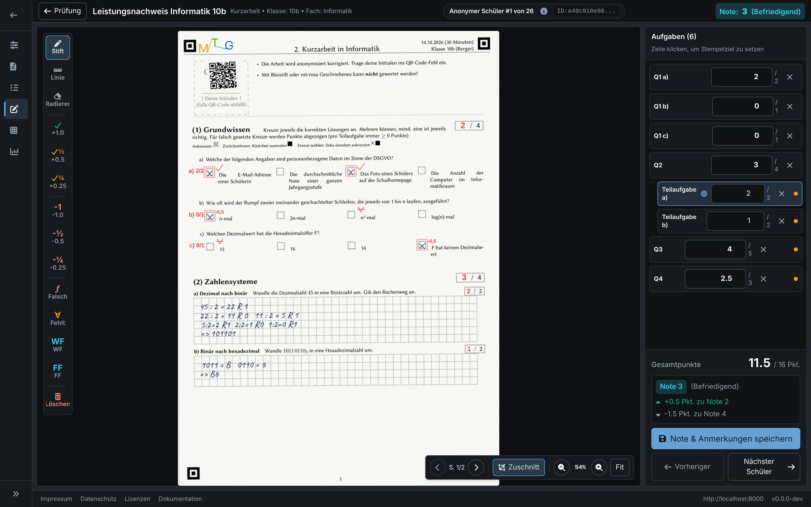
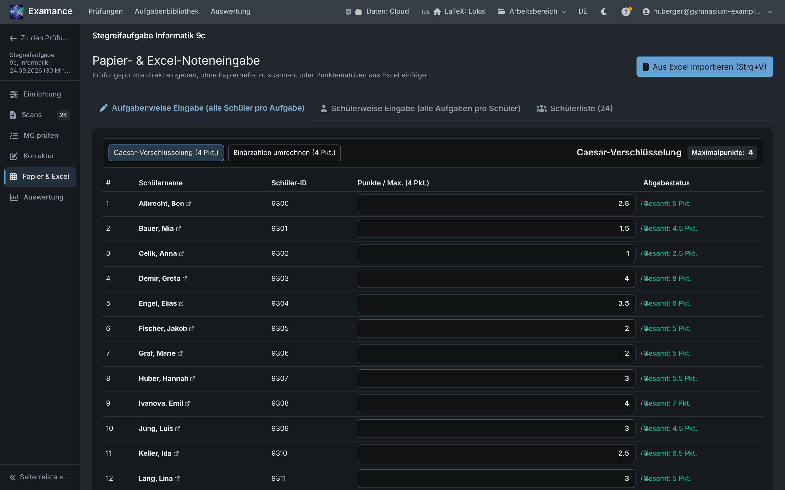

# Korrigieren

Korrigiert wird auf dem Scan selbst: Sie sehen die Handschrift und die Antworten, markieren sie mit Stift und Stempeln und vergeben Punkte pro Aufgabe. Summe und Note ergeben sich laufend aus dem Notenschlüssel. Klassen, die auf Papier korrigiert wurden, tragen Sie stattdessen in ein Punkteraster ein.

## Anonym korrigieren {#blind}

Während des Korrekturgangs sehen Sie **„Anonymer Schüler #3 von 26“**, nie einen Namen. Das ist der Kern des Verfahrens: Die Bewertung entsteht ohne Kenntnis der Person. Namen kehren nur dort zurück, wo Sie sie danach brauchen, für die Notenliste und den Export.

## Die Korrekturansicht {#workspace}

- **Alle Seiten einer Abgabe stehen untereinander.** Blättern Sie mit dem Mausrad oder der Scrollleiste durch, auf Touchgeräten mit **zwei Fingern** (ein Finger zeichnet).
- **Strg + Mausrad** oder Zwei-Finger-Zoom vergrößert; **Fit** passt die Seite an die Ansicht an. Die Seitenpfeile springen zwischen den Seiten.
- **Ränder zuschneiden** blendet die leeren Seitenränder aus, für eine größere Ansicht.
- **Vorheriger** und **Nächster Schüler** wechseln zwischen den Abgaben.

Das Feld **Bewertung** listet die Aufgaben mit ihren Punkten auf. Klicken Sie auf eine Zeile, um sie zum **Stempelziel** zu machen: Stempel, die Sie danach setzen, zählen für diese Aufgabe.

## Stift und Stempel {#tools}

Korrekturzeichen entstehen auf einer eigenen Ebene über dem Scan. Das Original bleibt unverändert und lässt sich jederzeit ohne Anmerkungen anzeigen.

| Werkzeug | Funktion |
|---|---|
| **Stift**, **Linie**, **Radierer** | Freihandmarkierungen in Rot, gerade Linien, Radieren |
| **+1.0**, **+0.5**, **+0.25** | Richtig, halb oder viertel richtig: addiert die Punkte zum Stempelziel |
| **-1.0**, **-0.5**, **-0.25** | Abzüge |
| **Falsch**, **Fehlt** | Markierungen ohne Punkte |
| **WF**, **FF** | Wiederholungsfehler, Folgefehler |
| **Löschen** | Entfernt jede Zeichnung und jeden Stempel auf der Seite und setzt die berechneten Punkte zurück |

Sie können die Punkte einer Aufgabe auch direkt eintippen. **Als unkorrigiert zurücksetzen** leert eine Zeile wieder.

## Punkte, Summe und Note {#scores}

Punkte werden **pro Aufgabe** vergeben. Summe und Note werden laufend aus dem [Notenschlüssel](./exams#grading-key) der Prüfung neu berechnet. Neben der Note zeigt Examance, wie viele Punkte bis zur nächstbesseren Note fehlen und wie groß der Puffer vor der nächstschlechteren ist.

Eine Abgabe gilt als **teilweise korrigiert**, bis jede Aufgabe Punkte hat. Teilweise korrigierte Abgaben erscheinen bereits mit einem vorläufigen Wert in der Statistik, siehe [teilweise korrigierte Abgaben](./results#partial).

## Je Teilaufgabe bewerten {#parts}

Bei einer Aufgabe mit [Teilaufgaben](./exercises#parts) zeigt die Punkteliste unter der Aufgabe eine Zeile je Teilaufgabe (**Teilaufgabe a)**, **Teilaufgabe b)**, …). Ein Klick auf die Zeile einer Teilaufgabe macht sie zum Stempelziel, sodass Stempel für diese Teilaufgabe zählen; Sie können ihre Punkte auch eintippen.

- Das Feld der Aufgabe selbst zeigt dann **Ergibt sich aus den Teilaufgaben, sobald alle bewertet sind**: Die Aufgabe gilt erst als bewertet, wenn jede Teilaufgabe Punkte hat.
- Punkte außerhalb der Teilaufgaben (etwa eine Bewertungseinheit in der Einleitung oder Stempel, die gesetzt wurden, während die Aufgabe selbst Stempelziel war) sammelt die Zeile **Ohne Teilaufgabe**. Erhält sie mehr Punkte, als die Aufgabe außerhalb ihrer Teilaufgaben hat, warnt die Zeile: Vermutlich ist ein Stempel ohne Teilaufgabe gesetzt worden.
- Sie können die Aufgabe weiterhin als Ganzes bewerten: Lassen Sie die Zeilen der Teilaufgaben einfach leer.

## Punktekästchen füllen sich selbst {#score-boxes}

Die Prüfung druckt neben jeder Aufgabe und jeder Teilaufgabe ein Punktekästchen und am Ende eine Tabelle mit allen Aufgaben, der Summe (Σ) und der Note. Während Sie korrigieren, trägt Examance die Punkte in diese Kästchen auf dem Scan ein, ebenso im korrigierten PDF, das Sie exportieren oder zurückgeben. Das Kästchen einer Aufgabe wird gefüllt, sobald sie bewertet ist; Summe und Note folgen, wenn die Abgabe vollständig ist. Die Tabelle füllen Sie nie von Hand aus. Wurde die Prüfung nach dem Erzeugen ihrer Antwortbogen-Vorlage geändert, bleiben die Kästchen leer, weil der gedruckte Bogen nicht mehr passt.

## Multiple Choice beim Korrigieren {#multiple-choice}

Bei Single- und Multiple-Choice-Fragen werden die erkannten Kreuze automatisch übernommen, einschließlich des Punktabzugs der Aufgabe für falsche Kreuze. Sie können sie vor dem Speichern prüfen und korrigieren.

Der gründliche Weg, Erkennungen zu prüfen, ist der Schritt **MC prüfen**, der unsichere Erkennungen zuerst auflistet, siehe [MC-Erkennungen prüfen](./scanning#mc-verification). Konnte eine Seite nicht ausgerichtet werden, weist die Korrekturansicht darauf hin: Bewerten Sie diese Aufgabe von Hand.

## Auf Papier korrigierte Klassen {#paper}

Nicht jede Prüfung braucht Scans. Im Schritt **Papier & Excel** tragen Sie Punkte direkt ein:

- **Aufgabenweise Eingabe**: alle Schülerinnen und Schüler für eine Aufgabe, dann die nächste Aufgabe.
- **Schülerweise Eingabe**: alle Aufgaben einer Schülerin oder eines Schülers, dann die nächste Person.
- **Schülerliste**: Schülerinnen und Schüler einzeln hinzufügen oder eine ganze Liste einfügen.
- **Aus Excel importieren (Strg+V)**: Markieren Sie die Zellen in Excel oder Google Tabellen, kopieren Sie sie und fügen Sie sie hier ein. Examance zeigt eine Vorschau, kann fehlende Schülerinnen und Schüler automatisch in der Liste anlegen und füllt dann das Raster.

Diese Ergebnisse fließen wie gescannte in Statistik, Auswertung und Export ein.

## Speichern {#saving}

**Note & Anmerkungen speichern** speichert die Punkte und die Markierungen verschlüsselt. Wechseln Sie mit ungespeicherten Anmerkungen zu einer anderen Person oder verlassen Sie die Seite, fragt Examance zuerst nach: Bestätigen Sie nur, wenn Sie sie wirklich verwerfen wollen.

Bricht die Verbindung ab, werden Änderungen, die nicht gesendet werden konnten, im Browser zwischengespeichert und später automatisch gesendet.
