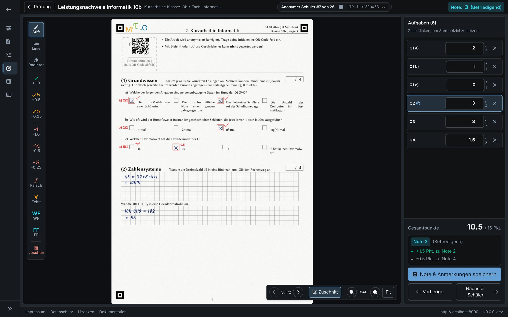
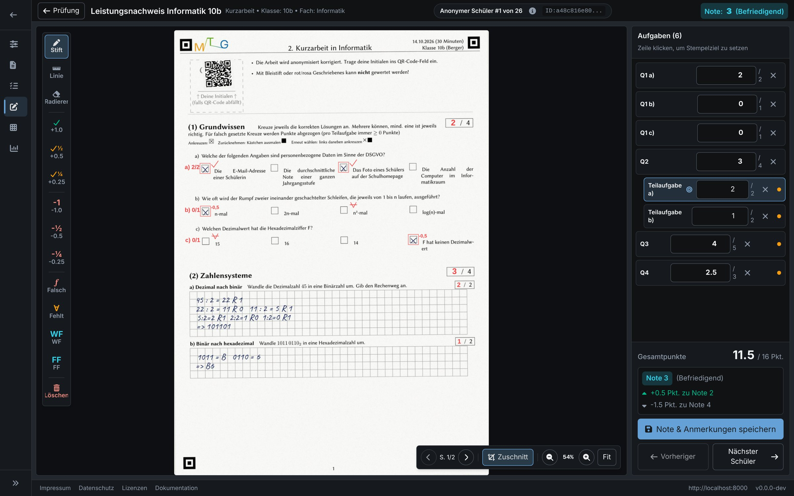
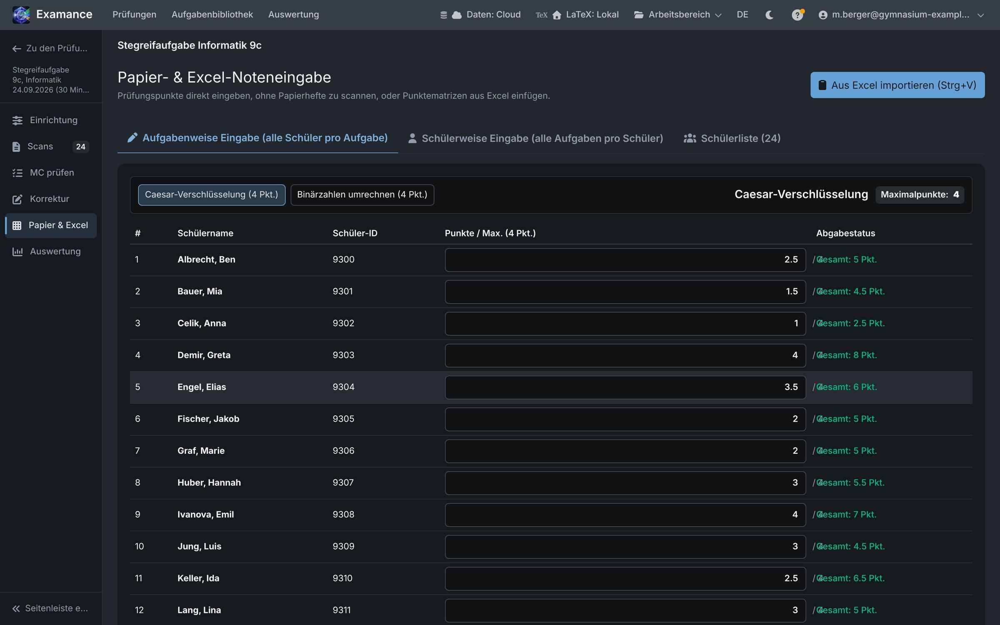

# Korrigieren

Korrigiert wird auf dem Scan selbst: Sie sehen die Handschrift und die Antworten, markieren sie mit Stift und Stempeln und vergeben Punkte pro Aufgabe. Summe und Note ergeben sich laufend aus dem Notenschlüssel. Klassen, die auf Papier korrigiert wurden, tragen Sie stattdessen in ein Punkteraster ein.

## Anonym korrigieren {#blind}

Während des Korrekturgangs sehen Sie **„Anonymer Schüler #3 von 26“**, nie einen Namen. Das ist der Kern des Verfahrens: Die Bewertung entsteht ohne Kenntnis der Person. Namen kehren nur dort zurück, wo Sie sie danach brauchen, für die Notenliste und den Export.

## Die Korrekturansicht {#workspace}

- **Bedienelemente links:** Ab Tablet-Breite schweben Werkzeugleiste, die Karte **Bewertung** und die untere Leiste links über dem Scan, damit eine rechte Schreibhand nichts davon verdeckt; die Seite steht daneben. Linkshänder legen sie unter [Einstellungen → Anordnung der Korrekturansicht](settings.md#grading-layout) nach rechts. Auf Smartphones liegt die Werkzeugleiste über dem Scan und die Karte **Bewertung** als Leiste darunter.
- **Karte Bewertung:** Oben die bisherigen Punkte, ihr Prozentsatz und die Note, als *(vorl.)* markiert, bis alle Aufgaben bewertet sind. Darunter die Aufgaben („1“, „2 a)“), wie viele Punkte die nächstbessere oder -schlechtere Note entfernt ist, sowie **Vorheriger** und **Nächster Schüler**. Der Pfeil in ihrer Ecke klappt sie auf Punkte und Pfeile zusammen; die Seite bekommt dann den Platz. Dieser Browser merkt sich die Wahl.
- **Alle Seiten einer Abgabe stehen untereinander.** Blättern Sie mit dem Mausrad oder der Scrollleiste durch, auf Touchgeräten mit dem Finger.
- **Stift oder Finger:** Ein Stift und die Maus zeichnen immer. Auf Geräten ohne Stift zeichnet ein Finger, zwei Finger blättern. Sobald Sie einmal einen Stift benutzen, merkt sich Examance das auf diesem Gerät: Danach blättern und zoomen Finger und eine aufgelegte Handfläche nur noch und zeichnen nie. Solange der Stift den Bildschirm berührt, und eine halbe Sekunde danach, markiert eine aufgelegte Handfläche auch keinen Text, drückt keine Schaltfläche und verschiebt den Scan nicht. Ein kurzer Hinweis meldet das, wenn der Stift zum ersten Mal erkannt wird; damit Finger wieder zeichnen, setzen Sie es unter [Einstellungen → Stifteingabe](settings.md#pen-input) zurück.
- **Untere Leiste:** **Rückgängig** und **Wiederholen**, die Seitenpfeile (mehrseitige Scans), Verkleinern und Vergrößern sowie **Anpassen**, das die Seite an die Ansicht anpasst. **Strg + Mausrad** oder Zwei-Finger-Zoom vergrößert ebenfalls.
- **Vorheriger** und **Nächster Schüler** wechseln zwischen den Abgaben. Die Aufgabennummern im Feld **Bewertung** sind keine Links, ein Antippen öffnet also nicht versehentlich die Aufgabe.

Das Feld **Bewertung** listet die Aufgaben mit ihren Punkten auf. Klicken Sie auf eine Zeile, um sie zum **Stempelziel** zu machen: Stempel, die Sie danach setzen, zählen für diese Aufgabe. Das Stempelziel ist die hervorgehobene Zeile mit dem dicken Balken links.

## Stift und Stempel {#tools}

Korrekturzeichen entstehen auf einer eigenen Ebene über dem Scan. Das Original bleibt unverändert und lässt sich jederzeit ohne Anmerkungen anzeigen.

Die Werkzeugleiste scrollt nie: Ist der Bildschirm für alle Schaltflächen zu niedrig, wandern die Stempel in Schubladen (zuerst **Plus**, **Minus** und **Weitere**, dann **Punkte** und **Weitere**, zuletzt eine Schublade **Stempel**). Eine Schublade zeigt den daraus gewählten Stempel; antippen zeigt die anderen.

| Werkzeug | Funktion |
|---|---|
| **Stift**, **Linie**, **Radierer** | Freihandmarkierungen in Rot, gerade Linien, Radieren |
| **+1.0**, **+0.5**, **+0.25** | Richtig, halb oder viertel richtig: addiert die Punkte zum Stempelziel |
| **-1.0**, **-0.5**, **-0.25** | Abzüge |
| **Falsch**, **Fehlt** | Markierungen ohne Punkte |
| **WF**, **FF** | Wiederholungsfehler, Folgefehler |
| **Rückgängig**, **Wiederholen** (untere Leiste) | Gehen Ihre Änderungen an den Anmerkungen schrittweise zurück und wieder vor (jeder Strich, Stempel, Radiervorgang, jedes Gekritzel und Löschen ist ein Schritt), auch mit Strg+Z und Strg+Umschalt+Z (am Mac Cmd); die berechneten Punkte folgen. Für jeden Schüler beginnt der Verlauf neu. |
| **Löschen** | Entfernt sofort jede Zeichnung und jeden Stempel der Abgabe und setzt die berechneten Punkte zurück; ein Hinweis bietet **Rückgängig** an |

**Durch Kritzeln radieren:** Kritzeln Sie mit dem Werkzeug **Stift** (per Stift, Maus oder Finger) schnell hin und her über Striche, Linien oder Stempel (mindestens fünfmal), um sie ohne Wechsel zum **Radierer** zu löschen; Stempel nehmen ihre Punkte mit. Nur Markierungen entlang des Gekritzels verschwinden, ein langer Strich, den es nur kreuzt, bleibt, und das Gekritzel selbst bleibt nie stehen. Die Markierungen leuchten eine halbe Sekunde bernsteinfarben, bevor sie verschwinden, damit ein Versehen auffällt, und ein Hinweis nennt, wie viele verschwunden sind, und bietet **Rückgängig** an. Ausschalten lässt es sich unter [Einstellungen → Stifteingabe](settings.md#pen-input).

Sie können die Punkte einer Aufgabe auch direkt eintippen. **Als unkorrigiert zurücksetzen** leert eine Zeile wieder.

## Punkte, Summe und Note {#scores}

Punkte werden **pro Aufgabe** vergeben. Summe und Note werden laufend aus dem [Notenschlüssel](./results#grading-key) der Prüfung neu berechnet. Neben der Note zeigt Examance, wie viele Punkte bis zur nächstbesseren Note fehlen und wie groß der Puffer vor der nächstschlechteren ist.

Eine Abgabe gilt als **teilweise korrigiert**, bis jede Aufgabe Punkte hat. Teilweise korrigierte Abgaben erscheinen bereits mit einem vorläufigen Wert in der Statistik, siehe [teilweise korrigierte Abgaben](./results#partial).

## Je Teilaufgabe bewerten {#parts}

Bei einer Aufgabe mit [Teilaufgaben](./exercises#parts) zeigt die Punkteliste unter der Aufgabe eine Zeile je Teilaufgabe (**Teilaufgabe a)**, **Teilaufgabe b)**, …). Ein Klick auf die Zeile einer Teilaufgabe macht sie zum Stempelziel, sodass Stempel für diese Teilaufgabe zählen; Sie können ihre Punkte auch eintippen.

- Das Feld der Aufgabe selbst zeigt dann **Ergibt sich aus den Teilaufgaben, sobald alle bewertet sind**: Die Aufgabe gilt erst als bewertet, wenn jede Teilaufgabe Punkte hat.
- Punkte außerhalb der Teilaufgaben (etwa eine Bewertungseinheit in der Einleitung oder Stempel, die gesetzt wurden, während die Aufgabe selbst Stempelziel war) sammelt die Zeile **Ohne Teilaufgabe**. Erhält sie mehr Punkte, als die Aufgabe außerhalb ihrer Teilaufgaben hat, warnt die Zeile: Vermutlich ist ein Stempel ohne Teilaufgabe gesetzt worden.
- Sie können die Aufgabe weiterhin als Ganzes bewerten: Lassen Sie die Zeilen der Teilaufgaben einfach leer.

## Punktekästchen füllen sich selbst {#score-boxes}

Die Prüfung druckt neben jeder Aufgabe und jeder Teilaufgabe ein Punktekästchen und am Ende eine Tabelle mit allen Aufgaben, der Summe (Σ) und der Note. Während Sie korrigieren, trägt Examance die Punkte in diese Kästchen auf dem Scan ein, ebenso im korrigierten PDF, das Sie exportieren oder zurückgeben. Das Kästchen einer Aufgabe wird gefüllt, sobald sie bewertet ist; Summe und Note folgen, wenn die Abgabe vollständig ist. Die Tabelle füllen Sie nie von Hand aus. Wurde die Prüfung nach dem Erzeugen ihrer Antwortbogen-Vorlage geändert, bleiben die Kästchen leer, weil der gedruckte Bogen nicht mehr passt.

## Multiple Choice beim Korrigieren {#multiple-choice}

Bei Single- und Multiple-Choice-Fragen werden die erkannten Kreuze automatisch übernommen, einschließlich des Punktabzugs der Aufgabe für falsche Kreuze. Sie können sie vor dem Speichern prüfen und korrigieren.

Der gründliche Weg, Erkennungen zu prüfen, ist der Schritt **MC prüfen**, der unsichere Erkennungen zuerst auflistet, siehe [MC-Erkennungen prüfen](./scanning#mc-verification). Konnte eine Seite nicht ausgerichtet werden, weist die Korrekturansicht darauf hin: Bewerten Sie diese Aufgabe von Hand.

## Auf Papier korrigierte Klassen {#paper}

Nicht jede Prüfung braucht Scans. Im Schritt **Papierkorrektur** tragen Sie Punkte direkt ein:

- **Aufgabenweise Eingabe**: alle Schülerinnen und Schüler für eine Aufgabe, dann die nächste Aufgabe.
- **Schülerweise Eingabe**: alle Aufgaben einer Schülerin oder eines Schülers, dann die nächste Person.
- **Schüler**: Die Schüler der Prüfung stammen von der [Seite Schüler](./students#student-data); fehlende legen Sie dort an.
- **Aus Excel importieren (Strg+V)**: Markieren Sie die Zellen in Excel oder Google Tabellen, kopieren Sie sie und fügen Sie sie hier ein. Examance zeigt eine Vorschau und füllt dann das Raster. Eingefügte Zeilen, die zu keinem Schüler auf der Seite Schüler passen, werden übersprungen, mit einem Hinweis.

Jede Punktzahl speichert sich, sobald Sie das Feld verlassen oder Enter drücken; daneben steht **Wird gespeichert …**, **Gespeichert** oder warum das Speichern fehlschlug. **Vorheriger** und **Nächster Schüler** speichern vor dem Wechsel.

Diese Ergebnisse fließen wie gescannte in Statistik, Auswertung und Export ein.

## Speichern {#saving}

Punkte und Markierungen speichern sich wenige Sekunden nach Ihrer letzten Änderung selbst, verschlüsselt. Die Zeile über **Vorheriger** und **Nächster Schüler** zeigt **Wird gespeichert …**, **Gespeichert** oder warum das Speichern fehlschlug. Beim Wechsel zu einer anderen Person oder beim Verlassen der Seite wird zuerst gespeichert. Nur wenn das fehlschlägt, fragt Examance, ob die Änderungen verworfen werden sollen.

Bricht die Verbindung ab, werden Änderungen, die nicht gesendet werden konnten, im Browser zwischengespeichert und später automatisch gesendet.
