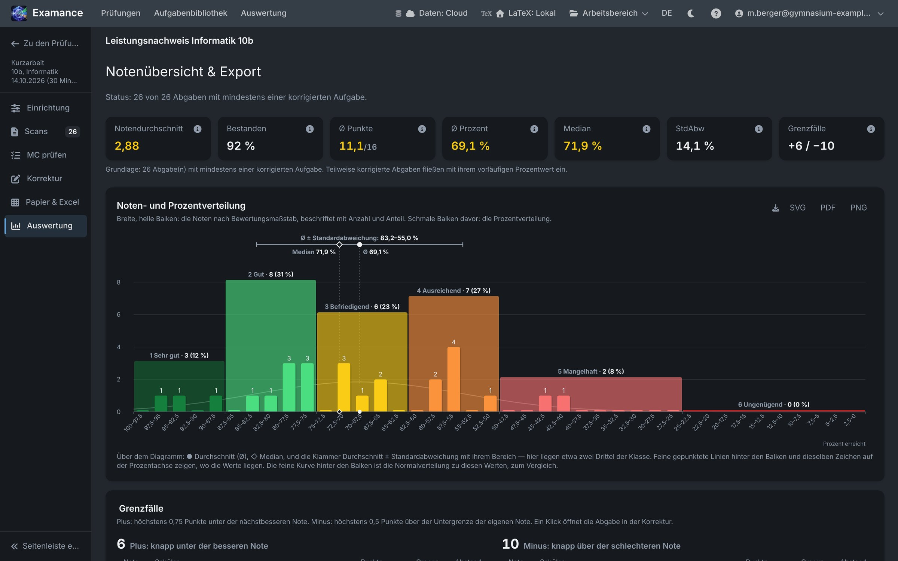
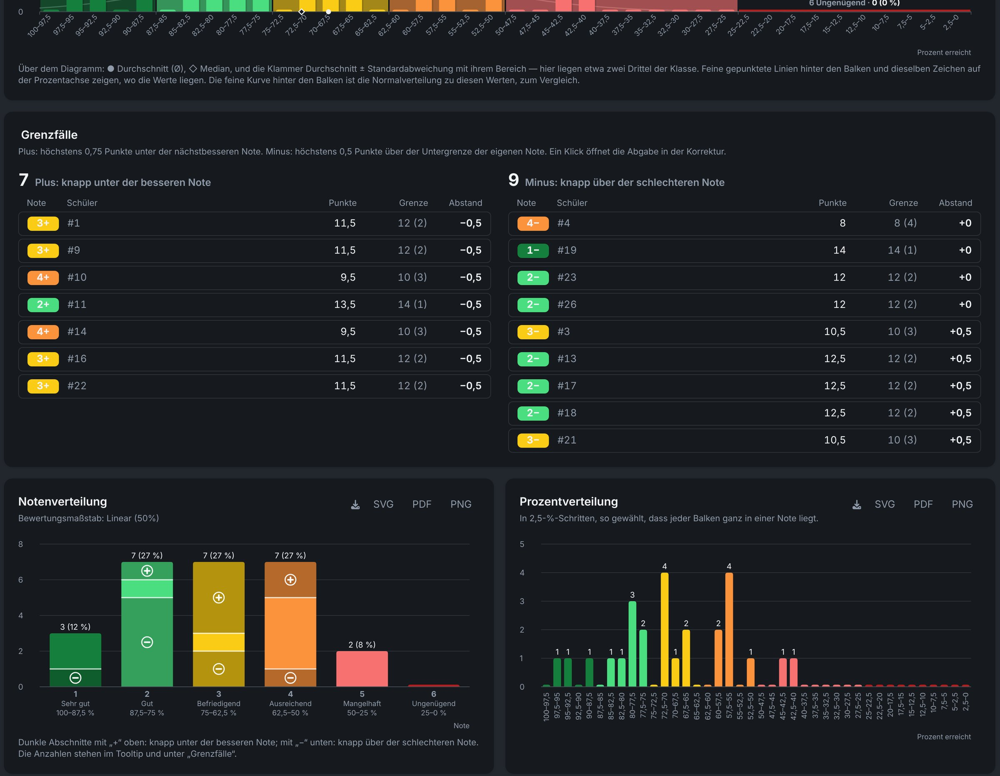
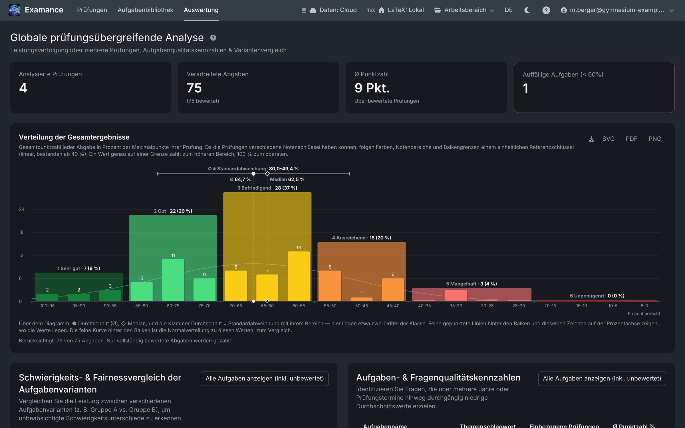
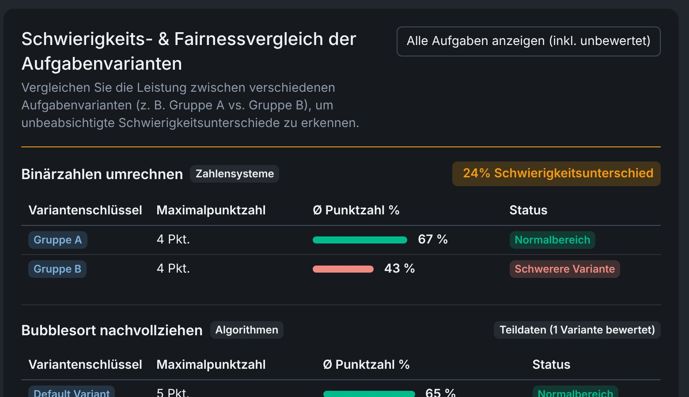

# Ergebnisse und Auswertung

Jede Prüfung hat einen Schritt **Ergebnisse & Export** (der letzte in der Seitenleiste) mit drei Reitern: **Statistik** zeigt die Notenverteilung, Kennzahlen und Grenzfälle, **An Schüler senden** gibt die korrigierten Prüfungen an die Schüler weiter, siehe [Ergebnisse teilen](#share), und **Archivieren** exportiert Übersichtsblatt, korrigierte Prüfungen und mehr für Ihre Unterlagen, siehe [Prüfung archivieren](#archive). Die **Auswertung** in der Navigationsleiste fasst mehrere Prüfungen zusammen. Beide lesen dieselben verschlüsselten Ergebnisse; auf dem Server wird nichts berechnet.

## Notenschlüssel {#grading-key}

Der Notenschlüssel legt fest, welcher Prozentwert welche Note (1 bis 6) ergibt. Sie bearbeiten ihn unter **Ergebnisse & Export → Statistik**, über der Verteilung; Änderungen zeigen sich sofort in den Diagrammen und werden mit **Speichern** gesichert, das erscheint, sobald Sie etwas ändern. Wählen Sie eine Voreinstellung oder legen Sie eigene Grenzen fest:

| Voreinstellung | Note 4 ab |
|---|---|
| **Klassisch** | 50 % |
| **Oberstufe** | 40 % |
| **Gleichmäßig** | gleichmäßig verteilte Grenzen |
| **Individuell** | Ihr eigener Mindestprozentwert je Note |

Beim Korrigieren werden die aktuelle Note und die Punkte bis zur nächsten Note laufend angezeigt. Die Statistik verwendet denselben Schlüssel.

## Prüfungsstatistik {#distribution}

Drei Diagramme zeigen, wie die Klasse abgeschnitten hat. Alle lesen sich vom **besten Ergebnis links** zum schlechtesten rechts und färben ihre Balken nach Note (1 dunkelgrün bis 6 dunkelrot).

1. **Notenverteilung**: immer die volle Skala von 1 bis 6, auch wenn eine Note nicht vorkommt. Eine Note, die niemand erreicht hat, ist ebenfalls eine Aussage. Grenzfälle sind dunkler abgesetzt: **„+“** oben im Balken (knapp unter der besseren Note), **„−“** unten (knapp über der schlechteren Note).
2. **Prozentverteilung**: alle Prozentbereiche in gleich breiten Schritten von höchstens 5 %. Die Schrittweite richtet sich nach dem Notenschlüssel, sodass jede Notengrenze auf einer Balkengrenze liegt und kein Balken zwei Noten mischt (zum Beispiel 2,5-%-Schritte beim klassischen Schlüssel mit Grenzen wie 62,5 %). Bereiche nennen zuerst die obere Grenze (100–85 %), passend zur Achse.
3. **Kombiniertes Diagramm**: die Prozentbalken vor den Notenbalken, jeder Notenbalken beschriftet mit Note, Bezeichnung, Anzahl und Anteil. Ein Streifen darüber markiert den **Durchschnitt (●)** und den **Median (◇)** und zeigt Durchschnitt ± Standardabweichung als Klammer; eine feine Kurve hinter den Balken zeigt zum Vergleich die Normalverteilung mit diesen Werten.

Feste Beschriftungen (Noten, Notenbezeichnungen, Bereiche) sind grau; Werte, die sich beim Weiterkorrigieren ändern (Anzahlen, Anteile), sind weiß. Wo Balken zu schmal für eine Beschriftung sind, bleibt an jeder Notengrenze eine Beschriftung stehen, und der Tooltip zeigt den Rest.

### Kennzahlen {#figures}

Die Kacheln über den Diagrammen zeigen den **Notendurchschnitt** der Klasse, die **Bestehensquote**, die **durchschnittliche Punktzahl** sowie **Mittelwert**, **Median** und **Standardabweichung** der Prozentwerte. Das **ⓘ** an jeder Kachel erklärt die Kennzahl. Notendurchschnitt, Ø Punkte, Ø Prozent und Median sind in der Farbe der Note eingefärbt, der sie entsprechen.

### Grenzfälle {#borderline}

Die Kachel **Grenzfälle** zählt die knappen Fälle, und eine Tabelle unter dem kombinierten Diagramm listet jede Abgabe knapp an einer Notengrenze auf:

- **+** bedeutet höchstens **0,75 Punkte** unter der nächstbesseren Note;
- **−** bedeutet höchstens **0,5 Punkte** über der Untergrenze der eigenen Note (genau auf der Grenze zählt als −).

Jede Zeile nennt die erreichten Punkte, die Grenze in Punkten und den Abstand dazu. Ein Klick auf eine Zeile öffnet die Abgabe in der Korrektur, weiterhin anonym, mit derselben Nummer. Nützlich für einen zweiten Blick, bevor Sie die Prüfungen zurückgeben.

### Teilweise korrigierte Abgaben {#partial}

Abgaben, bei denen noch nicht alle Aufgaben korrigiert sind, fließen mit einem **vorläufigen Prozentwert** ein, berechnet über die bisher korrigierten Aufgaben. Diese Anteile sind in einem helleren Ton dargestellt, damit eine halb korrigierte Klasse nicht wie ein fertiges Ergebnis aussieht. In der Grenzfall-Tabelle zählen die Punkte der bisher korrigierten Aufgaben.

### Diagramme herunterladen {#charts-download}

Die Schaltflächen **SVG**, **PDF** und **PNG** laden jedes Diagramm mit transparentem Hintergrund und dunkler Schrift herunter, bereit für eine helle Seite oder eine Folie. SVG und PDF sind Vektorgrafiken; PNG wird in 8K (7680 × 4320) erzeugt.

## Ergebnisse exportieren {#export}

Der **CSV-Export** der Noten, zum Beispiel für die Notenverwaltung der Schule, enthält Pseudonym, Ersatzcode, Name, Punkte, Maximalpunktzahl, Prozentwert und Note.

**Sichern / Weitergeben** an einer Prüfung (im Menü ihrer Karte auf der Startseite oder in der **Übersicht** der Prüfung) mit dem Format **Lesbares ZIP** bündelt eine Prüfung in einer einzigen ZIP. Wählen Sie die Teile, die Sie brauchen:

| Teil | Enthält |
|---|---|
| **Korrigierte Scans (PDF)** | jede Abgabe mit eingezeichneten Korrekturen und [ausgefüllten Punktekästchen](./grading#score-boxes); auch teilweise korrigierte (Dateiname mit `_partial`, unkorrigierte mit `_ungraded`); der Name steht in Rot oben auf jeder Seite |
| **LaTeX-Quelltext** | eine eigene ZIP mit Prüfung und Lösung, ihren Dateien und dem Logo, bereit für Overleaf (Compiler XeLaTeX); nur mit diesem Teil lässt sich die ZIP später (ohne Ergebnisse) wieder importieren |
| **Kompilierte Angabe und Lösung (PDF)** | die Blätter mit Angabe und Lösung (das Kompilieren kann etwas dauern) |
| **Zusammenfassung (PDF)** | Metadaten, Notenschlüssel in Punkten und Prozent, Durchschnitt, das kombinierte Diagramm und die Schülerliste mit Punkten und Noten, teilweise korrigierte hervorgehoben |
| **Noten (CSV)** | Excel-kompatible Notenliste |

::: warning Klarnamen, unverschlüsselt
CSV und ZIP enthalten **Klarnamen** und sind **nicht verschlüsselt**. Bewahren Sie sie nur an sicheren Orten auf und löschen Sie sie nach der Verwendung. Jeder ZIP-Export wird protokolliert.
:::

Die ZIP enthält keine Mebis-Option: Rückmeldedateien für Mebis gibt es nur unter [Ergebnisse teilen](#share).

Für eine verschlüsselte Kopie, die sich wieder importieren lässt, wählen Sie stattdessen **Wieder importierbare, passwortgeschützte Sicherung**, siehe [Sicherung und Übertragung](./backup#exam-backup).

## Ergebnisse teilen {#share}

Der Reiter **An Schüler senden** unter **Ergebnisse & Export** gibt jeder Schülerin und jedem Schüler die korrigierte Prüfung. Er ist eine Seite mit vier nummerierten Schritten: 1 die Schüler, 2 der Weg (Zettel zum Austeilen, E-Mail, Artemis oder Mebis-Dateien) mit seiner Einrichtung und der Sprache der Nachricht, 3 Schutz und Optionen (Linkschutz, Schlüssel bzw. Code in der Nachricht, Musterlösung, Gültigkeit), 4 Vorschau und Versand; die Schaltfläche zum Senden bleibt unten sichtbar. Darunter stehen die aktiven Links, die sich widerrufen lassen, alle auf einmal mit **Alle Links widerrufen**. Einzelheiten: [Korrigierte Prüfungen mit Schülern teilen](./students#share-results).

## Prüfung archivieren {#archive}

Der Reiter **Archivieren** unter **Ergebnisse & Export** sammelt, was Sie für Ihre Unterlagen aufbewahren möchten. Das **Übersichtsblatt der Ergebnisse** (Prüfungsdaten, Notenschlüssel, Statistik und das Ergebnis jeder Schülerin und jedes Schülers) sehen Sie als Vorschau und laden es einzeln als PDF herunter. Jede Karte hat dieselben Symbole im Kopf (der Name erscheint beim Darüberfahren): den Download-Pfeil, ausgegraut, solange es die Datei noch nicht gibt, und die Kreispfeile zum Erstellen bzw. Aktualisieren. Daneben fasst **Alle korrigierten Arbeiten (Druck-PDF)** alle korrigierten Scans mit eingebrannten Anmerkungen in einer nach Namen sortierten Datei zusammen, fertig zum Ausdrucken für die Ablage; mit **Jede Arbeit auf einem neuen Blatt beginnen** fängt beim beidseitigen Druck jede Arbeit auf einer Vorderseite an. Sie entsteht erst mit **PDF erstellen**, weil dafür jeder Scan gelesen wird. Zuletzt wählen Sie per Häkchen, was in ein ZIP kommt: korrigierte Prüfungen (einzeln und/oder alle in einer Druck-PDF), LaTeX-Code, erstellte PDFs, das Übersichtsblatt und die Noten als CSV. Der letzte Eintrag, **Wieder importierbare Sicherung (passwortgeschützt, eigene Datei)**, lädt zusätzlich eine `.examance-exam`-Datei herunter, die Examance wieder importieren kann (siehe [Sicherung und Übertragung](./backup#exam-backup)); dafür vergeben Sie ein Passwort. Das ZIP enthält personenbezogene Daten Ihrer Schüler; bewahren Sie es so sorgfältig auf wie die Prüfung selbst.

## Auswertung über mehrere Prüfungen {#analytics}

Die **Auswertung** fasst mehrere Prüfungen zusammen und zeigt, wie sich Ergebnisse über die Zeit, über Jahrgänge und über Fächer entwickeln.

Das **Histogramm der Gesamtergebnisse** ordnet alle vollständig korrigierten Abgaben nach dem Anteil der Maximalpunkte ihrer Prüfung in 5-%-Bereiche ein. Wie die Statistik einer Prüfung zeigt es Notenbereiche, Mittelwert, Median, Standardabweichung und eine Normalverteilungskurve. Weil die Prüfungen verschiedene Notenschlüssel haben können, folgen Farben und Bereiche einem einheitlichen Referenzschlüssel (linear, bestanden ab 40 %).

### Themen und Wissenslücken {#topics}

Die **Themen-Heatmap** zeigt, wo wiederholt Punkte verloren gehen, unabhängig von einer einzelnen Prüfung: ein Hinweis darauf, was im Unterricht zu wiederholen ist.

### Variantenfairness {#variant-fairness}

Für Aufgaben mit [Varianten](./exercises#variants) vergleicht die Auswertung, ob eine Fassung systematisch schwerer war als die andere. Das ist die Grundlage, um eine unfaire Variante zu überarbeiten.

