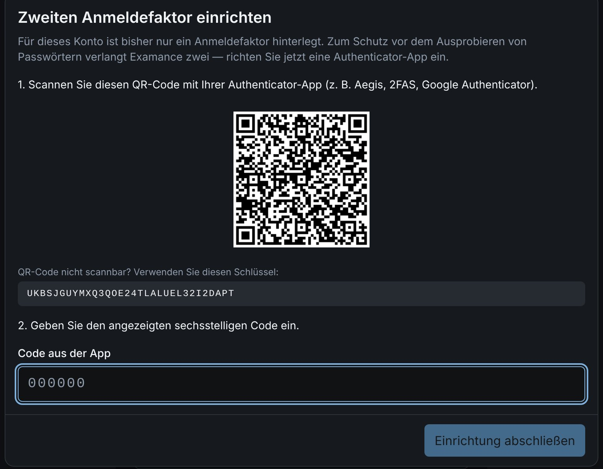
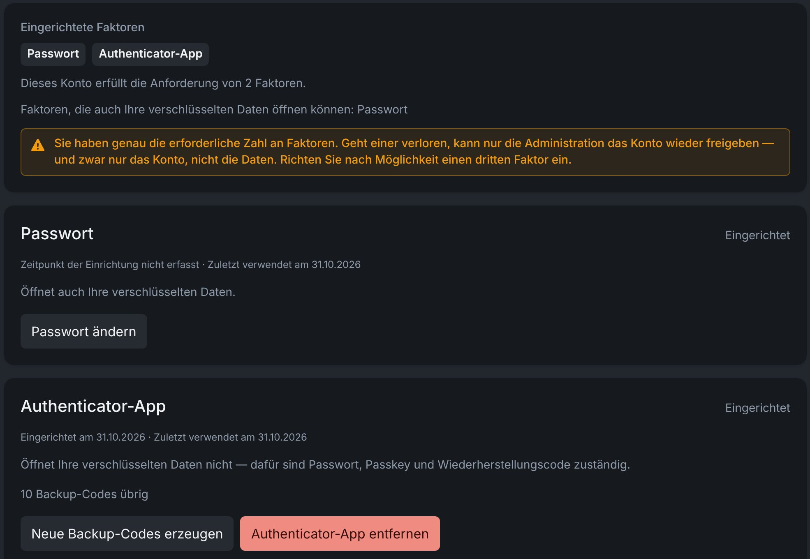

# Anmeldung und Sicherheit

Examance schützt zwei Dinge getrennt: den **Zugang zu Ihrem Konto** (Anmeldefaktoren) und den **Zugang zu Ihren Daten** (der Verschlüsselungsschlüssel, den nur Sie besitzen). Diese Seite erklärt beides und was zu tun ist, wenn ein Passwort, Telefon oder Gerät verloren geht.

## Anmeldefaktoren {#factors}

Sie melden sich mit einem **Passkey allein** oder mit **zwei von drei Faktoren** an:

| Faktor | Allein ausreichend? | Kann Ihre verschlüsselten Daten öffnen? |
|---|---|---|
| **Passwort** | nein | ja |
| **Authenticator-App** (sechsstellige Codes) | nein | nein: ihr Geheimnis liegt auf dem Server, und sechs Ziffern reichen nicht, um daraus einen Schlüssel abzuleiten |
| **Passkey** (Fingerabdruck, Gesicht oder Geräte-PIN) | ja | hängt vom Gerät ab, siehe unten |

Ein erratenes Passwort allein nützt nichts. Bei der ersten Anmeldung richten Sie den zweiten Faktor ein: einen Passkey (wird zuerst angeboten) oder eine Authenticator-App.

**Richten Sie nach Möglichkeit alle drei ein.** Dann ist der Verlust eines einzelnen Faktors nur lästig. Mit genau zwei bedeutet der Verlust eines Faktors, dass nur die Administration Ihnen wieder Zugang verschaffen kann, und zwar nur zum Konto, nicht zu den verschlüsselten Daten.

### Einstellungen → Anmeldung & Sicherheit {#security-page}

Der Abschnitt **Anmeldung & Sicherheit** der Einstellungen zeigt für jeden Faktor, ob er eingerichtet ist, wann er zuletzt verwendet wurde und ob er auch Ihre verschlüsselten Daten öffnen kann. Hier fügen Sie Faktoren hinzu und entfernen sie, ändern Ihr Passwort und ersetzen Ihre Codes.

## Passkeys {#passkeys}

Ein Passkey meldet Sie mit Fingerabdruck, Gesicht oder Geräte-PIN an, ohne Passwort. Weil das Gerät selbst Sie prüft, genügt er allein. Nach einer Anmeldung mit Passwort öffnet sich die Passkey-Abfrage automatisch als zweiter Faktor; brechen Sie sie ab, um stattdessen die Authenticator-App zu verwenden.

Ob ein Passkey auch **Ihre verschlüsselten Daten öffnen** kann, hängt vom Gerät und vom Passkey-Anbieter ab. Der Abschnitt **Anmeldung & Sicherheit** zeigt das je Passkey an; mit **Datenzugriff aktivieren** richten Sie es dort ohne Passwort ein. In Bitwarden gespeicherte Passkeys können das derzeit nicht. Wo ein Passkey es nicht kann, bleiben Passwort und Wiederherstellungscode für den Datenzugriff zuständig.

## Passwort ändern {#change-password}

Unter **Einstellungen → Anmeldung & Sicherheit** können Sie Ihr Passwort direkt ändern, ohne den Weg über „Passwort vergessen“. Ihr Datenschlüssel wird dabei im Browser neu verpackt und mit dem neuen Passwort gespeichert: Es wird nichts neu verschlüsselt, und Sie bleiben angemeldet. Andere Geräte werden abgemeldet; Ihre Passkeys und Ihr Wiederherstellungscode bleiben gültig.

## Backup-Codes und der Wiederherstellungscode {#codes}

Zwei verschiedene Arten von Codes:

- **Backup-Codes** ersetzen die **Authenticator-App**, wenn Sie Ihr Telefon nicht zur Hand haben. Jeder funktioniert genau einmal. Erzeugen Sie neue, solange Sie noch angemeldet sind.
- Der **Wiederherstellungscode** öffnet Ihre **verschlüsselten Daten**, wenn Sie Ihr Passwort vergessen. Er wird genau einmal angezeigt: wenn Ihr Schlüssel erstmals hinterlegt wird, und erneut nach jedem Zurücksetzen. Unter **Anmeldung & Sicherheit** können Sie ihn ersetzen; der bisherige wird dann ungültig.

Bewahren Sie beide **außerhalb des Browsers** auf: auf Papier oder in einem Passwortmanager.

## Einen Faktor entfernen {#remove-factor}

Ein Faktor lässt sich nur entfernen, solange danach noch **zwei übrig bleiben** und **mindestens einer davon Ihre Daten öffnen kann**. Wird das Entfernen abgelehnt, steht in der Meldung, welche der beiden Regeln greift.

## Passwort vergessen {#reset-password}

**Passwort vergessen** auf der Anmeldeseite setzt es zurück:

1. Bestätigen Sie mit einem zweiten Faktor (Passkey oder Authenticator-App).
2. Wählen Sie ein neues Passwort.
3. Geben Sie einmalig Ihren **Wiederherstellungscode** ein, damit Ihre vorhandenen verschlüsselten Daten wieder lesbar werden.

Es wird nichts neu verschlüsselt.

### Schlüsselkopie auf einem anderen Gerät geändert {#key-copy}

Ihre verschlüsselte Schlüsselkopie auf dem Server ändert sich, wenn Sie Ihr Passwort ändern oder zurücksetzen, einen neuen Wiederherstellungscode erzeugen oder einen Passkey hinzufügen oder entfernen. Jeder andere Browser, den Sie nutzen, bemerkt das bei der nächsten Anmeldung und fragt, ob Sie das selbst waren:

- **Wenn ja**, wählen Sie **Ich habe das selbst geändert — neuen Schlüssel annehmen**. Dieser Browser merkt sich die neue Schlüsselkopie und fragt nicht erneut.
- **Wenn Sie nichts geändert haben**, brechen Sie ab und melden Sie sich nicht an. Informieren Sie die Administration: Der Server könnte manipuliert worden sein, und ein Bestätigen würde eine gefälschte Schlüsselkopie übernehmen.

### Ohne Passwort und Wiederherstellungscode {#recovery-code}

Es gibt keine Hintertür. Ohne Ihr Passwort und ohne den Wiederherstellungscode bleiben bereits verschlüsselte Prüfungen, Schülerdaten und Korrekturen **dauerhaft unlesbar**. Auch Ihre Administration kann sie nicht wiederherstellen, weil der Server den Schlüssel nie kennt. Was Sie danach anlegen, ist davon nicht betroffen.

Im Hybrid-Modus gehören dazu auch die Ergebnisse, die nur in Ihrem Browser liegen; sichern Sie sie deshalb regelmäßig als [`.examance`-Archiv](./backup).

## Zu viele Fehlversuche {#lockout}

Nach mehreren falschen Passwörtern wird das Konto kurzzeitig gesperrt. Die Wartezeit verlängert sich mit jedem weiteren Fehlversuch und endet von selbst. Sehen Sie das, ohne es ausgelöst zu haben, versucht jemand anderes, sich bei Ihrem Konto anzumelden: Informieren Sie Ihre Administration.

## Wie Ihre Daten verschlüsselt werden {#encryption}

- Ihr Datenschlüssel wird **im Browser** mit Ihrem Passwort, Passkey oder Wiederherstellungscode entsperrt (Argon2id, HKDF-SHA-256) und nie übertragen.
- Alles Sensible wird mit AES-256-GCM verschlüsselt, **bevor** es gespeichert oder gesendet wird: Schülerdaten und Namen, Scans, Anmerkungen und Punkte je Aufgabe. Der Server speichert nur Chiffrat, das auch bei einem Einbruch in die Serverdatenbank unlesbar bleibt.
- Pseudonyme werden nur als Kennung gespeichert, die **je Prüfung** mit Ihrem Datenschlüssel gebildet wird: Der Server kann keine Namen durchprobieren und niemanden über Prüfungen hinweg verknüpfen.
- Jeder verschlüsselte Datensatz ist an seinen eigenen Platz gebunden; Chiffrat lässt sich nicht unbemerkt zwischen Datensätzen vertauschen.
- Solange ein Tab entsperrt ist, liegt sein Sitzungsschlüssel versiegelt mit einem Schlüssel, der diesen Tab nicht verlassen kann.
- Unverschlüsselt gespeichert werden: Aufgaben und Prüfungen (ihr LaTeX-Quelltext), technische Felder wie Kennungen und Reihenfolgen sowie im Modus „Alles auf dem Server“ die Gesamtpunktzahl je Pseudonym.

Die technischen Einzelheiten stehen unter [Datenfluss und Sicherheit (Englisch)](../../data_flow_and_security).

## Aufbewahrung {#retention}

Prüfungen tragen eine Aufbewahrungsfrist, nach deren Ablauf sie entfernt werden können. Schülerbezogene Daten lassen sich einzeln löschen, ohne die Statistik der Prüfung zu verlieren, siehe [Daten löschen](./settings#deletion). Die Aufbewahrungsfristen Ihrer Installation stehen in deren Datenschutzerklärung (**Datenschutz** in der Fußzeile).

## Umzug auf eine neue Adresse {#domain-move}

Zieht Ihre Installation auf eine neue Adresse um (zum Beispiel von `examance.valentin-herrmann.com` nach `examance.de`), kommen Ihr Konto, Ihre Prüfungen und Aufgaben mit: Sie liegen auf dem Server. Nur wenige Dinge gehören zur alten Adresse selbst.

1. **Nur im Hybrid-Modus: Ergebnisse zuerst mitnehmen.** Ergebnisse, die nur in diesem Browser liegen, gehören zur alten Adresse. Angemeldet zeigt Examance dort nur noch eine Seite zum Mitnehmen: **Ergebnisse auf den Server verschieben** (danach geht es automatisch auf der neuen Adresse weiter, dort können Sie wieder auf Hybrid wechseln) oder **Arbeitsbereich sichern** und die Datei auf der neuen Adresse [importieren](./backup#import). Stellen Sie vorher aus dem [Papierkorb](./trash#hybrid) wieder her, was Sie noch brauchen: Was Sie im Hybrid-Modus gelöscht haben, bleibt im Papierkorb dieses Browsers und lässt sich nach dem Umzug nicht wiederherstellen. Ab einem Stichtag leitet die alte Adresse auf die neue weiter, und zurückgelassene Ergebnisse sind nicht mehr erreichbar.
2. **Alle anderen werden weitergeleitet.** Melden Sie sich auf der alten Adresse an und gibt es nichts mitzunehmen, öffnet Examance die neue. Melden Sie sich dort mit derselben E-Mail-Adresse an; Ihr Passwort-Manager hat das Passwort unter der alten Adresse gespeichert, schlagen Sie es dort nach, falls es nicht vorgeschlagen wird.
3. **Ihr Passkey funktioniert noch einmal.** Passkeys gehören zu ihrer Adresse. Auf der neuen Adresse meldet **Passkey von** der alten Adresse **verwenden** Sie in Chrome, Edge und Safari mit Ihrem bisherigen Passkey an und öffnet Ihre Daten wie gewohnt. Danach bittet Examance Sie, **einen Passkey für die neue Adresse zu erstellen**, bevor es weitergeht. Firefox kann den alten Passkey nicht verwenden: Melden Sie sich dort mit Passwort und Authenticator-Code an.
4. **Lesezeichen und installierte App erneuern.** Einstellungen, die nur der Browser speichert (etwa das Design), stellen Sie einmal neu ein.
5. Später entfernen Sie die mit „Alte Adresse“ markierten Passkeys unter [Anmeldung & Sicherheit](#security-page) und den alten Eintrag im Passwort-Manager.
