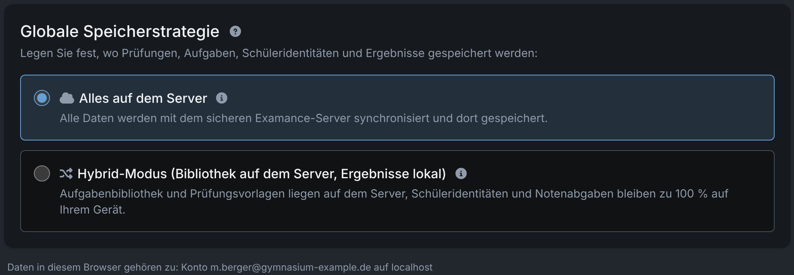
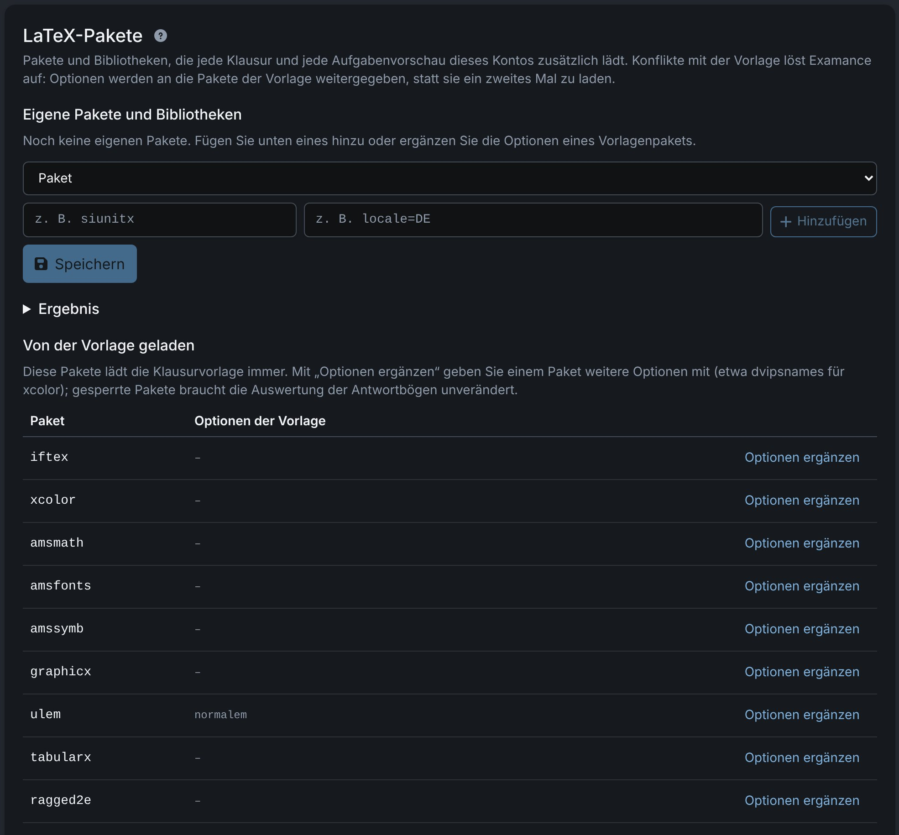
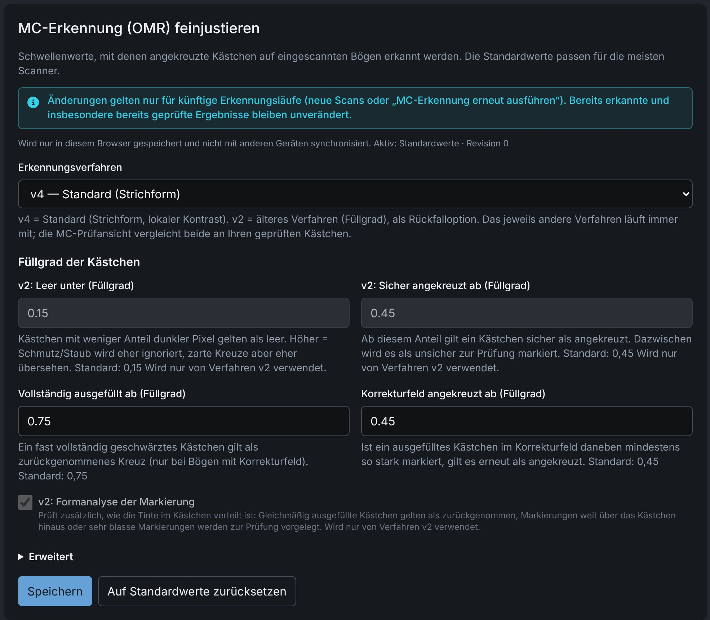

# Einstellungen

Die **Einstellungen** (dorthin führt auch die Angabe **Daten** in der Navigationsleiste) sind in **Allgemein**, **Arbeitsbereich** und **Konto & Datenschutz** gegliedert. Manche Einstellungen gehören zu Ihrem Konto und gelten in jedem Browser; andere werden nur in dem Browser gespeichert, den Sie gerade verwenden. Jeder Abschnitt unten sagt, was zutrifft.

## Speicherort {#storage}

*Gehört zu Ihrem Konto.* Legt fest, wo die **Ergebnisse** (Schülerdaten, Abgaben mit Scans, Punkte) liegen. Aufgaben und Prüfungen liegen immer auf dem Server.

| Modus | Ergebnisse liegen | Geeignet für |
|---|---|---|
| **Alles auf dem Server** | auf dem Server, vorher in Ihrem Browser verschlüsselt; in jedem Browser Ihres Kontos verfügbar | Arbeiten auf mehreren Geräten |
| **Hybrid** | nur in dem Browser, in dem Sie sie erfasst haben, verschlüsselt in dessen lokaler Datenbank | Ergebnisse auf einem Gerät behalten |

Sie wählen bei der ersten Anmeldung; es gibt keine Voreinstellung. Welche Modi Ihr Konto nutzen darf, legt Ihre Administration fest („nicht freigeschaltet“ kennzeichnet einen Modus, den Sie nicht nutzen dürfen).

In beiden Modi kann der Server Ihre Ergebnisse nicht lesen: Sie sind mit einem aus Ihrem Passwort abgeleiteten Schlüssel verschlüsselt. Siehe [Verschlüsselung](./security#encryption).

### Den Modus wechseln {#switching}

Sie können jederzeit wechseln. Der Wechsel **verschiebt die Ergebnisse direkt**, Prüfung für Prüfung, und prüft, dass jeder Datensatz angekommen ist, bevor sich der Modus Ihres Kontos ändert; danach lädt die Seite neu. Es ist kein Export und erneuter Import nötig, aber der Dialog bietet vorher eine `.examance`-Sicherung an.

- **Noch nicht übertragene Änderungen** müssen zuerst gesendet werden (**Jetzt senden**), sonst wird der Wechsel abgelehnt.
- **Andere geöffnete Tabs** sind währenddessen gesperrt und laden danach neu.
- **Die alte Kopie**: Examance fragt, ob Sie sie behalten oder löschen möchten. Beim Wechsel zu Hybrid wird die Kopie auf dem Server zum Löschen vorgemerkt (mit 7 Tagen Frist); beim Wechsel zu „Alles auf dem Server“ wird die lokale Kopie für jede vollständig angekommene Prüfung geleert. Eine Prüfung, die nicht verschoben werden konnte, behält ihre lokale Kopie.

Schaltet eine Administratorin oder ein Administrator „Schülerdaten auf dem Server“ für Ihr Konto ab, bittet die App Sie beim nächsten Öffnen, Ihre Ergebnisse in den Browser zu verschieben. Dabei geht nichts verloren.

### Hinweise zu lokalen Daten {#notices}

- Ein Browser im Modus „Alles auf dem Server“, der noch lokale Ergebnisse enthält (zum Beispiel aus früherer Hybrid-Nutzung), bietet an, sie **hochzuladen**.
- Im Hybrid-Modus weist ein Browser ohne Ergebnisse darauf hin: Die Ergebnisse liegen nur in dem Browser, in dem sie erfasst wurden.
- Der lokale Speicher eines Browsers gehört genau **einem Konto auf einem Server**. Daten eines anderen Kontos werden nicht geöffnet; der Hinweis erklärt, wie Sie sich mit dem passenden Konto anmelden oder den Speicher zurücksetzen.
- Daten aus dem früheren rein lokalen Modus (ohne Konto) lassen sich nicht mehr öffnen. Sie können sie löschen und weiterarbeiten; sie werden nicht übernommen.

## LaTeX-Kompilierung {#latex}

*Wird in diesem Browser gespeichert.* Legt unabhängig vom Speicherort fest, wo Prüfungen und Aufgaben gesetzt werden:

- **Lokaler Client (WebAssembly)**: in Ihrem Browser; der LaTeX-Quelltext verlässt Ihr Gerät nie. Die Engine wird nach der Anmeldung (oder beim Umstellen auf diese Option) einmalig im Hintergrund heruntergeladen; bis dahin dauert der erste Lauf länger. Schlägt dieser erste Lauf mit einer Meldung über eine fehlende `.sty`-Datei fehl, versuchen Sie es erneut, sobald der Download abgeschlossen ist.
- **Server**: schneller auf schwacher Hardware; der LaTeX-Quelltext wird an den Server gesendet. Nur verfügbar, wenn Ihr Konto es erlaubt.

## Sprache und Farbschema {#language}

*Wird in diesem Browser gespeichert.* Die Oberfläche gibt es auf Deutsch und Englisch; das Farbschema kann hell, dunkel oder **Wie System** sein. Beides lässt sich auch in der Navigationsleiste umschalten. Keines von beiden betrifft die gedruckte Prüfung, die immer auf Deutsch ist.

## Logo auf der Prüfung {#logo}

*Gehört zu Ihrem Konto.* Oben links auf der ersten Seite jeder Prüfung wird ein Logo gedruckt. Unter **Logo für Klausuren** laden Sie ein eigenes hoch (PNG, JPEG oder PDF, höchstens 2 MB), wählen **Kein Logo** oder setzen auf das Standardlogo zurück. Ohne Logo bleibt die Stelle frei; das Seitenlayout und die Lage der Antwortkästchen ändern sich dadurch nicht.

Eine einzelne Prüfung kann das Logo unter **Prüfung bearbeiten** überschreiben, siehe [Logo und LaTeX-Pakete](./exams#logo-packages).

## LaTeX-Pakete {#packages}

*Gehört zu Ihrem Konto.* Listet die Pakete auf, die die Vorlage lädt, und lässt Sie Pakete, TikZ-Bibliotheken und Optionen für alle Ihre Prüfungen hinzufügen. Wie Pakete von Konto, Prüfung und Aufgabe zusammenwirken, steht unter [LaTeX-Pakete](./exercises#packages).

## MC-Erkennung feinjustieren {#mc-detection}

*Wird in diesem Browser gespeichert.* Wählen Sie das Erkennungsverfahren (v4 oder v2, siehe [Erkennungsverfahren](./scanning#detection-methods)) und passen Sie die Schwellenwerte an, zum Beispiel wenn ein Scanner sehr helle oder sehr dunkle Scans erzeugt. Die Standardwerte passen zu den meisten Scannern.

- Änderungen gelten nur für **künftige** Erkennungsläufe (neue Scans oder **MC-Erkennung erneut ausführen**). Bereits erkannte und geprüfte Ergebnisse ändern sich nicht.
- Jeder Lauf speichert die verwendeten Werte mit, sodass die Prüfansicht sie vergleichen kann.
- **Auf Standardwerte zurücksetzen** stellt die mitgelieferten Werte wieder her.

## MC-Erkennung verbessern (freiwillig) {#donation}

*Wird in diesem Browser gespeichert, standardmäßig aus.* Schalten Sie sie ein, sendet der Browser für jedes Kästchen einer Ankreuzfrage, die Sie **geprüft oder korrigiert** haben, einen kleinen Bildausschnitt an den Server Ihrer Installation: 80 × 48 Pixel, Graustufen, nur das Kästchen und sein Korrekturfeld, kein Fragetext. Dazu kommen Ihre Entscheidung (angekreuzt oder nicht), die ursprüngliche Erkennung und einige Messwerte.

Nie gesendet werden: Namen, Pseudonyme, Prüfungs-, Abgabe- oder Fragen-Kennungen, Zeitstempel. Jedes Kästchen trägt nur eine zufällige Kennung, sodass eine spätere Korrektur die frühere Wertung ersetzt. Zum Beitragen müssen Sie angemeldet sein (das dient nur dem Missbrauchsschutz; Ihr Konto wird nicht mit den Ausschnitten gespeichert).

Ziel ist ein gemeinsamer, besserer Klassifikator, damit auch neue Installationen von Anfang an eine gute Erkennung haben. Schalten Sie die Option aus, endet alles sofort, auch bereits vorbereitete Ausschnitte.

## Sitzungssperre {#session}

Die Sitzung **sperrt sich nach einer Zeit der Inaktivität selbst**; danach sind die Inhalte nur noch mit Ihrem Passwort (oder Passkey) erreichbar. Sperren Sie sie selbst, wenn Sie den Rechner verlassen: Danach bleiben keine entschlüsselten Daten im Speicher.

## Daten löschen {#deletion}

- **Einzelne Schülerinnen und Schüler**: Löschen Sie einen Schülerdatensatz, zum Beispiel bei einem Auskunfts- oder Löschersuchen nach DSGVO. Vor dem Löschen steht ein Auskunftsexport zur Verfügung. Die Statistik der Prüfung bleibt erhalten.
- **Sitzungsdaten bereinigen**: leert alles, was in diesem Browser zwischengespeichert ist.

Das Löschen ist endgültig und kann nicht rückgängig gemacht werden.

### Konto löschen {#delete-account}

**Konto löschen** sendet Ihnen eine E-Mail mit einem Bestätigungslink; gelöscht wird erst, wenn Sie ihn öffnen und bestätigen. Dann wird alles entfernt, was zum Konto auf dem Server gespeichert ist (Prüfungen, Ergebnisse, Anmeldefaktoren), und der Browser, in dem Sie bestätigen, wird geleert. Andere Browser behalten ihre lokale Kopie, die ohne das Konto nicht mehr gelesen werden kann.

Mit **Meine Aufgaben auf dem Server behalten** bleiben Ihre Aufgaben ohne Ihren Namen auf dem Server, sodass sie später geteilt werden können. Administratorinnen und Administratoren können andere Konten mit derselben Option löschen.

## Updates und Wartung {#maintenance}

Vor einem Update oder einem Wartungsfenster erinnert Examance Sie zweimal (meist 5 Minuten und 1 Minute vorher), Ihre Arbeit zu speichern. Mit **Ich habe gespeichert** sieht die Administration, dass Sie bereit sind. Ab der zweiten Erinnerung sind neue Anmeldungen kurz pausiert. Wird die Wartung abgesagt, meldet Examance das ausdrücklich.

Lassen Sie den Tab während der Unterbrechung offen: Gespeichertes ist danach wie gewohnt da, und Änderungen, die in dieser Zeit nicht ankamen, werden automatisch gesendet.

Nach einem Update fasst ein Hinweis „Aktualisiert auf …“ die Änderungen zusammen.
