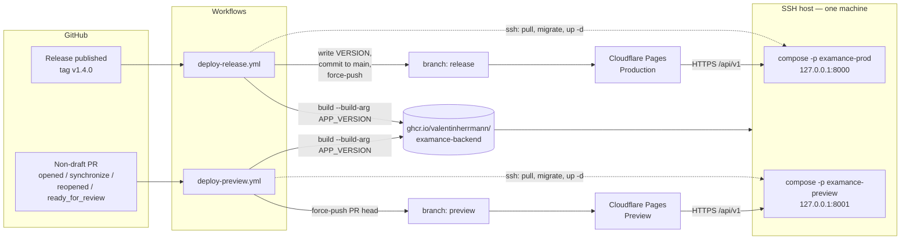
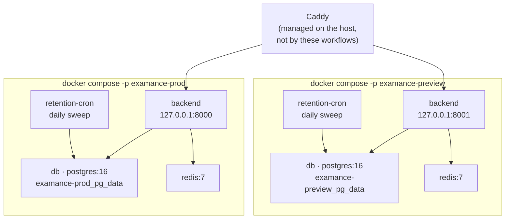
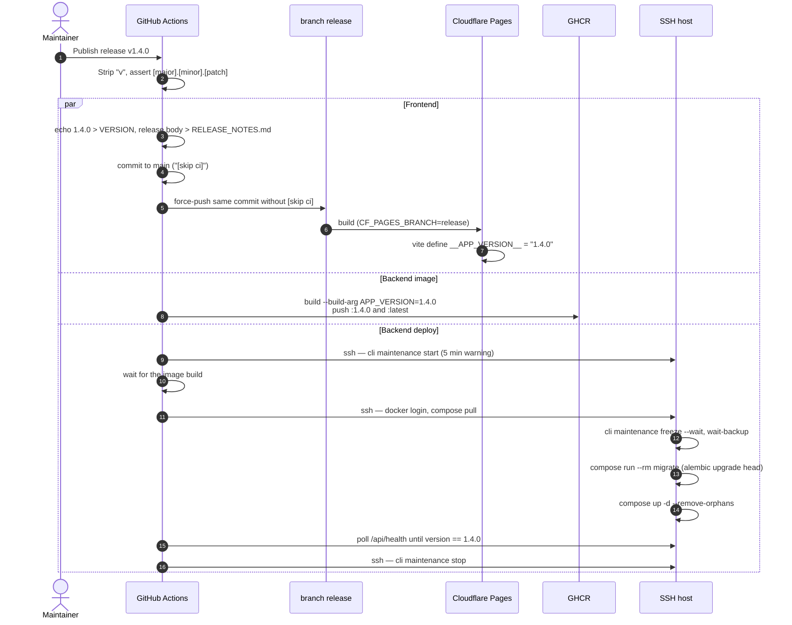
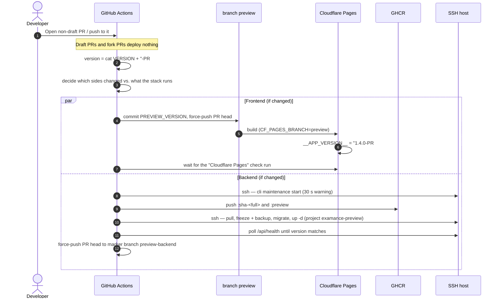

# Host it like the maintainer: GitHub Actions

How the maintainer's installation runs: two isolated stacks (production and preview) on one server, deployed by GitHub Actions on every release and every pull request, with the frontend on Cloudflare Pages. Each stack is an ordinary installation as described in [Host Examance](hosting.md); this page covers only what the pipeline adds. Read that page first.

Examance ships as two artefacts that always carry **the same version number, deployed at the same time**:

- **Frontend** — static SvelteKit build on Cloudflare Pages.
- **Backend** — Docker image on GHCR, run as a `docker compose` stack on an SSH-reachable server.

There are two fully independent instances, **production** and **preview**.

| | Production | Preview |
|---|---|---|
| Trigger | GitHub Release published | Non-draft PR opened / pushed to |
| Version | `1.4.0` (from the release tag) | `1.4.0-PR#123 [18.08.2026 \| 14:32]` (latest release + PR number + build timestamp) |
| Frontend branch | `release` | `preview` |
| Pages environment | Production | Preview |
| Image tag | `ghcr.io/…/examance-backend:1.4.0` + `:latest` | `…:sha-<full-sha>` + `:preview` |
| Compose project | `examance-prod` | `examance-preview` |
| Loopback port (`APP_PORT`) | `9002` in the template | `9001` in the template |
| Volumes | `examance-prod_pg_data`, `examance-prod_tectonic_cache`, `examance-prod_blob_data`, `examance-prod_restic_cache` | `examance-preview_pg_data`, `examance-preview_tectonic_cache`, `examance-preview_blob_data`, `examance-preview_restic_cache` |
| Files CI writes | `docker-compose.deploy.yml`, `restore-backup.sh` (next to `.env`) | same |
| Server env file | `$DEPLOY_APP_DIR/prod/.env` | `$DEPLOY_APP_DIR/preview/.env` |

Publishing a GitHub Release is the **only** action needed to ship production. Nothing else is manual.

### Copy this setup

1. Fork the repository. The backend image is pushed to `ghcr.io/<owner>/examance-backend`, so nothing names the maintainer there.
2. On the server, set up one directory per stack, each with its own `.env` ([section 6](#_6-two-stacks-on-one-server)).
3. In the repository: the `DEPLOY_*` secrets, and the environments `production` and `preview` with their variables ([section 5](#_5-secrets-and-variables)). Set `BACKEND_PUBLIC_URL` in both: the workflows fall back to the maintainer's API addresses.
4. Create the Cloudflare Pages project for `frontend/` with your own custom domains and build variables ([Cloudflare Pages](#cloudflare-pages-dashboard-managed)).
5. Optional: the BusyTeX mirror on Cloudflare R2 ([BusyTeX mirror](#busytex-mirror-cloudflare-r2)) and the documentation site ([Documentation site](#documentation-site-issue-174)).
6. Publish a release. It writes `VERSION`, pushes `release`, builds the image and deploys production.

---

## 1. Topology



Each environment is a complete, isolated stack. The compose **project name** namespaces both container names and named volumes, so the two databases can never collide and **no preview process can reach production data**.



Postgres and Redis publish **no ports at all**; only the API is bound, and only to loopback. TLS terminates at the host's Caddy.

---

## 2. Release flow (production)



The `[skip ci]`-then-amend step matters: the commit landing on `main` carries `[skip ci]` so it does not re-trigger CI, but the copy force-pushed to `release` must **not** carry it, or Cloudflare Pages skips the production build.

After pushing, both deploy workflows' `frontend` job waits for Cloudflare Pages to finish (`.github/scripts/wait-for-cloudflare-pages.sh`, polling the `Cloudflare Pages: <project>` check run Cloudflare posts on the pushed commit; 15 min timeout). A run is therefore green only once the frontend is live, and a failed Pages build fails the run. It uses the job's own `GITHUB_TOKEN` (`checks: read`) — no Cloudflare API token.

Both halves consume the same resolved version, which is what guarantees frontend and backend always ship the same number together.

### Documentation site (issue #174)

The Markdown under `docs/` is also published as a [VitePress](https://vitepress.dev) site (Mermaid diagrams render through `vitepress-plugin-mermaid`), linked in the app footer and from every in-app help section (`PUBLIC_DOCS_URL` at frontend build time, from the environment or `frontend/.env`, default `https://docs.examance.de/`).

- **Production and previews: Cloudflare Pages** (its own project, next to the app's). Settings: root directory `docs`, build command `npm ci --ignore-scripts && npm run docs:build`, build output directory `.vitepress/dist`, environment variables `NODE_VERSION=22.22.0` (as `frontend/.node-version`) and `SKIP_DEPENDENCY_INSTALL=1` (Pages' own install would run lifecycle scripts; the build command installs without them), production branch `release`, preview deployments for all other branches. Served at `/`.
- **Backup: GitHub Pages** (`https://valentinherrmann.github.io/Examance/`, served at `/Examance/` via `DOCS_BASE`). The `docs` job of the release workflow calls `.github/workflows/docs.yml` after the `frontend` job has pushed `release`; a reusable workflow rather than a `push: release` trigger because pushes made with `GITHUB_TOKEN` never start other workflows. "Run workflow" republishes by hand; its `ref` input publishes another branch, tag or commit. One-time setup: Settings → Pages → Source "GitHub Actions", and allow the `v*` tags (release runs) under Settings → Environments → `github-pages`.

The sources stay readable on GitHub; `docs/.vitepress/markdown.ts` fixes what only GitHub renders: task lists become checkboxes, code spans naming a docs page or a repo file become links (page, or GitHub on `release`), issue numbers link to GitHub, and the PDFs under `pitches/`/`posters/` plus `openapi.json` are copied into the site so they open in the browser. CI builds the site on every push and PR, so a dead internal link fails before release. Locally: `cd docs && npm install && npm run docs:dev`.

### Maintenance window on every backend deploy (issue #130)

The `backend-deploy` job starts together with the image build, not after it: its first step announces a deployment maintenance window through the running backend's CLI (production: 5 minutes, second reminder 1 minute before; preview: 30 seconds, second reminder 10 seconds before). Signed-in teachers are reminded to save their work while the image builds, sign-in pauses at the second reminder, and only the freeze, backup and restart are downtime. The job then waits for the "Build backend image" job (GitHub API, `actions: read`), pulls, and runs `maintenance freeze --wait` (waits out the warning, then stops teaching writes) and `maintenance wait-backup` (the `maintenance-backup` service dumps the database). A failed backup aborts the deploy **before** `migrate`. A final `if: always()` step ends the window by revision (also after a failed build); deployment windows also end by themselves 15 minutes after the announced start if never frozen, or 45 minutes after the freeze. The announcement never replaces an open manual maintenance or a frozen deploy: it waits up to 25 minutes for it to end, else the deploy fails before touching anything. An admin who sees nobody online can cut the wait short ("Start now" in the maintenance tab). Frontend-only deploys announce nothing. The deploy that introduces this feature runs without a window (the old image has no `maintenance` command). Details: `docs/dev/maintenance_mode.md`.

## 3. Preview flow



There is exactly **one** preview instance, shared by all open PRs — the newest non-draft push wins. `concurrency: cancel-in-progress: false`: a newer push queues behind the running deploy (GitHub keeps only the newest pending run), so a deploy is never cancelled mid-freeze or mid-migration; production uses the same so a release deploy is never interrupted.

**Selective deploys (pull requests only).** The `version` job's *Decide which sides to deploy* step skips a side when the stack already runs it from the same `<VERSION>-PR#<n>` and none of its inputs changed:

| Side | Baseline (what is deployed) | Inputs compared | Also required |
|---|---|---|---|
| Frontend | branch `preview` (what Cloudflare built) | `frontend/`, `VERSION` | its Cloudflare Pages check run succeeded |
| Backend | branch `preview-backend`, moved only after a healthy deploy | `backend/`, `deploy/` | `/api/health` reports the same PR |

Changes to `deploy-preview.yml` or `.github/scripts/` count for both. The baseline is the running stack, never the PR's previous push, so PR B never ships half of itself on top of PR A. Pushes to `main` and manual runs always deploy both sides; so does the release workflow. Because the two sides then carry different build times, the status bar compares versions without the `[<built-at>]` stamp. Cloudflare Pages builds only `preview`, so the `preview-backend` marker branch triggers nothing.

---

## 4. Versioning

`/VERSION` at the repository root is the single source of truth. It holds a bare semver (`1.4.0`, no `v`) and is written by the release workflow from the release tag. `frontend/package.json` and `backend/pyproject.toml` versions are **not** part of this chain.

```
Production build   1.4.0                                  VERSION verbatim
Preview build       1.4.0-PR#123 [18.08.2026 | 14:32]        VERSION + "-PR#<number> [<built-at>]"
Local dev           0.0.0-dev
```

How it reaches each artefact:

- **Frontend** — `frontend/vite.config.ts` reads `../VERSION` at config-eval time and inlines the result via Vite `define` as `__APP_VERSION__`. For a preview build (`CF_PAGES_BRANCH` set to anything other than `release`) it instead reads `../PREVIEW_VERSION` — a file `deploy-preview.yml`'s `frontend` job stamps as an extra commit on the `preview` branch, since Cloudflare Pages has no notion of PR numbers on its own. A preview build that never went through that job (a manual push straight to `preview`) falls back to `VERSION` + the short commit SHA. The same condition inlines `__IS_PREVIEW__`, which makes the root layout show the "Preview" corner ribbon (`PreviewBanner.svelte`); production and local dev never show it. Because `define` substitutes a literal into an already-bundled same-origin chunk, no new inline script appears and the CSP hashing in `frontend/scripts/generate-csp-headers.mjs` is unaffected.
- **Backend** — `docker build --build-arg APP_VERSION=…` → `ENV APP_VERSION` in `backend/Dockerfile` → `Settings.APP_VERSION` in `backend/app/config.py` → reported by `GET /api/health` and used as the FastAPI `version`.

`GET /api/health` reports it; how the frontend compares the two versions: [Host Examance, section 3](hosting.md#_3-versions).

---

## 5. Secrets and variables

SSH credentials are declared **once**, at repository level, and shared by both environments:

| Repository secret | Purpose |
|---|---|
| `DEPLOY_HOST` | SSH hostname or IP |
| `DEPLOY_USER` | SSH username |
| `DEPLOY_SSH_KEY` | PEM private key matching the server's `authorized_keys` |
| `DEPLOY_PORT` | SSH port (optional, defaults to `22`) |

Neither pushing to GHCR from CI nor the server's pull needs a stored registry credential — both use the workflow's own `GITHUB_TOKEN`. Each job mints its own copy, valid only for that job's duration, so the `backend-deploy` job's token is still live during its SSH step and can be handed to the server's `docker login` for that one pull. It requires `permissions: packages: read` on that job (already set in both workflows) but no secret you have to create or rotate.

Everything that differs per environment is a GitHub **Environment variable** (Settings → Environments → `production` / `preview` → Variables), not a secret:

| Environment variable | Production | Preview |
|---|---|---|
| `DEPLOY_APP_DIR` | `/home/deploy/examance` | `/home/deploy/examance` |
| `BACKEND_PUBLIC_URL` | `https://api.examance.…` | `https://api-preview.examance.…` |

Per-environment `SECRET_KEY` and `POSTGRES_PASSWORD` live **only** in the server's `.env` files and never pass through CI. Production and preview must use **different** values for both — sharing a `SECRET_KEY` would let a preview build mint tokens production accepts.

### Cloudflare Pages (dashboard-managed)

One Pages project builds the frontend for both stacks. What each build variable means and what the static host must do: [Host Examance, section 5](hosting.md#_5-frontend).

- Root directory `frontend/`, build command `npm run build`, output `build/`.
- Production branch: `release`.
- Preview branches: **only** `preview` (Settings → Builds → "Include only certain branches"). This keeps every feature branch from consuming build minutes and gives preview a stable URL, `prev-examance.valentin-herrmann.com`, which must be listed in the preview `CORS_ALLOWED_ORIGINS` (there is no wildcard default).
- **Custom domains for both environments** (Settings → Custom domains): `examance.valentin-herrmann.com` for `release`, `prev-examance.valentin-herrmann.com` for `preview`. Each stack's `FRONTEND_URL` points at its domain, never at `*.pages.dev` ([why](hosting.md#_4-2-settings)).
- Variables (Settings → Variables and Secrets), per environment: `PUBLIC_DEFAULT_BACKEND_URL` (that environment's API origin), and for **both** environments the `VITE_LEGAL_*` operator details, since the legal pages are public on both stacks. Optional `BUSYTEX_MIRROR_URL` for both (see below).
- **Web Analytics, Rocket Loader and Email Obfuscation stay off**: they inject scripts after the build, which the Content Security Policy blocks ([troubleshooting](hosting.md#_5-3-troubleshooting-executing-inline-script-violates-content-security-policy)).

### BusyTeX mirror (Cloudflare R2)

Every Pages build needs the ~500 MB of BusyTeX assets. From GitHub's release CDN the archive took anywhere from 10 s to 52 s, and gzipping it into ≤ 24 MiB chunks cost another 10–17 s of CPU that competed with `vite build`. The bucket therefore holds two objects per version (names in `frontend/scripts/busytex-mirror.mjs`):

| Object | Content | Used by |
|---|---|---|
| `busytex-processed-v<version>-<hash>.tar` | output of `process-large-files.mjs` (chunks, manifest, fetch interceptor); `<hash>` covers that script and `fetch-interceptor.js` | `build.mjs`, first choice — only unpacked, no gzip |
| `busytex-assets-v<version>.tar.gz` | upstream archive, byte for byte | `fetch-busytex.mjs` (fallback, and `npm run dev`) |

A build falls through processed mirror → raw mirror → GitHub → upstream `texlyre-busytex download-assets`, so a missing or unreachable mirror costs speed, never the build. Only the build reads the bucket — browsers never do, so the CSP and the no-third-party-transfer statements are unaffected.

`.github/workflows/mirror-busytex.yml` keeps it filled: whenever `frontend/package-lock.json`, `busytex-mirror.mjs`, `process-large-files.mjs` or `fetch-interceptor.js` change (PRs from this repository, `main`, or manually) it uploads whichever of the two objects is missing, producing the processed one on the Node version pinned in `frontend/.node-version` (the one Pages builds with), so its chunks are byte-identical to a fallback build's and Pages keeps deduplicating the upload. Nothing needs doing on a BusyTeX update or a change to the processing scripts. Old objects (~500 MB each) stay in the bucket; delete them whenever convenient, or set an R2 lifecycle rule.

One-time setup:

1. Cloudflare dashboard → R2 → create a bucket (e.g. `examance-build-assets`) → Settings → Public access → enable the `r2.dev` subdomain. Note the URL.
2. R2 → Manage API tokens → create a token with **Object Read & Write**, restricted to that bucket. Note the access key ID, secret access key, and your account ID.
3. GitHub → Settings → Secrets and variables → Actions: secrets `R2_ACCOUNT_ID`, `R2_ACCESS_KEY_ID`, `R2_SECRET_ACCESS_KEY`; repository variable `R2_BUCKET`.
4. Pages → Settings → Variables and Secrets: `BUSYTEX_MIRROR_URL` for Production and Preview (see above).
5. Actions → *Mirror BusyTeX assets* → Run workflow. The next Pages build logs `Streaming processed BusyTeX assets from https://pub-….r2.dev/…` followed by `✓ BusyTeX assets staged`.

---

## 6. Two stacks on one server

Set up each stack as in [Host Examance, section 4](hosting.md#_4-backend), with these differences:

- **Directories**: `$DEPLOY_APP_DIR/prod` and `$DEPLOY_APP_DIR/preview`, each with its own `.env` from `deploy/env.prod.example` / `deploy/env.preview.example` (mode 0600, never committed). Nothing else: every deploy writes `docker-compose.deploy.yml` and `restore-backup.sh` next to `.env` and sets `BACKEND_IMAGE`.
- **Project names** `examance-prod` and `examance-preview`, so containers and volumes never mix and no preview process can reach production data.
- **Different values** for `SECRET_KEY` and `POSTGRES_PASSWORD` (a shared key would let preview mint tokens production accepts), `APP_PORT`, `NETWORK_SUBNET` and therefore `PROXY_ALLOWED_IPS`, `FRONTEND_URL` (so each stack has its own passkeys), `CORS_ALLOWED_ORIGINS` and `ALLOWED_HOSTS`; with backups, a separate blob directory, restic repository prefix and password per stack.
- **First boot by hand** (pull, migrate, `up -d`, gateway into `PROXY_ALLOWED_IPS`) as in [section 4.3](hosting.md#_4-3-first-start), with `-p examance-prod` / `-p examance-preview`. Afterwards every deploy does pull, migrate and restart itself, plus the cache warm-up in the `latex` container (bounded to 300 s, non-fatal).
- **Caddy** has one site block per stack, each a plain `reverse_proxy` to its `APP_PORT`. It is managed on the host and deliberately **not** touched by the workflows.

---

## 7. Runbook

Generic operations (logs, rollback, restore): [Host Examance, section 7](hosting.md#_7-operating). The commands there use `$COMPOSE`; here that is `docker compose -p examance-prod -f docker-compose.deploy.yml --env-file .env` (or `examance-preview`) in the stack's directory.

**Manual redeploy**: Actions → *Deploy Release* → Run workflow → enter the version (e.g. `1.4.0`). Preview: Actions → *Deploy Preview* → Run workflow.

**Rollback**: set `BACKEND_IMAGE` by hand as described there; the next release deploy overwrites it again. To roll the frontend back too, re-point the `release` branch at the older commit.

**Check what is actually deployed**

```bash
curl -s https://api-examance.valentin-herrmann.com/api/health
# {"status":"ok","version":"1.4.0"}
```

**Reset the preview database** (safe — preview holds no production data). The restic repository and a host blob directory (`BLOB_STORAGE_HOST_DIR`) are not touched; empty them separately if needed:

```bash
cd ~/examance/preview
docker compose -p examance-preview -f docker-compose.deploy.yml --env-file .env down -v
```

**Verify the two stacks are really isolated**

```bash
docker volume ls | grep examance   # expect <project>_pg_data, _tectonic_cache, _blob_data (and _restic_cache with backups) for prod and preview
```
