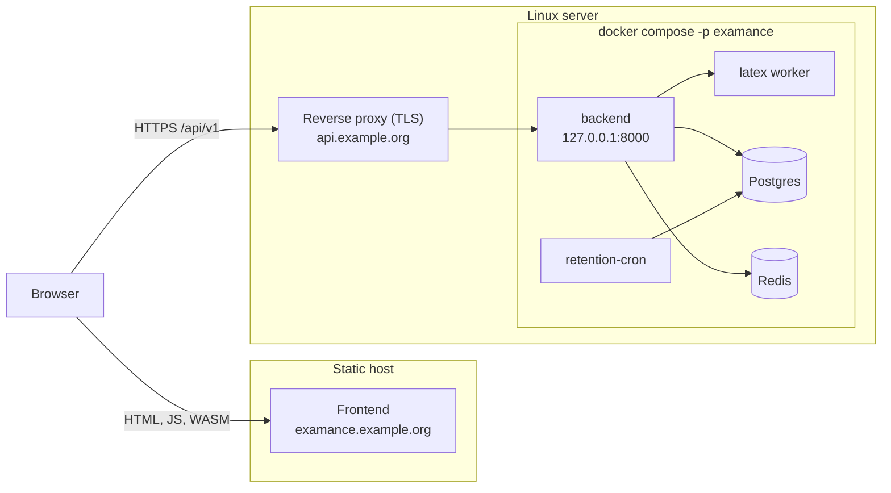
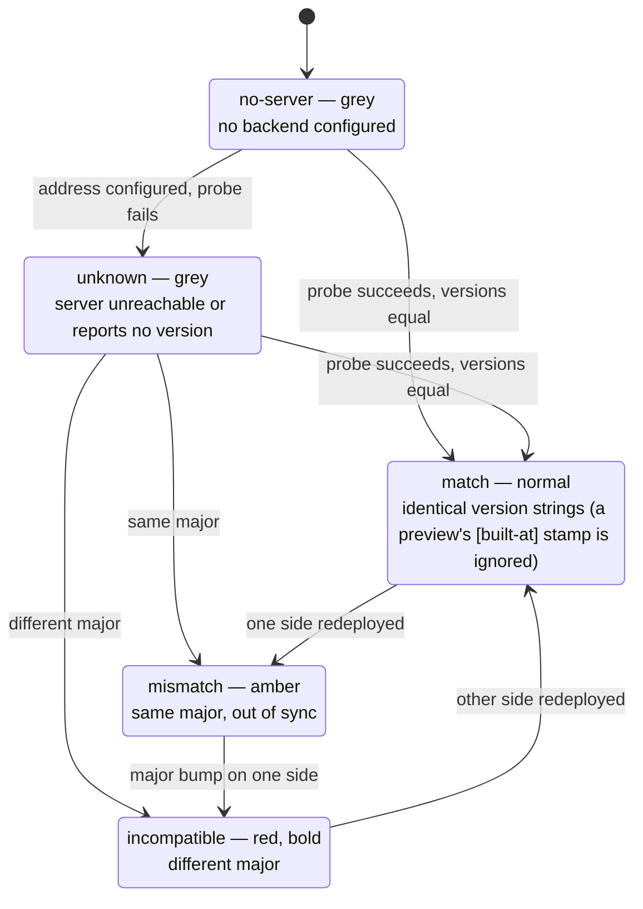

# Host Examance

How to run your own Examance installation: one backend stack on a Linux server and the frontend on any static host. To run it exactly like the maintainer's installation (two stacks, deployed automatically by GitHub Actions on every release and pull request), set up what this page describes and then follow [Host it like the maintainer: GitHub Actions](deployment.md).

## 1. What you run



- **Frontend**: a static build (HTML, JavaScript, WebAssembly). Encryption, decryption, scan processing and the browser LaTeX engine run in the browser, so the frontend host never sees plaintext.
- **Backend stack** (`deploy/docker-compose.deploy.yml`): the API, a separate LaTeX worker without secrets or database access, Postgres, Redis, a daily retention job, and optionally encrypted backups. Postgres and Redis publish no ports; the API binds only to loopback, behind your reverse proxy.

## 2. Requirements

- A Linux server with Docker and the Compose plugin, with a correct clock (NTP): sign-in codes from authenticator apps are time-based, so a drifting clock rejects correct codes.
- Two host names with HTTPS, one for the frontend and one for the API (for example `examance.example.org` and `api.example.org`).
- A reverse proxy that terminates TLS on the server. [Caddy](https://caddyserver.com) gets and renews certificates by itself; the examples use it.
- An SMTP account. Self-registration, invitations and password resets send links by e-mail.
- Outbound internet access for the server: the LaTeX worker downloads TeX bundle files on demand, and image builds need `relay.fullyjustified.net`.
- A static host for the frontend that can set response headers (the Content Security Policy) and fall back to `index.html` for unknown paths. Cloudflare Pages and Netlify do both from the files the build writes.

## 3. Versions

Every release has one version number for frontend and backend. Deploy both from the same release: **a different major version means they are incompatible**. Releases are listed on [GitHub](https://github.com/ValentinHerrmann/Examance/releases).

`GET /api/health` reports the backend's version and needs no sign-in:

```json
{ "status": "ok", "version": "1.4.0" }
```

The frontend probes it and shows the result in its footer:



The label reads `v1.4.0` when both match and `v1.4.0 / 1.3.2` when they differ. A mismatch also puts a badge in the navigation bar; an incompatible major version shows a banner that cannot be dismissed. The version is public on purpose: it is how the frontend detects an incompatible backend, and it is the same class of information a `Server` header carries.

## 4. Backend

### 4.1 Files

```bash
mkdir -p ~/examance && cd ~/examance
# From the release you deploy (replace 1.4.0):
curl -fsSLO https://raw.githubusercontent.com/ValentinHerrmann/Examance/1.4.0/deploy/docker-compose.deploy.yml
curl -fsSLO https://raw.githubusercontent.com/ValentinHerrmann/Examance/1.4.0/deploy/restore-backup.sh
chmod +x restore-backup.sh
curl -fsSL -o .env https://raw.githubusercontent.com/ValentinHerrmann/Examance/1.4.0/deploy/env.prod.example
chmod 600 .env
```

The backend image is public: `ghcr.io/valentinherrmann/examance-backend:<version>`. To build it yourself instead: `docker build --build-arg APP_VERSION=1.4.0 -t examance-backend:1.4.0 backend/` from a checkout of the release, and use that name as `BACKEND_IMAGE`.

### 4.2 Settings

Fill in `.env`. The template explains every setting; these are the ones you must get right:

| Setting | What to set | Why it matters |
|---|---|---|
| `BACKEND_IMAGE` | `ghcr.io/valentinherrmann/examance-backend:1.4.0` | Pin a version rather than `latest`, so an update is a deliberate step. |
| `SECRET_KEY` | `openssl rand -hex 32` | Signs all sessions. Changing it signs everyone out. Never share it between installations. |
| `POSTGRES_PASSWORD` | `openssl rand -hex 24` | Database password; the database is reachable only inside the stack. |
| `FRONTEND_URL` | `https://examance.example.org/` | Used in e-mailed links, and its host name is the passkey relying party. Never a `*.pages.dev` address: that domain is on URL blocklists, so mail servers reject the e-mails (`550 5.7.1 … (B-URL)`), and the backend refuses to start with one when SMTP is configured. Serving it from the same domain as `SMTP_FROM_EMAIL` also keeps spam filters calm. |
| `CORS_ALLOWED_ORIGINS` | `["https://examance.example.org"]` | The frontend origins allowed to call the API; no wildcard, and empty means the backend does not start. |
| `ALLOWED_HOSTS` | `["api.example.org","127.0.0.1","localhost"]` | Host names the API answers to; loopback keeps the health checks working. |
| `APP_PORT` | `8000` | Loopback port the reverse proxy forwards to. |
| `NETWORK_SUBNET` | e.g. `172.23.0.0/16` | Fixed subnet of the stack's network, so the proxy address below stays stable. |
| `PROXY_ALLOWED_IPS` | the network's gateway, see 4.3 | Addresses whose `X-Forwarded-For` the backend trusts. **Never `*`**: anyone could then fake their address, escape rate limits and falsify the audit log. |
| `SMTP_*` | your mail account | Without SMTP, links are only written to the log. |
| `INITIAL_ADMIN_EMAIL` / `INITIAL_ADMIN_PASSWORD` | your admin account | Creates the first admin on startup if it does not exist yet ([details](account_creation_and_management.md#_1-initial-admin-bootstrap-automatic-startup)). Remove the password afterwards. |

Passkeys belong to the host name in `FRONTEND_URL`: a passkey created on one installation or domain does not work on another, by design of WebAuthn.

Self-registration needs nothing beyond SMTP; its token lifetimes and the retention of unapproved accounts have defaults that only need an entry to change. Approval, features and allowed domains: [Accounts and administration](account_creation_and_management.md#_7-self-registration-approval-and-features).

### 4.3 First start

```bash
cd ~/examance
COMPOSE="docker compose -p examance -f docker-compose.deploy.yml --env-file .env"
$COMPOSE pull
$COMPOSE --profile tools run --rm migrate
$COMPOSE up -d

# The gateway of the stack's network is the address the proxy's requests arrive from:
docker network inspect examance_default -f '{{(index .IPAM.Config 0).Gateway}}'
# Put it into .env as PROXY_ALLOWED_IPS, then:
$COMPOSE up -d
```

The project name (`-p examance`) prefixes the containers and volumes. Use a different one for every stack on the same server, so their data can never mix.

### 4.4 Reverse proxy

```
api.example.org {
    reverse_proxy 127.0.0.1:8000
}
```

No timeout tuning is needed. Server-side LaTeX compiles run as background jobs that the browser polls with short requests, so no request comes near the 100 s limit of proxies such as Cloudflare. Do not set a response timeout shorter than `COMPILE_TIMEOUT_SECONDS` plus a margin: a proxy that answers first sends its own error page without CORS headers, and the browser then reports a CORS error instead of a timeout.

Check: `curl -s https://api.example.org/api/health`.

### 4.5 LaTeX worker and cache

A TeX document can read any file its process may read, so LaTeX never runs inside the API. The `latex` service runs the same image without secrets in its environment, with a read-only file system, no capabilities and only its cache volume; it can reach the internet for TeX bundle files but not the database or Redis. If it is down, server compiles answer `503 ERR_COMPILE_UNAVAILABLE` and the browser engine still works.

With an empty cache, the first compiles download several hundred bundle files and time out. The image therefore ships a warmed cache, and Docker copies it into a new, empty `tectonic_cache` volume. A volume that already holds files is never refreshed, so after an update warm it up once (seconds when it is already warm):

```bash
$COMPOSE exec latex sh /app/latex-warmup/warmup.sh
```

To start from scratch: stop the stack, `docker volume rm examance_tectonic_cache`, and `up -d` again. The cache holds only public TeX files, never exam content.

### 4.6 Scan storage and backups

By default every scan stays in Postgres. To keep scans on another disk or a cloud mount, and to turn on the nightly encrypted backup with restic (`COMPOSE_PROFILES=backup`), follow [Storage partitions](dev/storage_partitions.md). What the backups cover and how to restore: [Backup and restore](backup_and_restore.md). Note that `--profile …` on the command line replaces `COMPOSE_PROFILES` from `.env` for that command: name both profiles or neither.

## 5. Frontend

### 5.1 Build

Build from the same release tag as the backend, with the Node version in `frontend/.node-version`:

```bash
git clone --branch 1.4.0 --depth 1 https://github.com/ValentinHerrmann/Examance.git
cd Examance/frontend
npm ci
PUBLIC_DEFAULT_BACKEND_URL=https://api.example.org \
VITE_LEGAL_NAME="…" VITE_LEGAL_STREET="…" VITE_LEGAL_POSTCODE_CITY="…" VITE_LEGAL_EMAIL="…" \
npm run build
```

The build downloads about 500 MB of browser LaTeX engine files and writes the site to `frontend/build/`. Its version comes from the `VERSION` file of the release.

Set them in the build environment or in `frontend/.env` (template: `frontend/.env.example`, git-ignored once copied); the environment wins over the file.

| Build variable | Purpose |
|---|---|
| `PUBLIC_DEFAULT_BACKEND_URL` | API address a new browser starts with. Teachers can still change it; a saved address wins. |
| `VITE_LEGAL_NAME`, `VITE_LEGAL_STREET`, `VITE_LEGAL_POSTCODE_CITY`, `VITE_LEGAL_EMAIL`, optional `VITE_LEGAL_PHONE` | Operator details on the legal notice and privacy policy (`/legal/impressum`, `/legal/datenschutz`). They are built into the public pages, not stored in the repository. Without them both pages show marked placeholders and a "not configured" banner. Retention periods on the privacy page come from the backend at runtime. |
| `PUBLIC_DOCS_URL` | Optional: base URL of this documentation site, for the footer's "Documentation" link and the in-app help's links to user-guide sections (default: `https://docs.examance.de/`). |
| `BUSYTEX_MIRROR_URL` | Optional: a mirror of the LaTeX engine files that speeds up builds ([maintainer setup](deployment.md#busytex-mirror-cloudflare-r2)). |

### 5.2 Serve

Serve `frontend/build/` with:

- **A fallback to `index.html`** for paths that are not files (the app routes in the browser).
- **The response headers from `build/_headers`**, above all the Content Security Policy. Its script hashes are computed for each build, so take the file from every new build. Cloudflare Pages and Netlify apply it as is; on nginx, Caddy or Apache, translate it into header directives.
- **Nothing injected into the HTML.** Analytics snippets, Cloudflare Web Analytics, Rocket Loader and e-mail obfuscation rewrite the pages after the build, so their scripts don't match the policy (see 5.3). Turn them off: they would also send visitor data to a third party, which the privacy policy rules out.

The frontend must be served from the origin you put in `FRONTEND_URL` and `CORS_ALLOWED_ORIGINS`, on its own domain rather than a shared `*.pages.dev` address (see 4.2).

### 5.3 Troubleshooting: "Executing inline script violates … Content Security Policy"

If this appears in the browser console:

```
Executing inline script violates the following Content Security Policy directive
'script-src 'self' 'wasm-unsafe-eval' 'sha256-…''
```

**It is neither a CORS error nor a failed build**, though it reads like both. Work through it in this order:

1. **Does the host inject anything?** On Cloudflare that is Web Analytics, Rocket Loader or Email Obfuscation, the cause in every case so far. They change the HTML after the build hashed it. The app's own script still matches, so the page works and the console noise is the only symptom. Turn the feature off.
2. **Does the served `_headers` still contain `__INLINE_SCRIPT_HASHES__`?** Then the header step of the build did not run and every inline script is blocked: the page stays blank. `npm run build` checks this itself and fails, so a deploy should never get this far.
3. **Is the deployment mixed?** Headers from one build served with files from another give a valid-looking hash that matches nothing. Deploy the whole build again.

The app explains this in the console itself. **Never fix it by widening `script-src`**: allowing an analytics host starts sending visitor data to a third party.

## 6. Updating

1. Read the release notes, especially for a new major version.
2. Announce maintenance in the admin area (User management → Maintenance) so signed-in teachers save their work; it can back up the database first ([Maintenance mode](dev/maintenance_mode.md)).
3. Backend: set `BACKEND_IMAGE` in `.env` to the new version, then

   ```bash
   $COMPOSE pull
   $COMPOSE --profile tools run --rm migrate
   $COMPOSE up -d --remove-orphans
   $COMPOSE exec latex sh /app/latex-warmup/warmup.sh
   ```

   Also take `docker-compose.deploy.yml` and `restore-backup.sh` from the new release, and compare `.env` with the new `deploy/env.prod.example`.
4. Frontend: build and deploy the same release (section 5).
5. Check that the footer shows one version without colour.

Migrations run forward only: going back to an older image does not undo them.

## 7. Operating

**Logs**

```bash
$COMPOSE logs --tail 200 backend
```

**What is deployed**: `curl -s https://api.example.org/api/health`.

**Rollback**

```bash
sed -i 's|^BACKEND_IMAGE=.*|BACKEND_IMAGE=ghcr.io/valentinherrmann/examance-backend:1.3.2|' .env
$COMPOSE up -d
```

Before rolling back:

- **Migrations stay applied.** An older backend that cannot read the newer schema needs a deliberate `alembic downgrade`, by hand, after a database dump.
- Scans stored as files (`BLOB_STORAGE_BACKEND=fs`) cannot be read by releases before issue #114: move them back first ([Storage partitions](dev/storage_partitions.md), "Moving scans").
- Rolling the backend back **across a major version** makes it incompatible with the frontend until you roll the frontend back too.

**Restore from backup**: `./restore-backup.sh` in the stack directory. `list` shows the snapshots, `db <id|latest>` replaces the whole database (the state before is kept for `undo`), `scans <id|latest>` copies missing scan files back. A database restore rolls back every account, so use it for disasters, not for one teacher's mistake. Step by step per situation: [Backup and restore](backup_and_restore.md).

**Accounts**: invitations, approvals, password resets and the management CLI: [Accounts and administration](account_creation_and_management.md).

## 8. Legal responsibilities

Whoever runs an installation is responsible for its legal notice and privacy policy and, depending on who uses it, acts as controller or processor for teacher and pupil data. The [legal audit](legal_audit_dsgvo.md) describes the possible role models (a school, a school authority or a private individual hosting for teachers) and the documents each one needs; several of them are templates with placeholders that must be completed before a school uses the installation.
