<!-- _class: title -->
<!-- _paginate: false -->

Für Informatik-Lehrkräfte, Schulleitung, Datenschutz und IT

# Wie Examance funktioniert – und was es mit Prüfungsdaten macht.

Ablauf, Architektur, Verschlüsselung, Rollen und offene Punkte: alles, was man für eine kritische Bewertung braucht.

<figure class="shot"><figcaption>Anonyme Korrektur: „Anonymer Schüler #7 von 26“</figcaption></figure>

---

Überblick

# Was Examance ist – und was nicht

<h3>Ein Werkzeug für Prüfungen auf Papier</h3>
<dl class="facts">
<dt>Version</dt><dd>0.2, Beta – für einen begrenzten, begleiteten Einsatz</dd>
<dt>Lizenz</dt><dd>MIT, Quellcode vollständig einsehbar, selbst betreibbar</dd>
<dt>Frontend</dt><dd>SvelteKit / Svelte 5, läuft komplett im Browser</dd>
<dt>Backend</dt><dd>FastAPI, PostgreSQL, Redis, Docker</dd>
<dt>LaTeX</dt><dd>XeLaTeX im Browser (WebAssembly) oder Tectonic auf dem Server</dd>
<dt>Sprachen</dt><dd>Deutsch und Englisch</dd>
</dl>

<h3>Was es tut</h3>
Aufgabenbibliothek, Klausursatz, Scan-Import mit QR-Zuordnung, anonyme Korrektur, MC-Erkennung mit Prüfansicht, Auswertung, Export.

<h3>Was es nicht ist</h3>
Keine Online-Prüfung, kein Schulverwaltungsprogramm, keine KI-Korrektur. Bewertet wird immer durch die Lehrkraft.

---

Ablauf

# Vom Quelltext zur Notenverteilung

<figure class="diagram" style="margin-top:6px">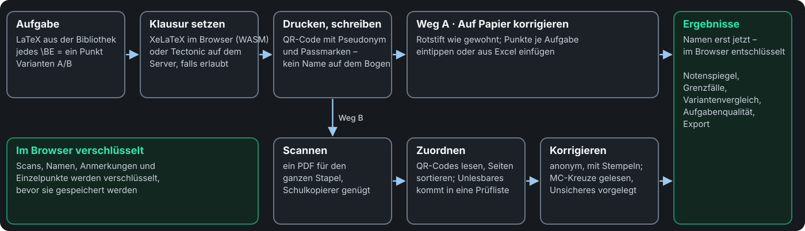</figure>

Beide Wege enden in derselben Notenübersicht und Auswertung; pro Klausur neu wählbar. Scans werden im Browser zerlegt, gelesen und verschlüsselt – pdf.js, <code>zxing-wasm</code> und die MC-Erkennung laufen in Web Workern.

---

Erstellen · Bibliothek und Editor

<figure class="shot"><figcaption>LaTeX links, gesetzte Aufgabe rechts; die Punktzahl wird aus dem Text gezählt</figcaption></figure>

## LaTeX bleibt LaTeX

<ul class="small">
<li>Eine Quelle für Angabe und Lösung: <code>\LoesungKaro</code>, <code>\LoesungLine</code>, <code>\LoesungLuecke</code> zeigen im Schülerblatt Raster, Linien oder Lücken, im Lösungsblatt den Inhalt.</li>
<li>Jedes <code>\BE</code> ist ein Punkt, <code>\hBE</code> ein halber; die Summe zählt der Editor mit.</li>
<li>Ressourcen pro Aufgabe, TikZ, UML und Struktogramme eingebunden.</li>
<li><strong>Varianten</strong> (Gruppe A/B) und <strong>Versionen</strong>: alte Klausuren bleiben unverändert.</li>
</ul>

---

Erstellen · Multiple Choice und Klausursatz

<figure class="shot h460">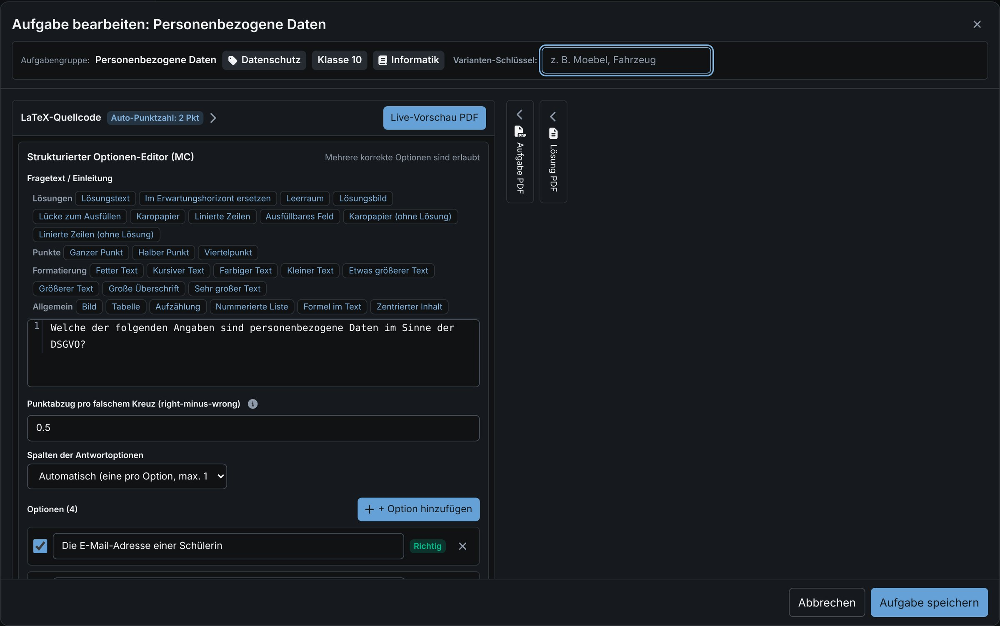<figcaption>Strukturierter MC-Editor, ohne LaTeX-Kenntnisse</figcaption></figure>
<figure class="shot h460"><figcaption>Aufgaben und Varianten anhaken</figcaption></figure>

<ul class="small">
<li>MC: Einfach- oder Mehrfachauswahl, Punktabzug für falsche Kreuze, nie unter null; auf Wunsch zeigt eine Zeile an jeder Aufgabe, wie man ein Kreuz zurücknimmt und neu setzt.</li>
<li>Klausur: Kopf mit Fach, Klasse, Datum, Schullogo; Notenschlüssel linear, Oberstufe oder eigene Grenzen.</li>
<li>Prüfung und Lösungsblatt werden gemeinsam gesetzt, mit QR-Code und Passmarken.</li>
<li>Satz standardmäßig <strong>im Browser</strong>; auf dem Server nur, wenn die Administration es für das Konto erlaubt.</li>
</ul>

---

Erstellen · Teilen

<figure class="shot">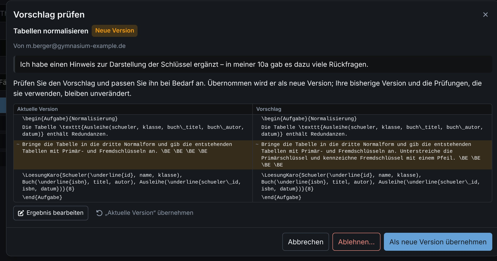<figcaption>Vorschlag eines Kollegen: Diff gegen die aktuelle Version, Übernahme als neue Version oder Variante</figcaption></figure>

## Wie Pull Requests, nur für Aufgaben

<ul class="small">
<li>Geteilte Aufgaben sind für alle Konten der Instanz lesbar; wer sie nutzt, arbeitet mit einer <strong>Kopie</strong>, die spätere Änderungen der Quelle einspielen kann.</li>
<li>Verbesserungen gehen als <strong>Vorschlag</strong> zurück; die Autorin entscheidet.</li>
<li>Geteilt werden nur Aufgabentexte und ihre Dateien – nie Klausuren, Scans oder Ergebnisse. Vor dem ersten Teilen ist eine Bestätigung Pflicht; die E-Mail-Adresse wird sichtbar.</li>
<li>Die Administration schaltet Teilen pro Konto ein oder aus.</li>
</ul>

---

Korrigieren · Scan

<figure class="shot h420">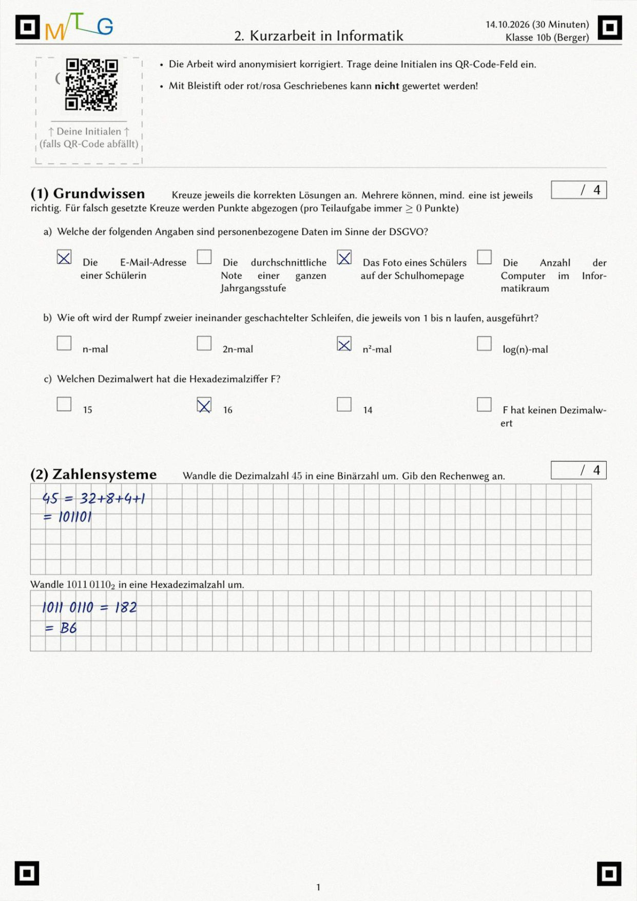<figcaption>Gescannter Bogen (synthetisch)</figcaption></figure>

## Ein Stapel, ein PDF, sechsundzwanzig Abgaben

<figure class="shot h300 bottom"><figcaption>Nach dem Einlesen: jede Abgabe nur mit Pseudonym-Code</figcaption></figure>
<ul class="small">
<li>Der QR-Code trägt Pseudonym, Variante und Ersatzcode – keinen Namen. Unlesbare Codes landen in einer Prüfliste.</li>
<li>Vier Passmarken pro Seite; die Lage der Kästchen stammt aus einem leeren Satz der Klausur. Darüber füllt Examance beim Korrigieren auch die gedruckten Punktekästchen und die Tabelle am Ende aus.</li>
</ul>

---

Korrigieren · Multiple Choice

<figure class="shot">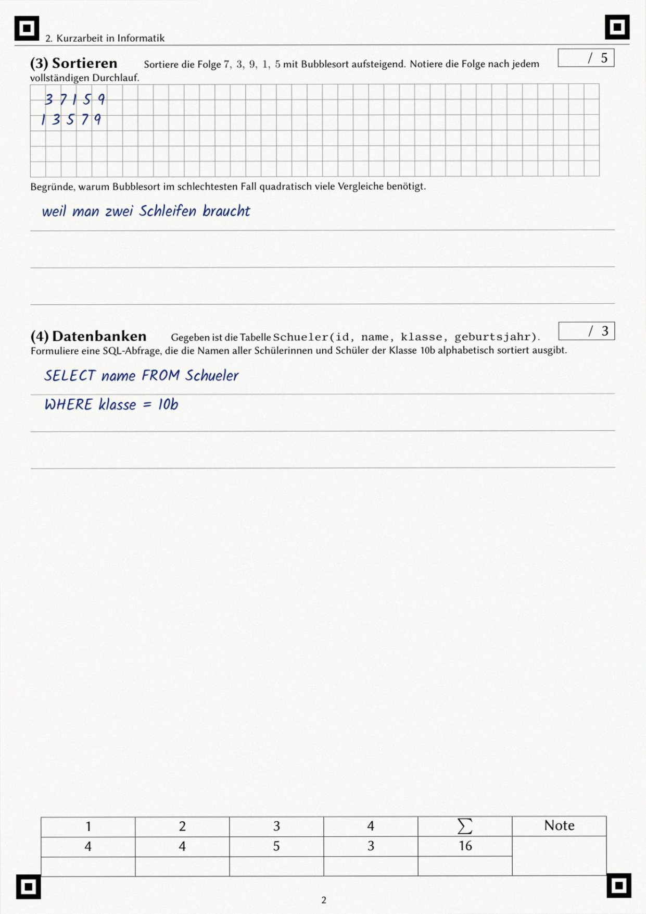<figcaption>Synthetischer Scan: Korrekturzeile, Kreuz zurückgenommen und neu gesetzt</figcaption></figure>

## Messung plus menschliche Prüfung

<figure class="shot h300"><figcaption>Prüfansicht: Scan-Ausschnitt, erkannte Kreuze, Punkte nach aktuellem Schlüssel</figcaption></figure>

<ul class="small">
<li>Zwei Verfahren laufen mit: <strong>v4</strong> (Strichform, Standard) und <strong>v2</strong> (Füllgrad); die Prüfansicht zeigt, welches bei Ihren Daten öfter richtig lag.</li>
<li>Ausmalen nimmt ein Kreuz zurück, ein Kreuz links daneben wählt es neu; die Erkennung liest genau diese Zeichen.</li>
<li>Übermalte und blasse Kreuze werden als unsicher vorgelegt; Stichproben auch bei sicheren Erkennungen.</li>
</ul>

---

Korrigieren · Pseudonymisierung

# Erst die Antwort. Dann der Name.

<figure class="diagram" style="margin-top:2px">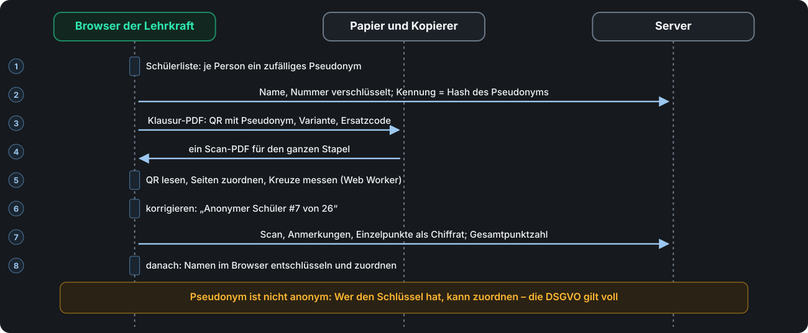</figure>

---

Auswerten

## Auch ohne Scanner, im Browser gerechnet

<figure class="shot h300"><figcaption>Auf Papier korrigiert: Punkte aus Excel eingefügt</figcaption></figure>
<ul class="small">
<li>Notenspiegel, Grenzfälle, Aufgabenqualität über Jahre.</li>
<li><strong>Variantenvergleich</strong>: ab 15 Prozentpunkten Differenz markiert.</li>
<li>Klassenstatistik erst ab fünf Abgaben (k-Anonymität).</li>
</ul>

<figure class="shot"><figcaption>Variantenvergleich aus den Demodaten: Gruppe B fiel 24 Prozentpunkte schwächer aus</figcaption></figure>

---

<!-- _class: statement -->

Teil 2

# Datenschutz und Sicherheit im Detail

Grundsatz: Der Server speichert Schülerdaten nur in einer Form, die er selbst nicht lesen kann. Die folgenden Folien zeigen, wie das umgesetzt ist – und wo die Grenzen liegen.

---

Datenklassen

# Was der Server sieht – und was nicht

<figure class="diagram" style="margin-top:6px">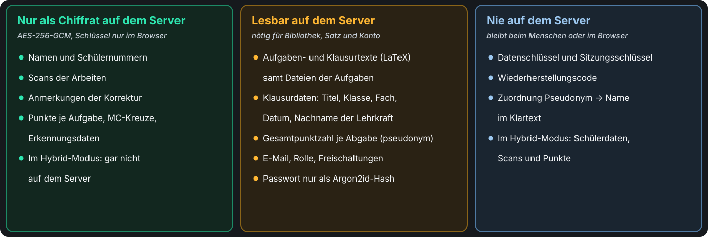</figure>

Pseudonym heißt nicht anonym: Wer den Schlüssel hat, kann zuordnen. Die DSGVO gilt deshalb vollständig, auch für die pseudonyme Gesamtpunktzahl.

---

Verschlüsselung

# Zufälliger Datenschlüssel, je Faktor verpackt

<figure class="diagram">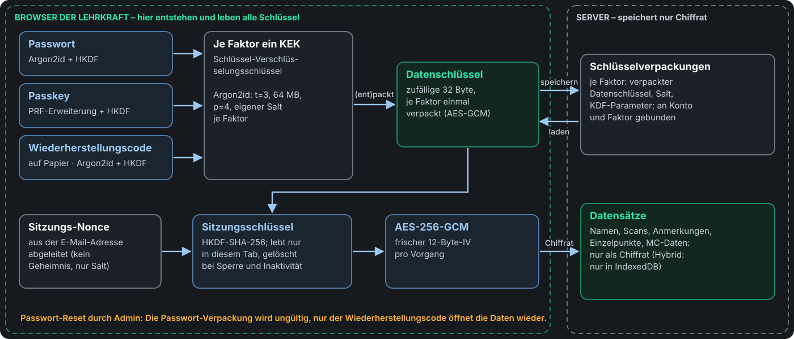</figure>

---

Verschlüsselung · Eigenschaften

# Warum die Hierarchie so aussieht

<h3>Passwort-Reset ohne Datenverlust</h3>
Der Wiederherstellungscode packt denselben Datenschlüssel neu; nichts wird neu verschlüsselt.

<h3>Kein stiller Austausch</h3>
Jede Verpackung ist an Konto, Faktor und Schlüsselgeneration gebunden; der Browser merkt sich einen Fingerabdruck des Satzes und lehnt einen fremden ab.

<h3>Admin ist keine Hintertür</h3>
Ein Admin-Reset des Passworts macht dessen Verpackung ungültig; ohne Wiederherstellungscode bleiben die Daten verschlossen.

<h3>Gesperrter Tab ist leer</h3>
Bei Sperre oder 60 Minuten Inaktivität werden Schlüssel gelöscht; im Server-Modus auch der lokale Zwischenspeicher.

<h3>Ein Ausweichverfahren</h3>
Fehlt Argon2 als WebAssembly, greift PBKDF2-HMAC-SHA-256 mit 600 000 Iterationen (OWASP 2024).

<h3>Standardbausteine</h3>
Web Crypto API für AES-GCM und HKDF, Zufall aus <code>crypto.getRandomValues</code>, <code>py_webauthn</code> für Passkeys.

---

Anmeldung

# Zwei Faktoren, und erst danach Auskunft

<figure class="diagram">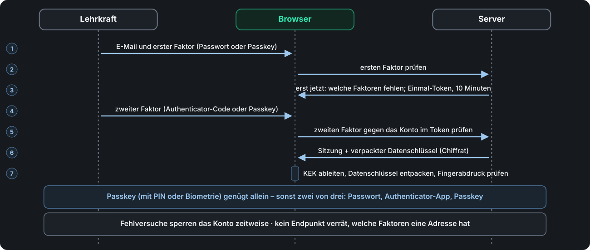</figure>

---

Anmeldung · Details

## Was Angreifer nicht bekommen

<ul class="small">
<li>Ohne zweiten Faktor erreicht ein Konto nichts außer der Einrichtung.</li>
<li>TOTP öffnet keine Daten: Das Geheimnis liegt serverseitig, sechs Ziffern tragen keine Entropie. Jeder Code gilt nur einmal.</li>
<li>Kein Endpunkt verrät, welche Faktoren eine Adresse hat.</li>
<li>Refresh-Tokens rotieren; die Wiederverwendung eines alten gilt als Diebstahl und beendet alle Sitzungen.</li>
<li>Sperre nach Fehlversuchen pro Konto, mit Obergrenze gegen Aussperren durch Dritte.</li>
<li>Protokoll sicherheitsrelevanter Aktionen, IP-Adressen nur als Hash.</li>
</ul>

<figure class="shot"><figcaption>Erste Anmeldung: der zweite Faktor ist Pflicht</figcaption></figure>

---

Speicherort

# Zwei Modi, pro Konto festgelegt

<figure class="diagram" style="margin-top:4px">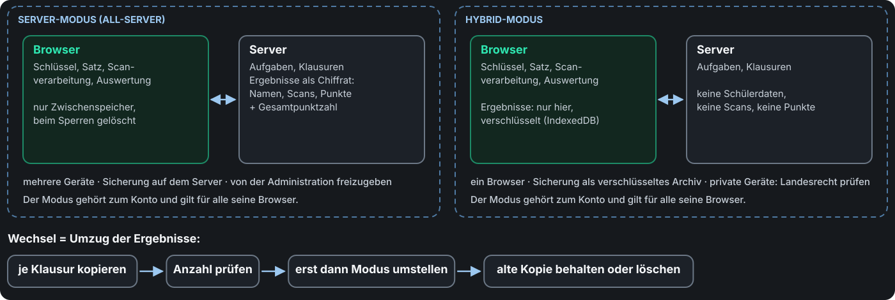</figure>

<strong>Hinweis Hybrid:</strong> Die Daten liegen auf dem Gerät der Lehrkraft; Landesrecht kann private Endgeräte einschränken (in Bayern ausdrücklich geregelt). Der Modus wird bei der ersten Anmeldung gewählt.

---

Rollen

# Was die Administration kann – und was nicht

<figure class="diagram" style="margin-top:4px">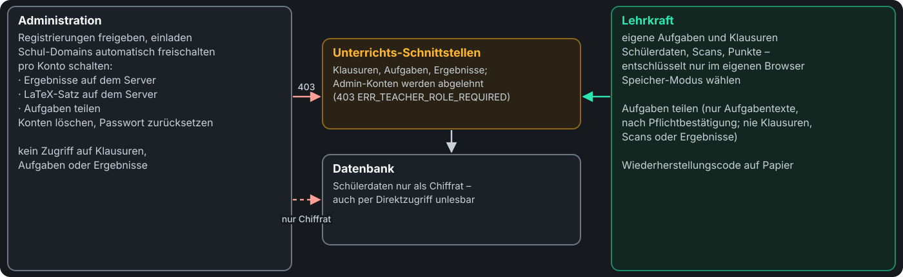</figure>

Das ist Absicht: Wer den Server betreibt, soll Prüfungsdaten nicht einsehen können – auch nicht bei einem Einbruch in den Server.

---

Konten

## Wer ein Konto bekommt, entscheidet die Schule

<ul class="small">
<li><strong>Einladung</strong> durch die Administration, oder</li>
<li><strong>Registrierung</strong>: E-Mail bestätigen, Passwort wählen, dann Freigabe durch die Administration.</li>
<li>Adressen von hinterlegten Schul-Domains werden nach der E-Mail-Bestätigung automatisch freigeschaltet.</li>
<li>Unbestätigte und nicht freigegebene Anträge werden nach einer Frist automatisch gelöscht.</li>
<li>Pro Konto schaltbar: Ergebnisse auf dem Server, LaTeX-Satz auf dem Server, Aufgaben teilen.</li>
</ul>

<figure class="shot">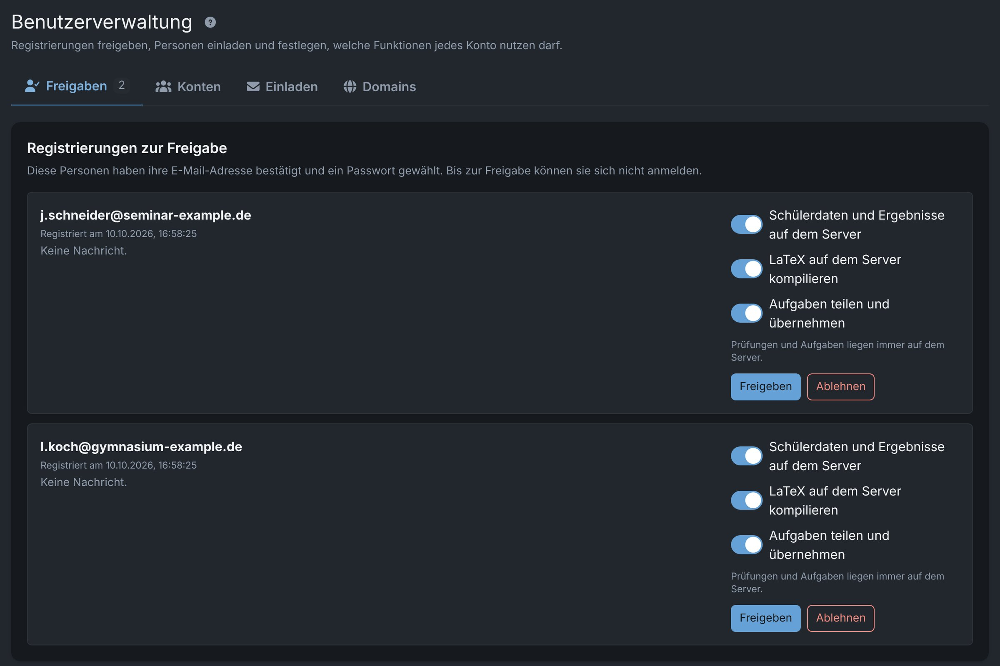<figcaption>Freigaben: zwei Registrierungen warten, Funktionen vorab wählbar</figcaption></figure>

---

Betrieb

# Architektur einer Instanz

<figure class="diagram" style="margin-top:4px">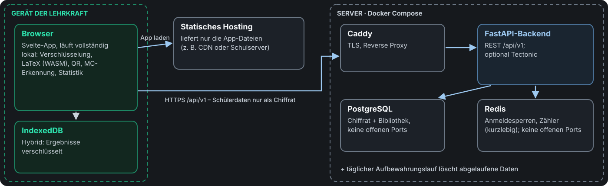</figure>

PostgreSQL und Redis veröffentlichen keine Ports; nur die API ist gebunden, TLS endet am Reverse Proxy. Ein täglicher Aufbewahrungslauf löscht abgelaufene Daten; die Fristen sind konfigurierbar.

---

Betrieb

# Drei Betriebsmodelle, drei Verantwortungslagen

<table style="margin-top:8px">
<tr><th>Modell</th><th>Verantwortlich für Schülerdaten</th><th>Was es braucht</th></tr>
<tr><td><strong>A · Schule betreibt selbst</strong> Backend als Docker-Container, Frontend statisch</td><td>Die Schule</td><td>Kein Auftragsverarbeitungsvertrag; Verzeichnis, DSFA und Information der Betroffenen durch die Schule</td></tr>
<tr><td><strong>B · Dienstleister betreibt für Schulen</strong></td><td>Die Schule</td><td>Vertrag zur Auftragsverarbeitung (Vorlage liegt bei), Unterauftragnehmer offenlegen</td></tr>
<tr><td><strong>C · Private Instanz für Lehrkräfte</strong> so läuft die aktuelle Beta-Instanz</td><td>Lehrkraft bzw. ihre Schule</td><td>Klärung mit der Schule, bevor echte Schülerdaten verarbeitet werden</td></tr>
</table>

Wird das Frontend über einen CDN-Anbieter mit Sitz in den USA ausgeliefert, ist das eine Drittlandübermittlung von Zugriffsdaten. Beim Selbstbetrieb in der EU entfällt sie.

---

Offen gesagt

# Bekannte Grenzen und Kompromisse

<h3>Schlüssel im Tab</h3>
Damit F5 nicht neu fragt, liegt der Sitzungsschlüssel in <code>sessionStorage</code>, versiegelt mit einem nicht exportierbaren Schlüssel je Tab; Skript auf derselben Origin kann ihn trotzdem nutzen, solange der Tab entsperrt ist.

<h3>Klartext auf dem Server</h3>
LaTeX-Quelltexte samt Aufgabendateien (Tectonic braucht sie), Klausurmetadaten und die Gesamtpunktzahl je Abgabe.

<h3>Löschen mit Frist</h3>
Vom Server gelöschte Ergebnisse bleiben 7 Tage (einstellbar) verschlüsselt wiederherstellbar, bevor der Server sie endgültig entfernt.

<h3>TOTP nicht Zero-Knowledge</h3>
Der Server muss den Code berechnen; die Geheimnisse liegen mit einem Serverschlüssel verschlüsselt.

<h3>Hybrid heißt: ein Browser</h3>
Ergebnisse liegen nur dort. Sicherung über ein verschlüsseltes Archiv.

<h3>Lokaler LaTeX-Satz</h3>
Der erste Lauf lädt die Engine nach. In Einzelfällen setzt die WASM-Engine Inhalte unvollständig, die auf dem Server korrekt erscheinen – Ursache offen.

---

Unterlagen

# Was bereits dokumentiert ist

<h3>Datenfluss & Sicherheit</h3>
Schlüsselableitung, Verschlüsselung, Sitzungen, Anmeldefaktoren, bekannte Kompromisse.

<h3>DSGVO-Prüfung</h3>
Technische Bewertung gegen DSGVO, BDSG und bayerisches Schulrecht, mit Befunden und Stand.

<h3>DSFA-Vorlage</h3>
Datenschutz-Folgenabschätzung nach Art. 35, vorbereitet zum Ausfüllen.

<h3>Verzeichnis (Art. 30)</h3>
Vorlage für das Verzeichnis von Verarbeitungstätigkeiten.

<h3>AV-Vertrag</h3>
Vorlage für die Auftragsverarbeitung (Modell B).

<h3>Vorfallsplan</h3>
Checkliste für den Fall einer Datenpanne, mit Meldewegen.

Diese Unterlagen sind <strong>Arbeitsvorlagen aus der Entwicklung</strong>. Sie ersetzen weder die Prüfung durch die oder den Datenschutzbeauftragten noch eine Rechtsberatung. Alles liegt im Repository unter <code>docs/</code>.

---

<!-- _class: center -->

Vor einem Einsatz

# Was die Schule entscheiden muss

<ul class="small">
<li>Rechtsgrundlage bestätigen (in Bayern Art. 85 BayEUG mit BaySchO)</li>
<li>Aufbewahrungsfrist für Prüfungsarbeiten festlegen</li>
<li>Betriebsmodell wählen, ggf. AV-Vertrag schließen</li>
<li>DSFA abschließen und das Verzeichnis ergänzen</li>
</ul>

<ul class="small">
<li>Regel für private Endgeräte, besonders für den Hybrid-Modus</li>
<li>Welche Funktionen freigeschaltet werden (Server-Ergebnisse, Teilen)</li>
<li>Ansprechperson und Supportweg für Lehrkräfte</li>
<li>Information der Schülerinnen, Schüler und Eltern</li>
</ul>

Für Auskunft und Löschung nach Art. 15 und 17 DSGVO gibt es in der App eine eigene Ansicht je Schülerin und Schüler. Ergebnisse lassen sich als Tabelle und als verschlüsseltes Archiv exportieren; Lehrkräfte können ihr Konto selbst löschen.

---

<!-- _class: center -->

Vorschlag

# Erst ein begrenzter Pilot

<b>Rahmen</b>Eine Fachschaft, ein Halbjahr, wenige freiwillige Lehrkräfte.

<b>Probelauf</b>Zuerst mit erfundenen Daten: setzen, ausdrucken, ausfüllen, scannen.

<b>Echter Einsatz</b>Eine Kurzarbeit vollständig über Examance – parallel zur gewohnten Korrektur, wenn gewünscht.

<b>Bilanz</b>Zeitaufwand, Fehler bei Scan und Erkennung, Akzeptanz, offene Rechtsfragen.

<h3>Besonders hilfreiche Rückmeldung</h3>
Grenzfälle bei QR und MC, eigene Makros und Vorlagen, Tablet mit Stift, Kopierer mit wenig Auflösung, große Stapel.

<h3>Ansehen statt glauben</h3>
Der komplette Ablauf lässt sich mit erfundenen Daten vorführen, einschließlich Benutzerverwaltung. Fehler als Issue im Repository oder an den Betreiber, mit Version aus der Fußzeile.

