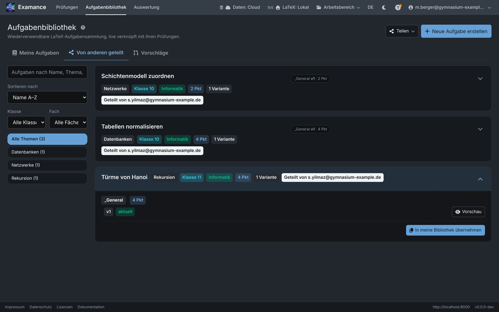

<!-- _class: title -->
<!-- _paginate: false -->

Für Lehrkräfte

# Gute Aufgaben einmal schreiben. Klausuren in Minuten zusammenstellen.

Examance ist eine Aufgabenbibliothek mit Klausursatz – und auf Wunsch mehr: anonyme Korrektur am Bildschirm, Notenübersicht und Auswertung über Jahre.

<figure class="shot"><figcaption>Fertige Klausur mit Lösungsblatt, im Browser gesetzt</figcaption></figure>

---

Zwei Wege

# Sie entscheiden, wie viel Examance übernimmt

<h3>Erstellen – und auf Papier korrigieren</h3>

Aufgaben sammeln, Klausur setzen, drucken, wie gewohnt mit Rotstift korrigieren. Die Punkte tippen oder aus Excel einfügen – fertig sind Notenübersicht und Auswertung.

<b>Bibliothek</b>Aufgaben und Varianten

<b>Klausur</b>PDF mit Lösung

<b>Papier</b>Korrektur wie immer

<b>Punkte</b>Tabelle oder Excel

<h3>… oder scannen und am Bildschirm korrigieren</h3>

Der Stapel geht durch den Schulkopierer. Examance ordnet die Bögen per QR-Code zu, liest Multiple-Choice-Kreuze und zeigt die Arbeiten ohne Namen.

<b>Scan</b>Ein PDF für die Klasse

<b>Zuordnung</b>QR-Code mit Pseudonym

<b>Korrektur</b>Anonym, mit Stempeln

<b>MC</b>Kreuze gelesen

Beide Wege enden in derselben Notenübersicht und Auswertung. Sie können pro Klausur neu entscheiden.

---

1 · Aufgabenbibliothek

<figure class="shot"><figcaption>Aufgabe mit zwei Varianten (Gruppe A und B), Filter nach Thema, Klasse und Fach</figcaption></figure>

## Ihr Fundus, geordnet

<ul class="small">
<li>Jede Aufgabe einmal anlegen, in jeder späteren Klausur wiederverwenden.</li>
<li><strong>Varianten</strong> derselben Aufgabe (Gruppe A/B) gegen Abschreiben – Punkte und Statistik bleiben vergleichbar.</li>
<li><strong>Versionen</strong>: Änderungen ergeben eine neue Fassung; alte Klausuren bleiben unverändert.</li>
<li>Die Bibliothek zeigt, in welchen Prüfungen eine Aufgabe schon eingesetzt wurde.</li>
<li>Suche über Name, Thema, Klasse, Fach und Aufgabentext.</li>
</ul>

---

2 · Aufgabeneditor

<figure class="shot"><figcaption>LaTeX links, gesetzte Aufgabe rechts; die Punktzahl wird aus dem Text gezählt</figcaption></figure>

## Schreiben mit Werkzeugkasten

<ul class="small">
<li><strong>Bausteine per Klick</strong>: Karopapier, linierte Zeilen, Lücken, Leerraum, Lösungstext, Bilder, Tabellen, Formeln.</li>
<li><strong>Eine Quelle, zwei Blätter</strong>: Schülerblatt mit Raster oder Linien, Lösungsblatt mit dem Erwartungshorizont.</li>
<li><strong>Punkte im Text</strong>: ganze, halbe und Viertelpunkte; die Summe zählt der Editor mit.</li>
<li><strong>Live-Vorschau</strong> von Aufgabe und Lösung, gesetzt im Browser.</li>
<li>Eigene Bilder und Dateien je Aufgabe; TikZ, UML und Struktogramme sind eingebunden.</li>
</ul>

---

3 · Multiple Choice

## Ankreuzaufgaben ohne LaTeX-Kenntnisse

<ul class="small">
<li>Frage eingeben, Optionen hinzufügen, richtige Antworten anhaken.</li>
<li>Einfach- oder Mehrfachauswahl; Punktabzug für falsche Kreuze einstellbar, nie unter null.</li>
<li>Spaltenzahl der Optionen wählbar, damit die Aufgabe auf die Seite passt.</li>
<li>Mehrere Fragen werden in der Klausur zu einem Block zusammengefasst.</li>
<li>Gescannt liest Examance die Kreuze später selbst.</li>
</ul>

<figure class="shot h460"><figcaption>Strukturierter Editor für Multiple-Choice-Fragen</figcaption></figure>

---

4 · Klausur zusammenstellen

<figure class="shot h460"><figcaption>Auswahl aus der Bibliothek; bei Binärzahlen ist Gruppe A gewählt</figcaption></figure>

## Ankreuzen statt kopieren

<ul class="small">
<li>Aufgaben aus der Bibliothek anhaken, Variante pro Klasse wählen.</li>
<li>Direkt aus der Auswahl schnell bearbeiten oder Vorschau öffnen.</li>
<li>MC-Fragen zu einem Block gruppieren; eigene Einzelaufgaben ergänzen.</li>
<li>Kopf mit Fach, Klasse, Datum, Dauer und Schullogo.</li>
<li>Notenschlüssel: linear (50 % oder 40 %), Oberstufe oder eigene Grenzen.</li>
</ul>

---

5 · Druckfertig

## Klausur und Lösung aus einem Guss

<ul class="small">
<li>Prüfung und Lösungsblatt werden gemeinsam gesetzt, mit Punktekästen und Punktetabelle.</li>
<li>Satz standardmäßig im Browser: Der Aufgabentext verlässt das Gerät dafür nicht. Optional setzt der Server, wenn die Schule das erlaubt.</li>
<li>QR-Code und Passmarken sind schon drin – falls Sie später doch scannen wollen.</li>
<li>Reihenfolge per Pfeil ändern, Punktsumme läuft mit.</li>
</ul>

<figure class="shot"><figcaption>Einrichtung einer Klausur: vier Aufgaben, Prüfung und Lösung als PDF</figcaption></figure>

---

6 · Gemeinsam besser

# Aufgaben teilen, übernehmen, verbessern

<figure class="shot h300"><figcaption>„Von anderen geteilt“: Aufgaben der Kollegin, mit Absender</figcaption></figure>
<ul class="small">
<li>Teilen ist freiwillig, pro Aufgabe oder für alle; die Schule kann es abschalten.</li>
<li>Wer übernimmt, erhält eine eigene Kopie und kann spätere Änderungen der Quelle einspielen.</li>
</ul>

<figure class="shot"><figcaption>Ein Kollege schlägt eine Verbesserung vor; die Autorin sieht den Unterschied und entscheidet</figcaption></figure>

---

Weg A · Auf Papier korrigiert

<figure class="shot"><figcaption>Punkte einer Stegreifaufgabe, aus einer Excel-Tabelle eingefügt</figcaption></figure>

## Rotstift bleibt erlaubt

<ul class="small">
<li>Punkte aufgabenweise (eine Aufgabe, alle Schüler) oder schülerweise eintragen.</li>
<li>Oder eine bestehende Tabelle aus Excel einfügen – Namen und Schülerliste werden mit angelegt.</li>
<li>Danach stehen Notenübersicht, Grenzfälle und Auswertung genauso zur Verfügung wie nach einem Scan.</li>
</ul>

---

Weg B · Scannen

# Ein Stapel, ein PDF, sechsundzwanzig Abgaben

<figure class="shot h420"><figcaption>Gescannter Bogen (synthetisch)</figcaption></figure>

<figure class="shot h340 bottom"><figcaption>Nach dem Einlesen: jede Abgabe nur mit Pseudonym-Code</figcaption></figure>

Der QR-Code verweist auf ein <strong>Pseudonym</strong>, nicht auf einen Namen. Unlesbare Codes landen in einer Prüfliste. Jede Seite wird sofort im Browser verschlüsselt.

---

Weg B · Korrigieren

<figure class="shot"><figcaption>„Anonymer Schüler #7 von 26“ – der Name ist während der Korrektur nicht sichtbar</figcaption></figure>

## Erst die Antwort. Dann der Name.

<ul class="small">
<li>Stempel für ganze, halbe und Viertelpunkte, „Falsch“, „Fehlt“, Folgefehler.</li>
<li>Anmerkungen liegen als Ebene über dem Scan; das Original bleibt unverändert.</li>
<li>Note und Abstand zur nächsten Notengrenze stehen daneben.</li>
<li>Mit Maus, Stift oder Tablet.</li>
</ul>

---

Weg B · Multiple Choice

<figure class="shot"><figcaption>Prüfansicht einer erkannten MC-Antwort mit Scan-Ausschnitt</figcaption></figure>

## Kreuze werden gelesen. Sie entscheiden.

Erkannte Kreuze werden mit dem Lösungsschlüssel verrechnet.

Blasse, übermalte oder zurückgenommene Kreuze werden zur Bestätigung vorgelegt.

Auch sichere Erkennungen lassen sich stichprobenartig prüfen.

---

Auswertung

<figure class="shot"><figcaption>Notenübersicht der 10b (26 Abgaben, Demodaten)</figcaption></figure>

## Was die Klasse kann – und was nicht

<ul class="small">
<li>Durchschnitt, Median, Streuung, Bestehensquote.</li>
<li>Noten- und Prozentverteilung mit Vergleichskurve.</li>
<li><strong>Grenzfälle</strong>: wer knapp unter oder über einer Notengrenze liegt – ein Klick öffnet die Arbeit.</li>
<li>Export als Tabelle und Diagramm (SVG, PDF, PNG).</li>
</ul>

---

Über Klausuren hinweg

## Waren Gruppe A und B gleich schwer?

Die 10a schrieb Gruppe B, die 10b Gruppe A derselben Aufgabe. Examance vergleicht die Ergebnisse und markiert Unterschiede ab 15 Prozentpunkten.

<ul class="small">
<li>Welche Aufgaben fallen über Jahre hinweg schwach aus?</li>
<li>Welche Variante war unbeabsichtigt schwerer?</li>
<li>Wo lohnt sich Wiederholung im Unterricht?</li>
</ul>

<figure class="shot"><figcaption>Gruppe B fiel 24 Prozentpunkte schwächer aus – ein Hinweis, die Variante zu überarbeiten</figcaption></figure>

---

<!-- _class: center -->

Datenschutz in einfachen Worten

# Was der Server sieht – und was nicht

<h3>Liegt lesbar auf dem Server</h3>
<ul class="small">
<li>Aufgaben- und Klausurtexte (für Bibliothek und Satz)</li>
<li>Klausurdaten: Titel, Klasse, Fach, Datum, Ihr Nachname</li>
<li>Gesamtpunktzahl je Abgabe, ohne Namen</li>
<li>Ihre E-Mail-Adresse und Ihre Anmeldedaten</li>
</ul>

<h3>Nur mit Ihrem Schlüssel lesbar</h3>
<ul class="small">
<li>Namen und Nummern der Schülerinnen und Schüler</li>
<li>Scans, Anmerkungen und Punkte je Aufgabe</li>
<li>Der Schlüssel entsteht im Browser und verlässt ihn nicht – auch die Administration kann diese Daten nicht öffnen.</li>
</ul>

Im <strong>Hybrid-Modus</strong> verlassen Schülerdaten, Scans und Punkte den Browser gar nicht; im Server-Modus liegen sie dort nur verschlüsselt. Geteilt werden nur Aufgaben – nie Schülerdaten, und erst nach Ihrer ausdrücklichen Bestätigung. Angemeldet wird immer mit zwei Faktoren.

---

<!-- _class: center -->

Einstieg

# Was Sie brauchen

<h3>Ein Konto</h3>
Per Einladung der Administration oder selbst beantragt; Konten mit Schuladresse können automatisch freigeschaltet werden.

<h3>Einen zweiten Faktor</h3>
Authenticator-App oder Passkey (Fingerabdruck, Gesichtserkennung, Geräte-PIN) und einen Wiederherstellungscode auf Papier.

<h3>Einen Browser</h3>
Ein aktueller Desktop-Browser oder ein Tablet. Ein Kopierer, der in ein PDF scannt, nur wenn Sie am Bildschirm korrigieren möchten.

<h3>Examance ist in der Beta-Phase</h3>

Beginnen Sie mit der Bibliothek und einer Probeklausur. Im Hybrid-Modus liegen Ergebnisse nur in diesem Browser – sichern Sie sie über das verschlüsselte Archiv. Ein Handbuch ist in die App eingebaut (Fragezeichen oben rechts).

