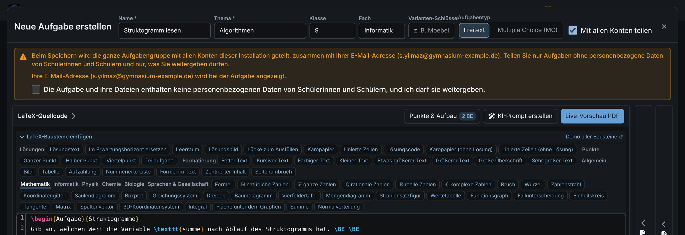

Für Schulleitung, Datenschutz und IT

# Prüfungsdaten, die der Server nicht lesen kann.

Examance unterstützt Lehrkräfte bei Papierklausuren: Aufgaben sammeln und teilen, Klausuren setzen, auf Papier oder anonym am Bildschirm korrigieren, auswerten. Schülerdaten werden im Browser verschlüsselt, bevor sie gespeichert werden.

## Was wo liegt

<table>
<tr><th>Daten</th><th>Für den Server lesbar?</th></tr>
<tr><td>Namen, Schülernummern, Scans, Anmerkungen, Einzelpunkte</td><td class="y">Nein – AES-256-GCM, Schlüssel nur im Browser</td></tr>
<tr><td>Gesamtpunktzahl je Abgabe</td><td class="n">Ja, pseudonym, ohne Namen</td></tr>
<tr><td>Klausurdaten (Titel, Klasse, Fach, Datum, Nachname der Lehrkraft), Aufgabentexte</td><td class="n">Ja</td></tr>
<tr><td>Konto: E-Mail, Rolle, Freischaltungen</td><td class="n">Ja (Passwort nur als Hash)</td></tr>
</table>

## Funktionen und ihre Steuerung

Lehrkräfte<h3>Erstellen & Setzen</h3>
Aufgabenbibliothek, Klausur als PDF. Satz im Browser; Server-Satz pro Konto freischaltbar.

Lehrkräfte<h3>Korrigieren & Auswerten</h3>
Punkte von Hand oder anonym am Scan; Noten, Grenzfälle, Vergleiche über Klassen.

Steuerbar<h3>Aufgaben teilen</h3>
Pro Konto an/aus. Pflichtbestätigung „keine Schülerdaten“. Nie Klausuren oder Ergebnisse.

Steuerbar<h3>Speicherort</h3>
Ergebnisse nur im Browser (Hybrid) oder verschlüsselt auf dem Server – pro Konto erlaubt.

Konten<h3>Zugang</h3>
Einladung oder Antrag mit Freigabe; Schul-Domains automatisch. Zwei Anmeldefaktoren Pflicht.

Admin<h3>Keine Hintertür</h3>
Admin-Konten sehen keine Unterrichtsdaten; ein Passwort-Reset öffnet keine Daten.

<figure class="shot h260"><figcaption>Benutzerverwaltung: Funktionen je Konto</figcaption></figure>
<figure class="shot h260"><figcaption>Bestätigung vor dem Teilen einer Aufgabe</figcaption></figure>

<h3>Vor dem Einsatz</h3><ul>
<li>Rechtsgrundlage und Aufbewahrungsfrist bestätigen</li>
<li>Betriebsmodell wählen, ggf. AV-Vertrag</li>
<li>DSFA und Verzeichnis abschließen (Vorlagen liegen bei)</li>
<li>Regel für private Endgeräte festlegen</li>
</ul>

<h3>Vorschlag</h3>
Ein begrenzter Pilot in einer Fachschaft, zuerst mit erfundenen Daten, mit paralleler Datenschutzprüfung. Offener Quellcode (MIT), selbst betreibbar. Examance ist in der Beta-Phase.

