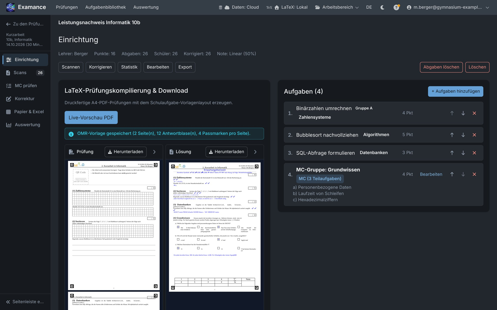
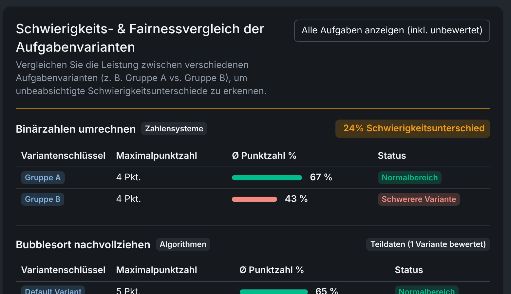

Für Lehrkräfte

# Aufgaben sammeln, Klausuren setzen, fair bewerten.

Examance ist Aufgabenbibliothek, Klausursatz und Notenbuch in einem – im Browser, mit verschlüsselten Schülerdaten. Korrigieren können Sie weiter auf Papier oder anonym am Bildschirm.

<figure class="shot h260"><figcaption>Aufgabeneditor: Bausteine per Klick, Live-Vorschau</figcaption></figure>
<figure class="shot h260"><figcaption>Fertige Klausur mit Lösungsblatt</figcaption></figure>

## Was Examance kann

Erstellen<h3>Aufgabenbibliothek</h3>
Einmal schreiben, immer wiederfinden – nach Thema, Klasse, Fach. Mit Varianten (Gruppe A/B) und Versionen.

Erstellen<h3>Aufgabeneditor</h3>
Karopapier, Linien, Lücken, Lösungstext per Klick. Punkte im Text, Summe automatisch, Vorschau von Aufgabe und Lösung.

Erstellen<h3>Multiple Choice</h3>
Fragen und Optionen ohne LaTeX eintippen, richtige anhaken, Punktabzug für falsche Kreuze einstellen.

Erstellen<h3>Klausur setzen</h3>
Aufgaben anhaken, Variante pro Klasse wählen, Notenschlüssel festlegen – Prüfung und Lösung als druckfertiges PDF.

Gemeinsam<h3>Teilen & Vorschläge</h3>
Aufgaben mit Kolleginnen teilen, Kopien übernehmen, Verbesserungen vorschlagen. Die Autorin entscheidet.

Korrigieren<h3>Papier oder Bildschirm</h3>
Punkte eintippen oder aus Excel einfügen – oder scannen: QR-Zuordnung, anonyme Korrektur, MC-Kreuze werden gelesen.

## Auswerten

<figure class="shot h240"><figcaption>Notenverteilung, Grenzfälle, Export</figcaption></figure>

## Vergleichen

<figure class="shot h240"><figcaption>Waren Gruppe A und B gleich schwer?</figcaption></figure>

<h3>Datenschutz</h3>
Namen, Scans und Einzelpunkte sind nur mit Ihrem Schlüssel lesbar – auch nicht für die Administration. Anmeldung mit zwei Faktoren.

<h3>Beta-Phase</h3>
Starten Sie mit der Bibliothek und einer Probeklausur. Ein Handbuch ist in die App eingebaut.

