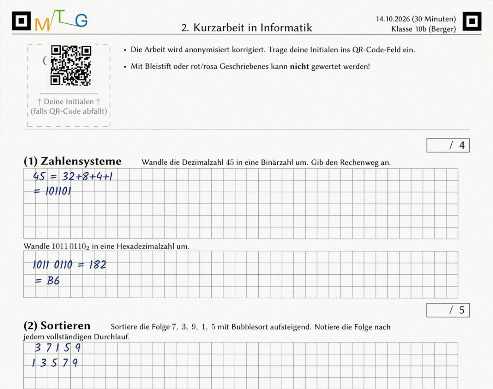

Teil 1 · Erstellen

# Von der Aufgabe zur druckfertigen Klausur.

<figure style="flex:2.105 1 0"><figcaption><b>LaTeX-Aufgabeneditor</b> · Bausteine per Klick, Live-Vorschau – <em>druckreif ohne LaTeX-Kenntnisse</em></figcaption></figure>

<figure style="flex:0.792 1 0"><figcaption><b>Multiple Choice</b> · Optionen eintippen, richtige anhaken – <em>Kreuze werden später automatisch gelesen</em></figcaption></figure><figure style="flex:0.832 1 0"><figcaption><b>Klausur zusammenstellen</b> · Aufgaben und Varianten anhaken – <em>in Minuten statt Stunden</em></figcaption></figure><figure style="flex:1.543 1 0"><figcaption><b>Fertige Klausur</b> · Prüfung und Lösung als PDF – <em>sofort druckbar, auch für Papierkorrektur</em></figcaption></figure>

<figure style="flex:1.600 1 0"><figcaption><b>Aufgabenbibliothek</b> · nach Thema, Klasse, Fach; Varianten A/B – <em>einmal schreiben, immer wiederverwenden</em></figcaption></figure><figure style="flex:1.902 1 0"><figcaption><b>Teilen & Vorschläge</b> · Kollegium schlägt Änderungen vor, die Autorin entscheidet – <em>gemeinsamer Aufgabenpool der Fachschaft</em></figcaption></figure>

---

Teil 2 · Korrigieren und auswerten

# Anonym bewerten, fair vergleichen.

<figure style="flex:1.266 1 0"><figcaption><b>QR statt Name</b> · Pseudonym-Aufkleber auf dem Bogen – <em>anonym von Anfang an</em></figcaption></figure><figure style="flex:1.600 1 0"><figcaption><b>Anonym korrigieren</b> · Aufgabe für Aufgabe, Stempel im Scan – <em>fair, ohne Halo-Effekt</em></figcaption></figure>

<figure style="flex:2.353 1 0"><figcaption><b>MC-Erkennung</b> · Kreuze erkannt, Zweifelsfälle prüfen Sie – <em>Automatik unter Ihrer Kontrolle</em></figcaption></figure><figure style="flex:1.370 1 0"><figcaption><b>Papierkorrektur</b> · Punkte tippen oder aus Excel einfügen – <em>Auswertung auch ohne Scanner</em></figcaption></figure>

<figure style="flex:1.600 1 0"><figcaption><b>Ergebnisse</b> · Notenspiegel, Schnitt, Grenzfälle – <em>fertig, sobald die Punkte da sind</em></figcaption></figure><figure style="flex:1.733 1 0"><figcaption><b>Variantenvergleich</b> · Gruppe B 24 Prozentpunkte schwächer – <em>unfaire Varianten fallen auf</em></figcaption></figure>

<figure style="flex:2.053 1 0"><figcaption><b>Speicherort</b> · Ergebnisse auf dem Schulserver oder nur im Browser – <em>Sie entscheiden</em></figcaption></figure>

AES-256-GCM

Namen, Scans und Punkte werden <b>im Browser</b> verschlüsselt (Ende-zu-Ende). Der Schlüssel entsteht aus Ihrem Passwort (Argon2id) und verlässt Ihr Gerät nie – der Server sieht nur Chiffretext. Anmeldung mit zweitem Faktor.

