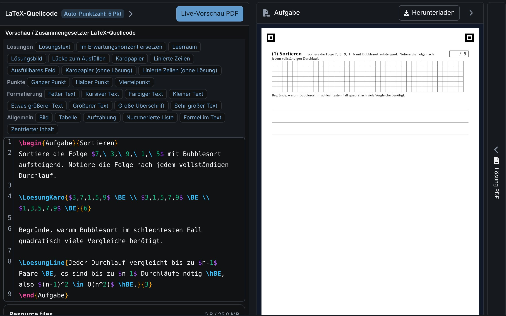
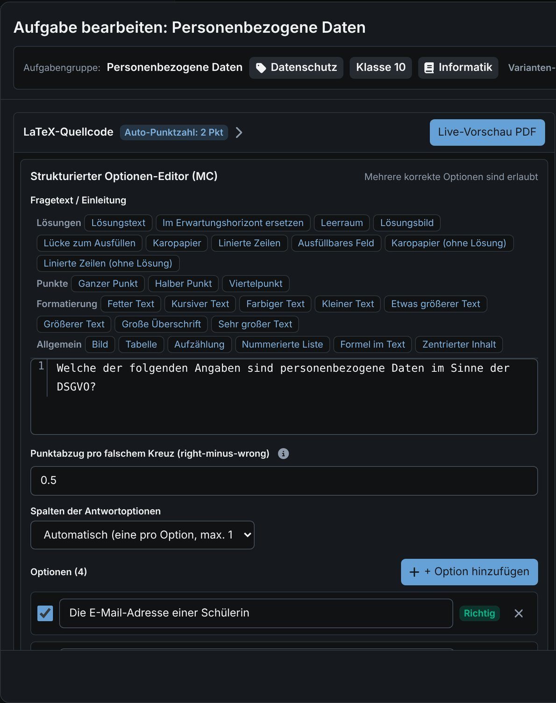
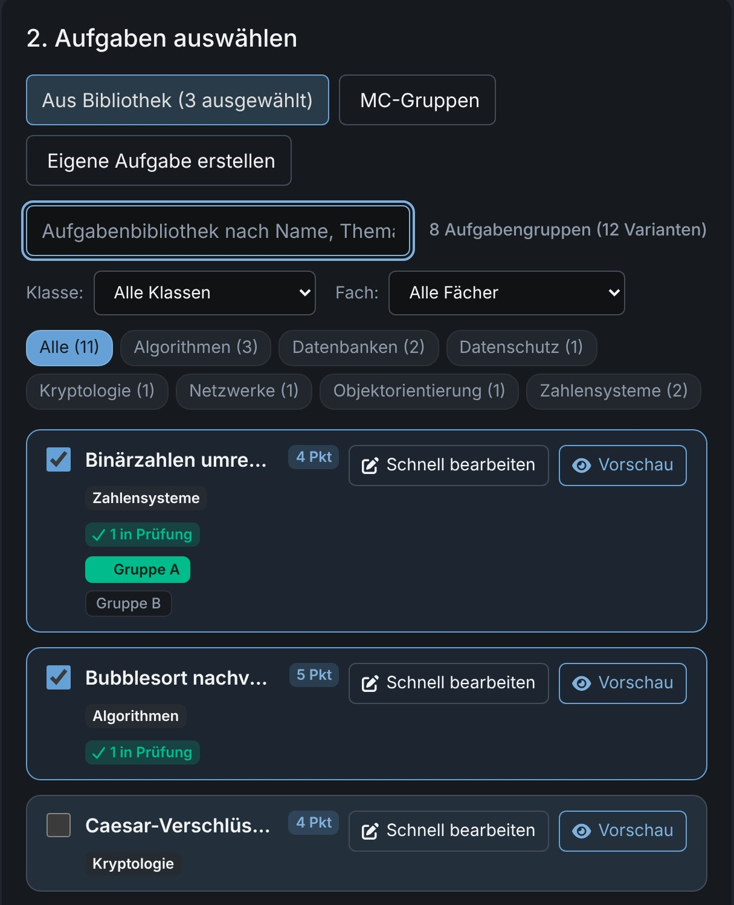
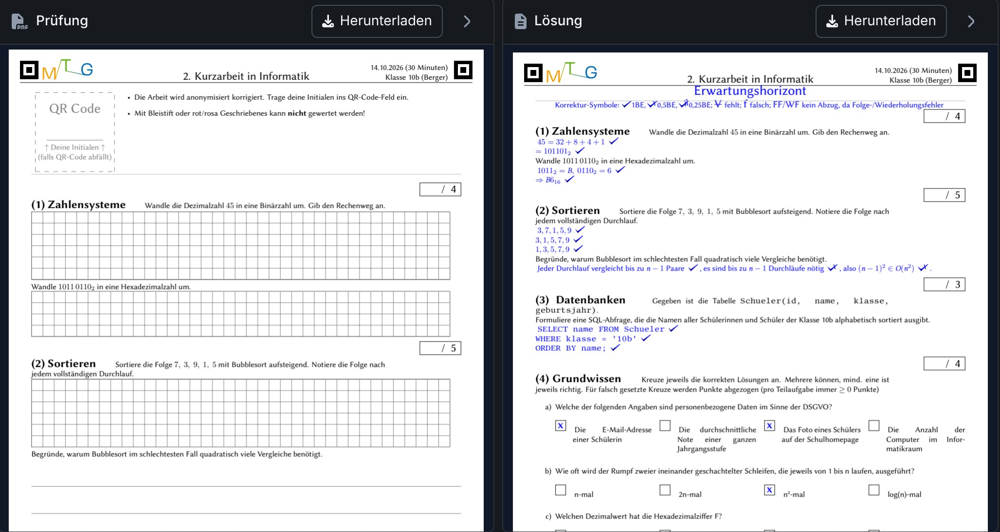
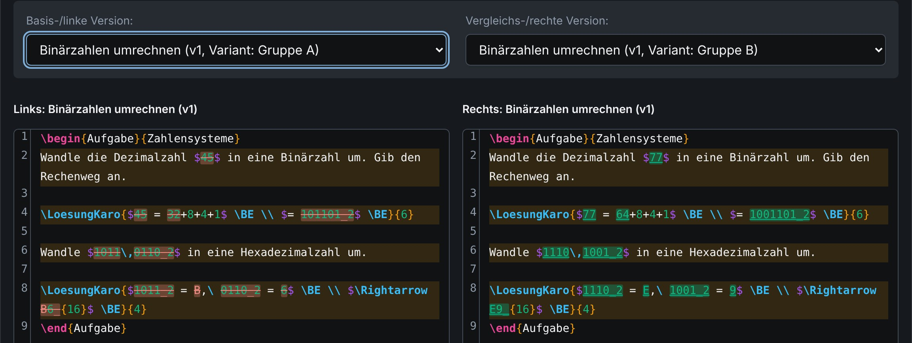
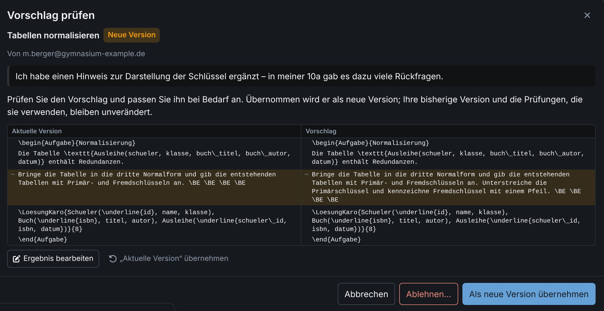
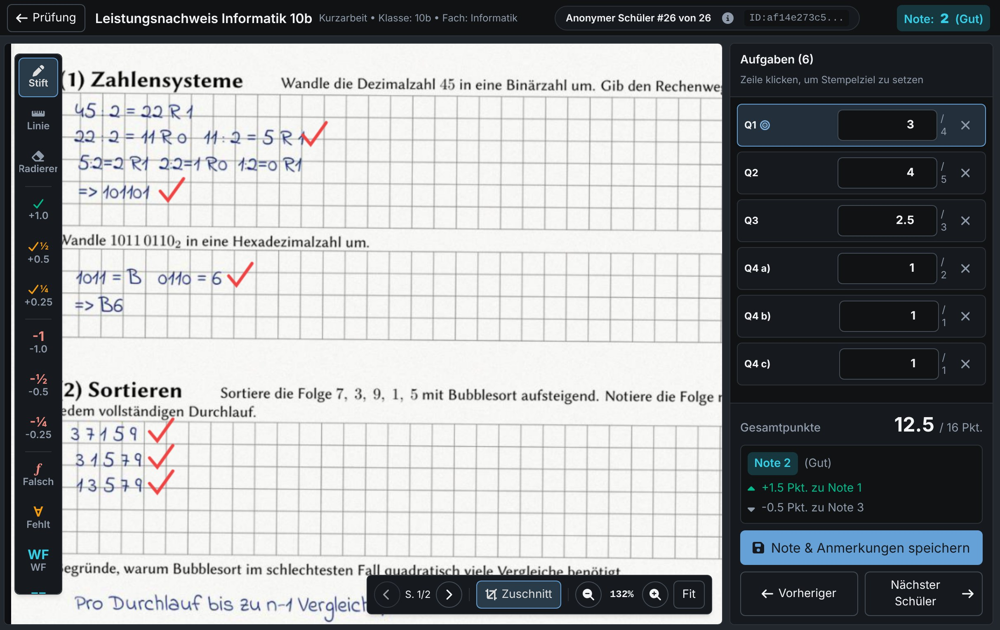
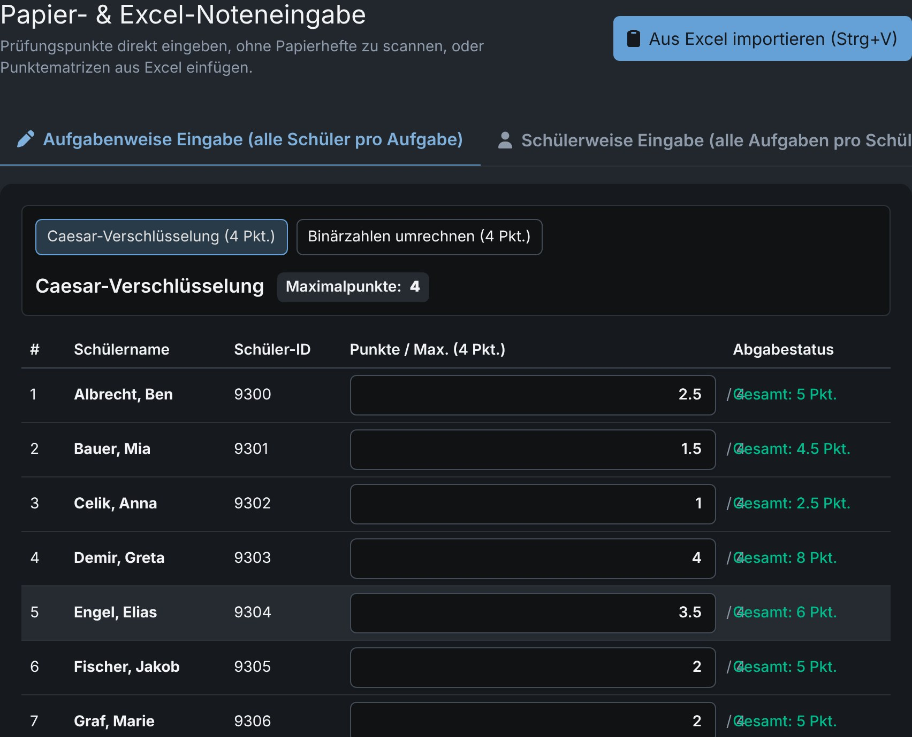
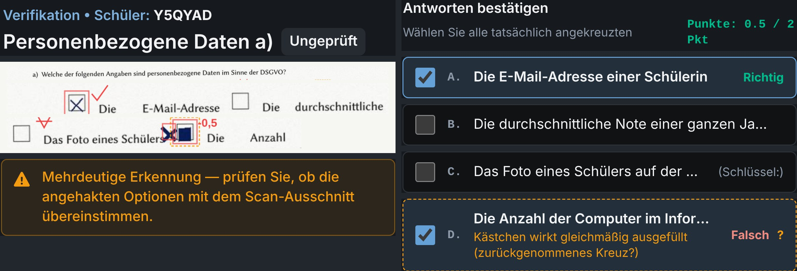
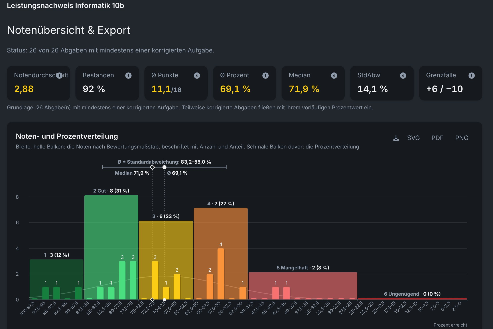

Teil 1 · Erstellen

# Von der Aufgabe zur druckfertigen Klausur.

<figure style="flex:1.602 1 0"><figcaption><b>LaTeX-Aufgabeneditor</b> · Bausteine per Klick, Live-Vorschau; jedes \BE ist ein Punkt, \hBE ein halber – <em>Punktzahl rechnet sich selbst</em></figcaption></figure><figure style="flex:0.768 1 0"><figcaption><b>Multiple Choice</b> · Optionen eintippen, richtige anhaken, Punktabzug wählen – <em>Kreuze werden später automatisch gelesen</em></figcaption></figure>

<figure style="flex:0.813 1 0"><figcaption><b>Klausur zusammenstellen</b> · Aufgaben und Varianten anhaken – <em>in Minuten statt Stunden</em></figcaption></figure><figure style="flex:1.877 1 0"><figcaption><b>Fertige Klausur</b> · Prüfung und Erwartungshorizont; jeder Haken zeigt, welcher Teil welchen Punkt bringt – <em>sofort druckbar, auch für Papierkorrektur</em></figcaption></figure>

<figure style="flex:2.654 1 0"><figcaption><b>Varianten vergleichen</b> · Gruppe A und B nebeneinander, Unterschiede markiert – <em>nur die Zahlen ändern sich, der Aufbau bleibt</em></figcaption></figure><figure style="flex:1.937 1 0"><figcaption><b>Teilen & Vorschläge</b> · Kollegium schlägt Änderungen vor, die Autorin entscheidet – <em>gemeinsamer Aufgabenpool der Fachschaft</em></figcaption></figure>

---

Teil 2 · Korrigieren und auswerten

# Anonym bewerten, fair vergleichen.

<figure style="flex:1.585 1 0"><figcaption><b>Anonym korrigieren</b> · QR-Aufkleber statt Name; Haken-Stempel direkt im Scan ergeben die Punkte – <em>fair, ohne Halo-Effekt</em></figcaption></figure><figure style="flex:1.235 1 0"><figcaption><b>Papierkorrektur</b> · Punkte tippen oder aus Excel einfügen – <em>Auswertung auch ohne Scanner</em></figcaption></figure>

<figure style="flex:2.926 1 0"><figcaption><b>MC-Erkennung</b> · A richtig, D zurückgenommen und neu gesetzt (unsicher markiert) – 0,5 von 2 Punkten – <em>Sie entscheiden im Zweifel</em></figcaption></figure>

AES-256-GCM

Namen, Scans und Punkte werden <b>im Browser</b> verschlüsselt (Ende-zu-Ende). Der Schlüssel entsteht aus Ihrem Passwort (Argon2id) und verlässt Ihr Gerät nie – der Server sieht nur Chiffretext. Anmeldung mit zweitem Faktor.

examance.valentin-herrmann.com

<figure style="flex:1.497 1 0"><figcaption><b>Ergebnisse</b> · Notenspiegel, Schnitt, Grenzfälle – <em>fertig, sobald die Punkte da sind</em></figcaption></figure><figure style="flex:1.733 1 0"><figcaption><b>Variantenvergleich</b> · Gruppe B 24 Prozentpunkte schwächer – <em>unfaire Varianten fallen auf</em></figcaption></figure>

