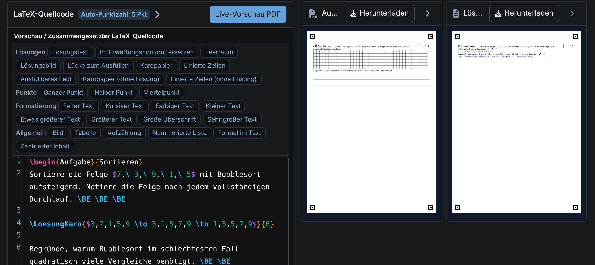

# Klausuren schreiben, setzen, fair bewerten.

<figure style="flex:2.239 1 0"><figcaption><b>LaTeX-Aufgabeneditor</b> · Bausteine per Klick, Vorschau von Aufgabe und Lösung – <em>druckreif ohne LaTeX-Kenntnisse</em></figcaption></figure><figure style="flex:0.768 1 0"><figcaption><b>Multiple Choice</b> · Optionen eintippen, richtige anhaken, Punktabzug wählen – <em>Kreuze werden später automatisch gelesen</em></figcaption></figure>

<figure style="flex:1.517 1 0"><figcaption><b>Fertige Klausur</b> · Prüfung und Erwartungshorizont als PDF – <em>sofort druckbar, auch für Papierkorrektur</em></figcaption></figure><figure style="flex:1.585 1 0"><figcaption><b>Anonym korrigieren</b> · QR-Aufkleber statt Name; Aufgabe für Aufgabe, Stempel direkt im Scan – <em>fair, ohne Halo-Effekt</em></figcaption></figure><figure style="flex:1.445 1 0"><figcaption><b>Papierkorrektur</b> · Punkte tippen oder aus Excel einfügen – <em>Auswertung auch ohne Scanner</em></figcaption></figure>

<figure style="flex:2.790 1 0"><figcaption><b>MC-Erkennung</b> · richtig, falsch, leer, zurückgenommen und neu gesetzt; Unsicheres wird markiert – <em>Sie entscheiden im Zweifel</em></figcaption></figure>

AES-256-GCM

Namen, Scans und Punkte werden <b>im Browser</b> verschlüsselt (Ende-zu-Ende). Der Schlüssel entsteht aus Ihrem Passwort (Argon2id) und verlässt Ihr Gerät nie – der Server sieht nur Chiffretext. Anmeldung mit zweitem Faktor.

examance.valentin-herrmann.com

<figure style="flex:1.497 1 0"><figcaption><b>Ergebnisse</b> · Notenspiegel, Schnitt, Grenzfälle – <em>fertig, sobald die Punkte da sind</em></figcaption></figure><figure style="flex:1.733 1 0"><figcaption><b>Variantenvergleich</b> · Gruppe B 24 Prozentpunkte schwächer – <em>unfaire Varianten fallen auf</em></figcaption></figure><figure style="flex:1.937 1 0"><figcaption><b>Teilen & Vorschläge</b> · Kollegium schlägt Änderungen vor, die Autorin entscheidet – <em>gemeinsamer Aufgabenpool der Fachschaft</em></figcaption></figure>

