<!-- _class: tour -->

Teil 1 · Erstellen

# Von der Aufgabe zur druckfertigen Klausur.

<figure>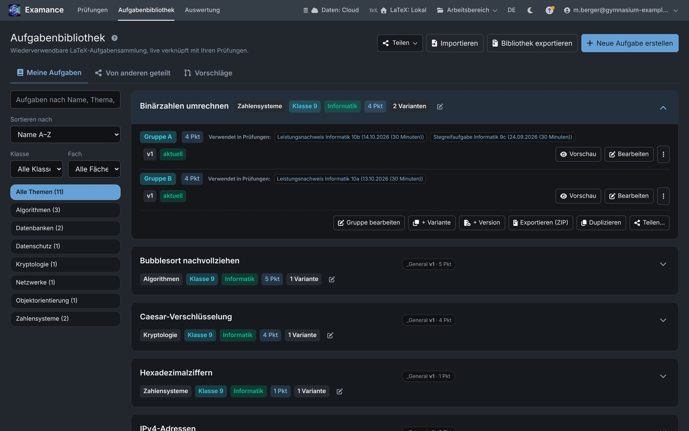<figcaption><b>Aufgabenbibliothek</b> · Nach Klasse, Fach und Thema filtern; Varianten und Versionen je Aufgabe – <em>einmal schreiben, immer wieder nutzen</em></figcaption></figure><figure>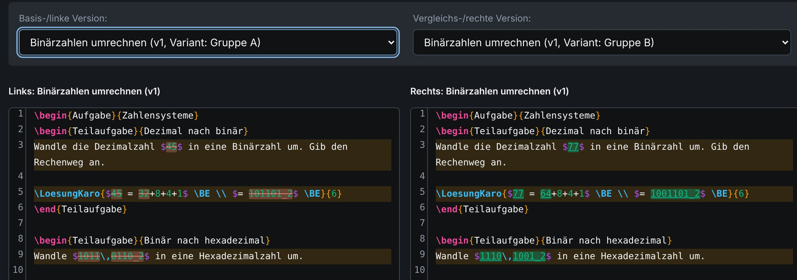<figcaption><b>Varianten vergleichen</b> · Gruppe A und B nebeneinander, Unterschiede markiert – <em>nur die Zahlen ändern sich, der Aufbau bleibt</em></figcaption></figure><figure>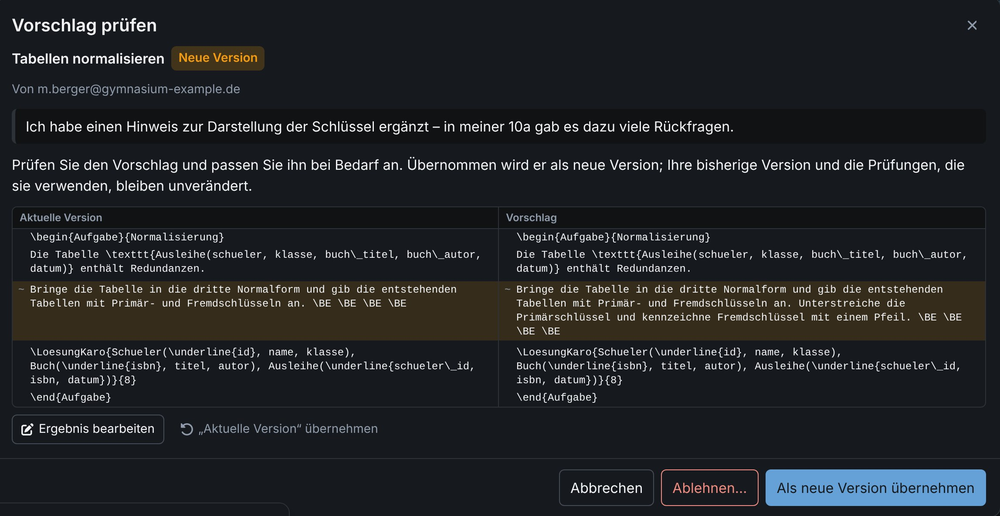<figcaption><b>Teilen & Vorschläge</b> · Kollegium schlägt Änderungen vor, die Autorin entscheidet – <em>gemeinsamer Aufgabenpool der Fachschaft</em></figcaption></figure><figure>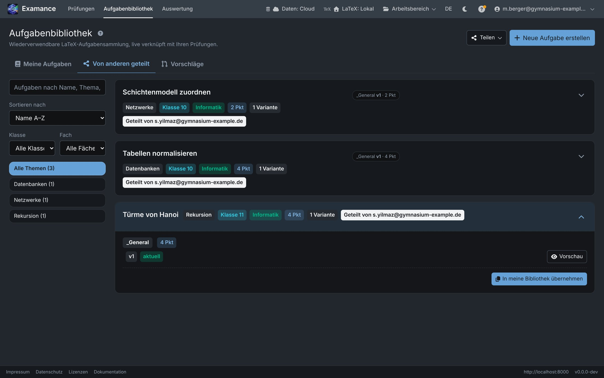<figcaption><b>Geteilte Aufgaben</b> · Aufgaben aus dem Kollegium in die eigene Bibliothek übernehmen – <em>nur Aufgabentexte, nie Schülerdaten</em></figcaption></figure>

<figure>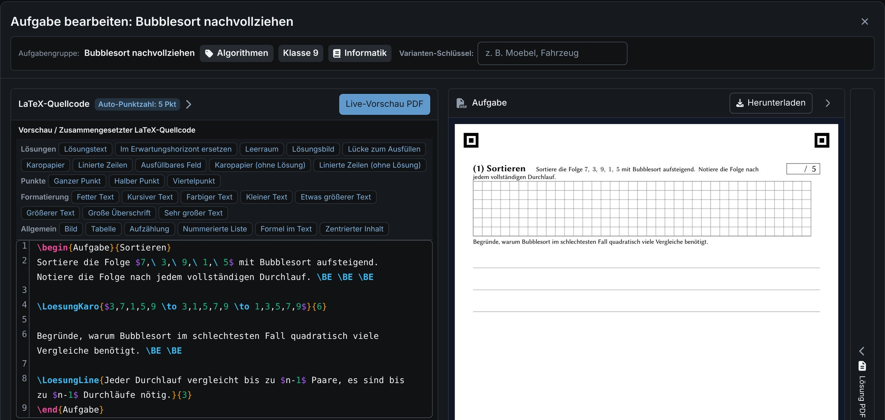<figcaption><b>LaTeX-Aufgabeneditor</b> · Bausteine per Klick, PDF-Vorschau; \BE ist ein Punkt, \hBE ein halber, \qBE ein viertel – <em>Punktzahl rechnet sich selbst</em></figcaption></figure><figure>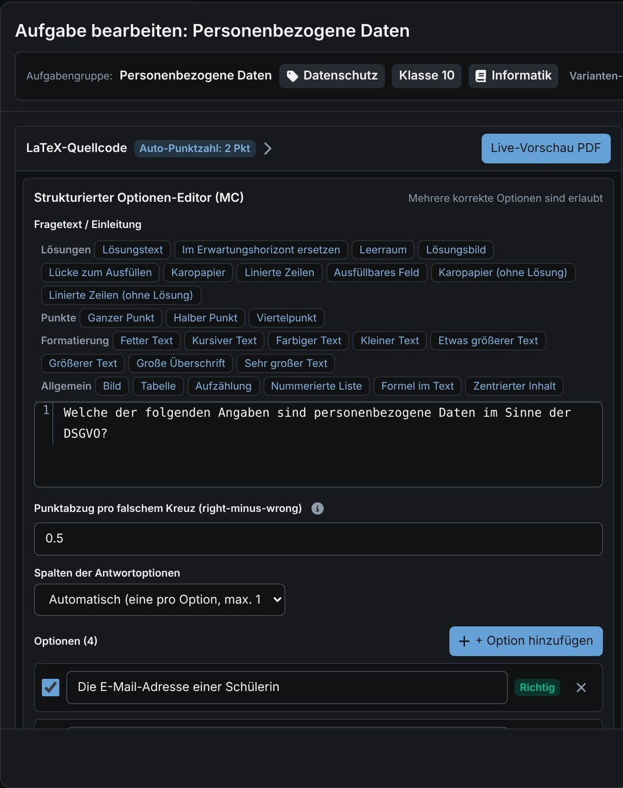<figcaption><b>Multiple Choice</b> · Optionen eintippen, richtige anhaken, Punktabzug wählen – <em>Kreuze werden später automatisch gelesen</em></figcaption></figure><figure>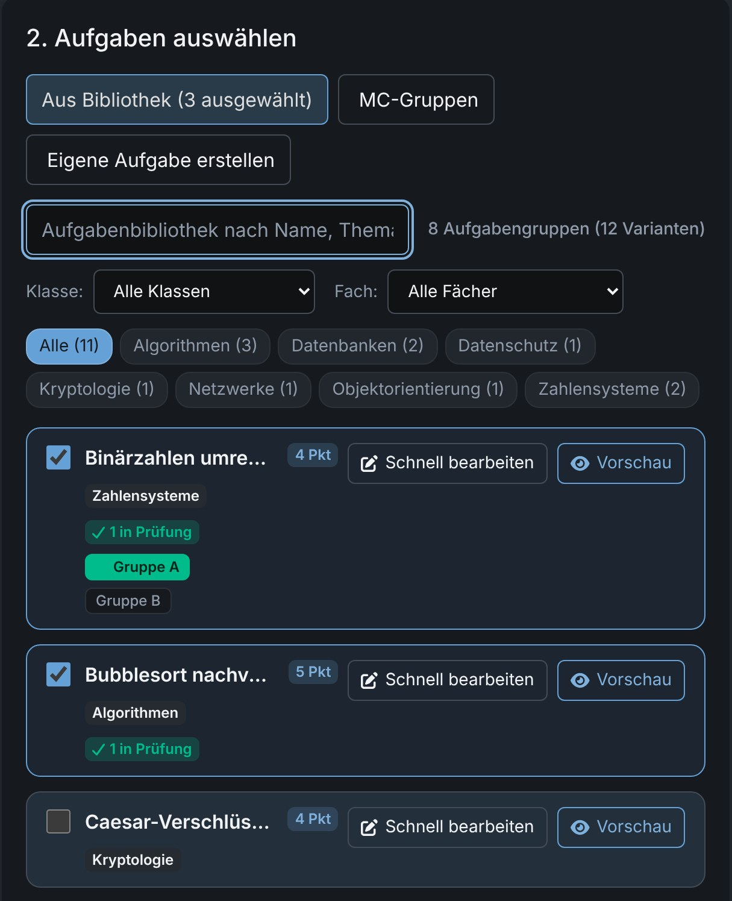<figcaption><b>Klausur zusammenstellen</b> · Aufgaben und Varianten anhaken – <em>in Minuten statt Stunden</em></figcaption></figure><figure>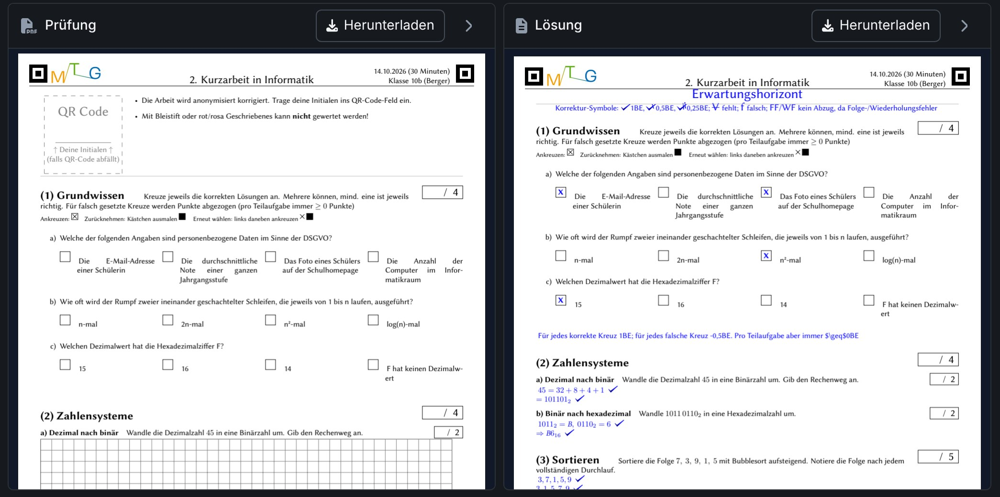<figcaption><b>Fertige Klausur</b> · Prüfung und Erwartungshorizont; jeder Haken zeigt, welcher Teil welchen Punkt bringt – <em>sofort druckbar, auch für Papierkorrektur</em></figcaption></figure>

---

<!-- _class: tour -->

Teil 2 · Korrigieren und auswerten

# Anonym bewerten, fair vergleichen.

<figure style="flex:1.585 1 0">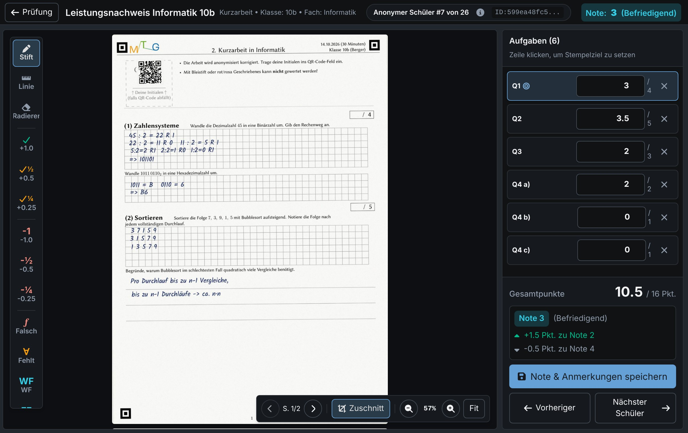<figcaption><b>Anonym korrigieren</b> · QR-Aufkleber statt Name; Stempel ergeben die Punkte – <em>fair, ohne Halo-Effekt</em></figcaption></figure><figure style="flex:1.592 1 0">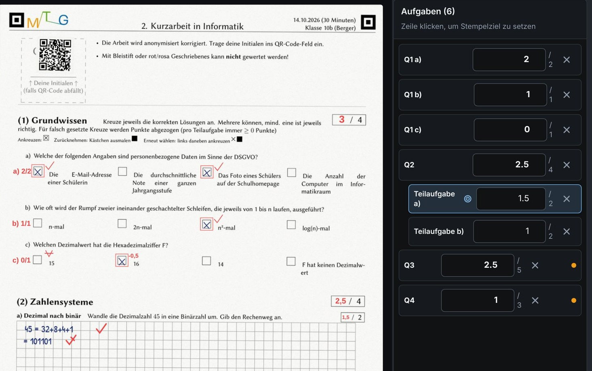<figcaption><b>Punktekästchen füllen sich selbst</b> · Examance trägt die Punkte je Aufgabe und Teilaufgabe in die gedruckten Kästchen und die Tabelle am Ende ein – <em>kein Zusammenzählen von Hand</em></figcaption></figure>

<figure style="flex:1.235 1 0">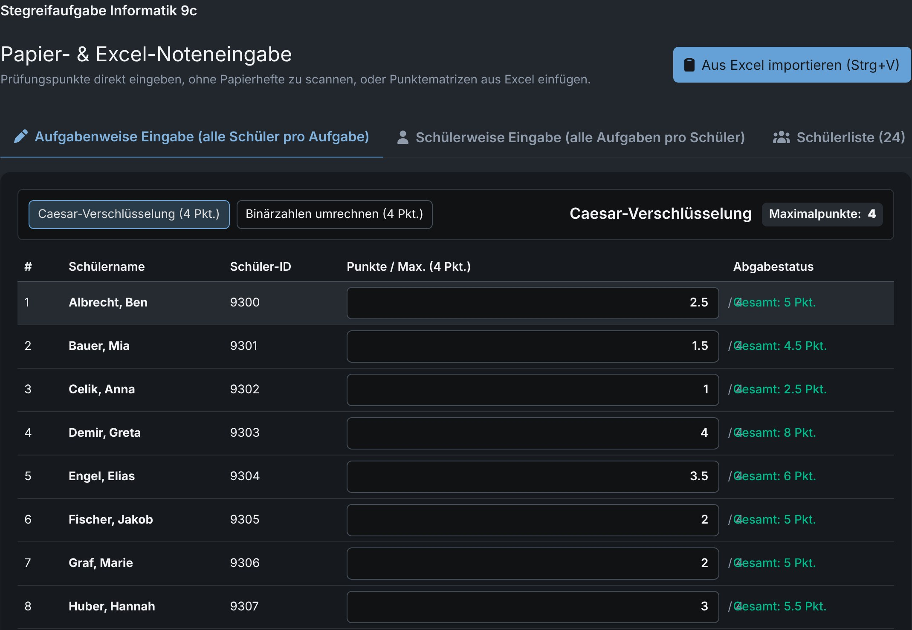<figcaption><b>Papierkorrektur</b> · Punkte tippen oder aus Excel einfügen – <em>Auswertung auch ohne Scanner</em></figcaption></figure><figure style="flex:1.497 1 0">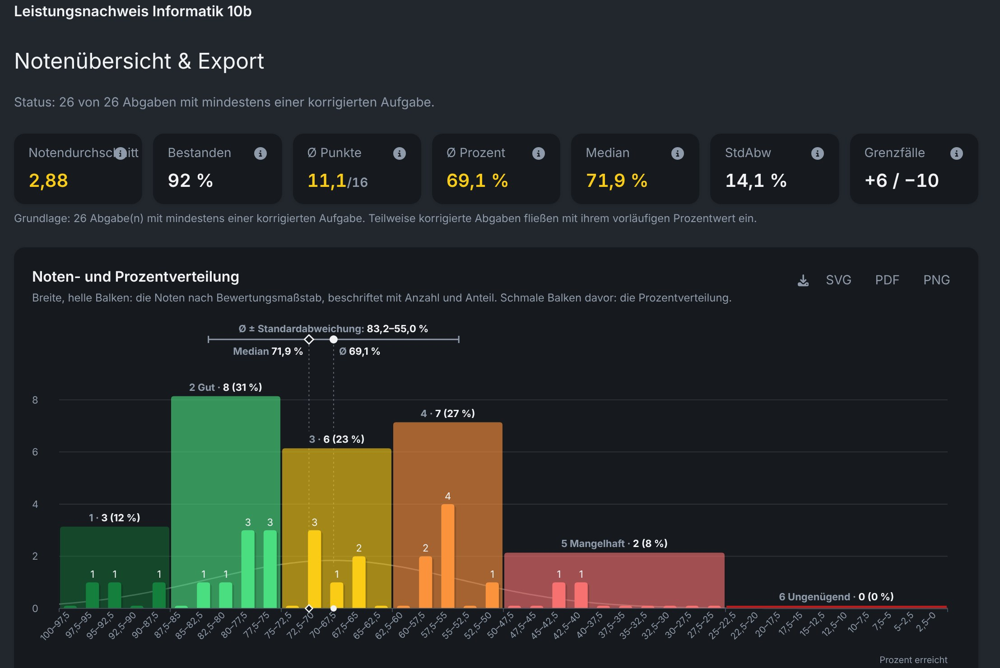<figcaption><b>Ergebnisse</b> · Notenspiegel, Schnitt, Grenzfälle – <em>fertig, sobald die Punkte da sind</em></figcaption></figure><figure style="flex:1.733 1 0">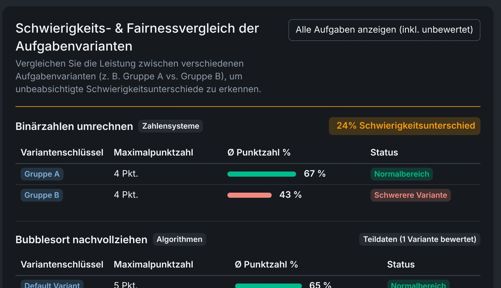<figcaption><b>Variantenvergleich</b> · Gruppe B 24 Prozentpunkte schwächer – <em>unfaire Varianten fallen auf</em></figcaption></figure>

<figure style="flex:1.186 1 0">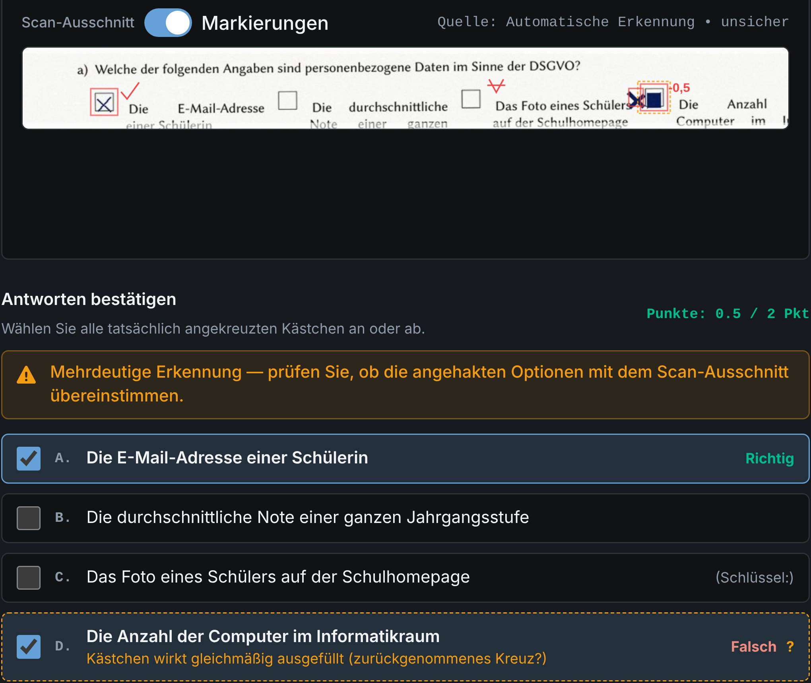<figcaption><b>MC-Erkennung</b> · A richtig, D zurückgenommen und neu gekreuzt: 0,5 von 2 Punkten – <em>Sie entscheiden im Zweifel</em></figcaption></figure>

AES-256-GCM
<ul><li><b>Ende-zu-Ende verschlüsselt</b> Namen, Scans, Einzelpunkte und Anmerkungen werden im Browser mit AES-256-GCM verschlüsselt, bevor sie gespeichert werden.</li><li><b>Schlüssel bleibt bei Ihnen</b> Ein 256-Bit-Schlüssel, freigeschaltet durch Ihr Passwort (Argon2id), Ihren Passkey oder den Wiederherstellungscode. Unverpackt verlässt er Ihr Gerät nie.</li><li><b>Server sieht keine Schülerdaten</b> Lesbar sind nur Aufgaben, Klausurdaten und die pseudonyme Gesamtpunktzahl. Die Administration verwaltet nur Konten.</li><li><b>Anonym korrigieren</b> Ein QR-Aufkleber ersetzt den Namen; Ihr Browser macht daraus ein Pseudonym je Klausur. Namen sehen Sie erst in Notenliste und Export.</li><li><b>Sie wählen den Speicherort</b> Ergebnisse verschlüsselt auf dem Schulserver oder nur in diesem Browser.</li><li><b>Zwei Faktoren</b> Passkey allein oder zwei von drei: Passwort, Authenticator-App, Passkey.</li></ul>
examance.de

