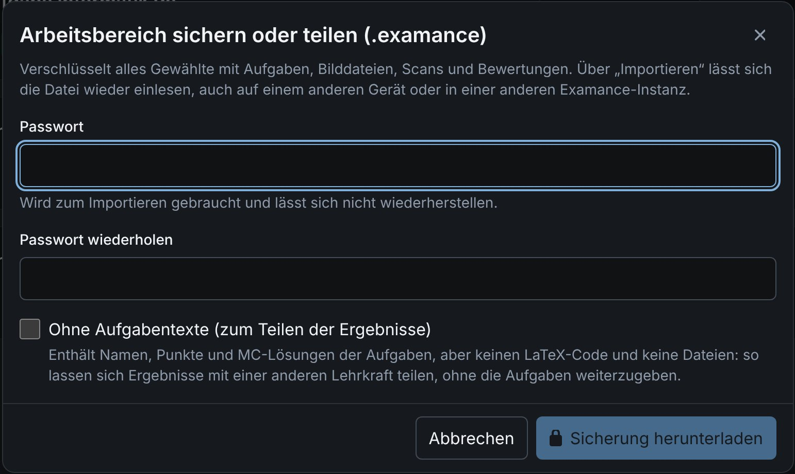

# Backup and transfer

A password-protected archive backs up your work, moves it to another account or installation, or shares results with a colleague. It is encrypted with your own password (Argon2id + AES-256-GCM), independently of your account.

In **hybrid mode** this archive is the **main backup** of your results, because they exist only in one browser. Make one regularly.

## Back up the whole workspace {#workspace-backup}

**Back up or share workspace** in the workspace menu creates a `.examance` archive with:

- all exams, with their logos (an imported exam keeps its header);
- the whole exercise library, including older versions an exam still uses, and the exercises' image and resource files;
- student data, scans, annotations and scores.

Not included: MC answer-sheet templates (they are rebuilt) and your account settings.

## Back up one exam {#exam-backup}

**Export** on an exam (dashboard or exam page) with the format **Re-importable, password-protected backup** creates a `.examance-exam` archive with only that exam, its exercises with their files, and its results.

The file extension shows the scope: `.examance` for a whole workspace, `.examance-exam` for a single exam. Older `.bgproj` backups can still be imported.

## Share results without the exercises {#results-only}

The option **Without exercise texts (to share results)** exports the same, but **without LaTeX code and files**. Exercise names, points and MC answer keys are kept. Use it to pass results to a colleague without handing over your exercises.

Whoever imports such an archive can grade and analyse the exams:

- they carry a **Results only** notice;
- compiling, editing and building MC answer-sheet templates are disabled for those exercises;
- the exercises do not appear in the library.

## Import an archive {#import}

**Import** (workspace menu, dashboard or exercise library) reads an archive back, into the same or a different account, also on another Examance installation. You need the archive's password.

- An exercise you already own on the server is **linked** instead of copied. Exercises other teachers share are never linked.
- Nothing is written before the archive has been decrypted and every conflict has been resolved.

### Conflicts {#conflicts}

If an exam or exercise already exists in a different version, the import asks you to

- **keep the existing one**, or
- **import the archive version as a copy** (the copy brings its image files).

Nothing is overwritten. For student data and submissions you can also take the archive version, for example to restore results from a backup.

### Report {#report}

After every export and import, a report shows what was included or imported, what was deliberately left out, which linked exercises were not available, and which image files could not be read.

## Handle archives with care {#care}

An archive contains student data. Pass the file and its password on **separately** (for example the file by e-mail and the password by phone), and keep backups where only you can reach them. Without the archive password, nobody can open it, not even an administrator.

Readable exports (CSV, ZIP with PDFs) are something else: they are unencrypted, see [Export results](./results#export).
