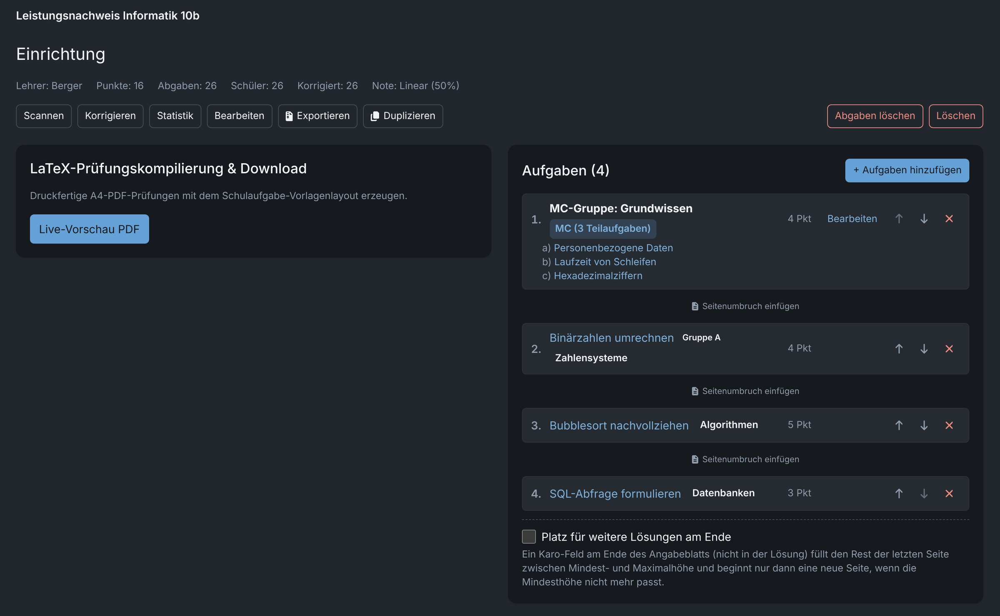
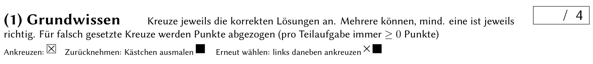
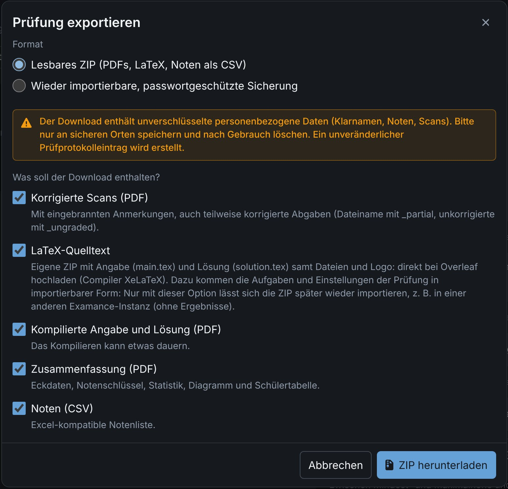

# Creating an exam

An exam is a selection of exercises from your library plus header data, a grading key and a few layout options. Examance typesets it as a print-ready PDF with a QR code on every sheet, so the scans can later be assigned automatically and anonymously.

## Create a new exam {#new-exam}

**New exam** (on the dashboard) asks only for the header data, creates the exam and opens it on the exam page. Everything else (exercises, order, MC groups, logo, packages, preview) is done there.

The exam page is organised in steps, shown as tabs (or a sidebar on wide screens): **Setup & Exercises**, **Scans**, **Check MC**, **Grading**, **Paper & Excel**, **Statistics**.

### Header data {#header}

**Subject**, **class**, **exam type**, **date** and **number** appear on the cover sheet. They are exam content and are therefore always printed in German, whatever language the interface is in.

The optional **topic** (for example "Recursion") organises your exams in the overview, where you can filter and search by it. It is never printed. The overview can also be sorted by date, title, grade or subject.

To change the header data later, open **Edit Exam** on the exam page.

## Assemble the exercises {#assemble}

On the exam page, **Add exercises** picks exercises from the library, with the variant you want for each. **New exercise** writes a new one right there; it is saved to your library and selected immediately.

- The arrows reorder the exercises.
- The total score is recalculated as you go.
- A long exercise simply continues on the next page; its heading always stays with its first lines.

### Page breaks between exercises {#page-breaks}

To start an exercise on a new page, use **Insert page break** between two exercises. The break belongs to the exercise below it and moves with it when you reorder. Page breaks *inside* an exercise are set in the exercise itself, see [Page breaks](./exercises#page-breaks).

If you change page breaks after you created the answer-sheet template for MC detection, create the template again.

### MC groups {#mc-groups}

Several tick-box exercises can be printed together as an **MC group**. Create and edit groups on the exam page (**MC Groups**). An exam can hold any number of groups of any size; each question belongs to at most one group.

Groups are layout only: grading and statistics stay strictly per question.

## Grading key {#grading-key}

The grading key decides which percentage earns which grade (1 to 6). Choose a preset or set your own thresholds:

| Preset | Grade 4 from |
|---|---|
| **Standard** | 50 % |
| **Upper secondary** | 40 % |
| **Even split** | evenly spaced thresholds |
| **Custom** | your own minimum percentage per grade |

While grading, the current grade and the points to the next grade are shown live. The statistics use the same key.

## Layout options {#layout}

### Name line {#name-line}

With **Print a name line next to the QR code box** (when creating the exam or under **Edit Exam**), the title page gets a line for the student's name. The QR code box stays where it is, so scanning and assignment work as before; only the initials field inside the box is dropped.

### Space for extra solutions {#extra-space}

**Space for extra solutions at the end** (below the exercise list) ends the student sheet with a grid area for additional solutions:

- a heading and a smaller note below it (prefilled with defaults, printed in German);
- a **minimum** and **maximum height** in cm. The area fills the rest of the last page; it starts a new page only when even the minimum height no longer fits.

The solution sheet does not include it.

### How to correct a cross {#mc-hint}

**Show how to correct a cross at every multiple-choice task** (when creating the exam, or under **Edit Exam**) prints one short line at the start of every multiple choice task, in the exam and in the solution:

- **cross** a box to choose an option;
- **fill** the box completely to withdraw a cross;
- **cross just left of** a filled box to choose it again.

MC detection reads exactly these marks, see [Verify MC detections](./scanning#mc-verification). Turning the option on or off rebuilds the answer-sheet template, so typeset and print the exam again afterwards.

### Logo and LaTeX packages {#logo-packages}

Every exam prints a logo at the top left of the first page. Under **Edit Exam** you choose the logo from your settings, no logo, or a logo for this exam only (see [Logo on the exam](./settings#logo)). In the exam overview, every expanded exam shows which logo it prints.

Under **Edit Exam** you can also add LaTeX packages for this exam only or leave out packages of your account (see [LaTeX packages](./exercises#packages)).

## Typeset {#typeset}

**Live Preview PDF** typesets the exam and the solution sheet. The run produces a print-ready PDF with QR codes, one per exam, variant and student slot.

Depending on your settings and your account, the exam is typeset

- **in your browser**: nothing leaves your device, but the first run downloads the LaTeX environment and is slower;
- **on the server**: faster on weak hardware; the LaTeX source is sent to the server.

See [LaTeX compilation](./settings#latex). If something looks wrong, [report a layout problem](./exercises#layout-reports); if compiling fails, see [When compiling fails](./exercises#compile-errors).

### Preview from the overview {#preview}

In the exam overview, **Preview** in an expanded entry opens the last compiled PDF. If there is none, Examance asks, compiles the exam and shows it right in the window. The preview is kept only until the page is reloaded.

## Print {#print}

Print the sheets **exactly as typeset**: no "fit to page", no scaling, no cropping. The QR codes and the corner marks must stay readable, otherwise the scan cannot be assigned automatically and ticked boxes cannot be detected.

After the exam, continue with [Scanning and assignment](./scanning).

## Duplicate an exam {#duplicate}

**Duplicate** (in the exam overview and on the exam page) creates a new exam with the same header, exercises, MC groups, grading key and settings, for example for a parallel class or the next school year. Students, scans and results are never copied; the copy gets its own QR codes.

## Export {#export}

**Export** on an exam (dashboard or exam page) downloads it either as a readable ZIP or as a password-protected backup, see [Exporting results](./results#export) and [Backup and transfer](./backup#exam-backup).

