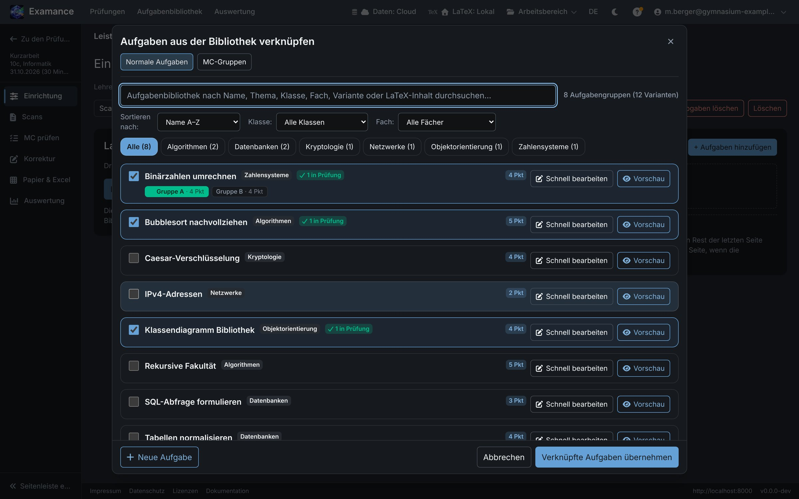
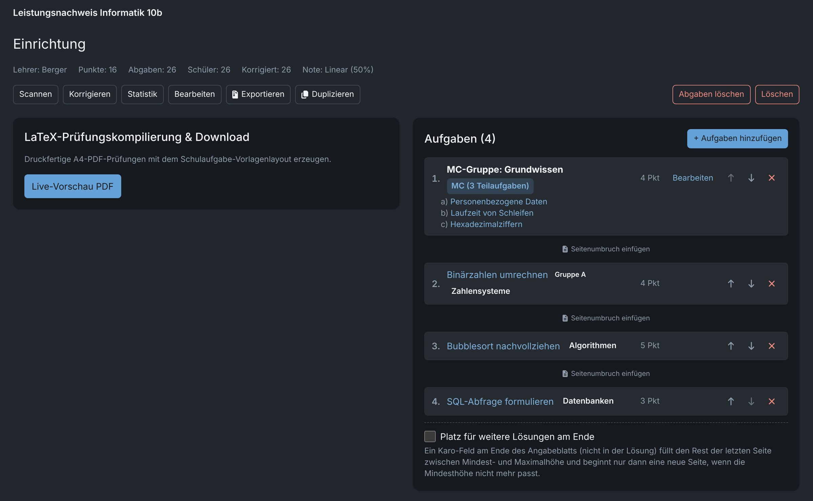
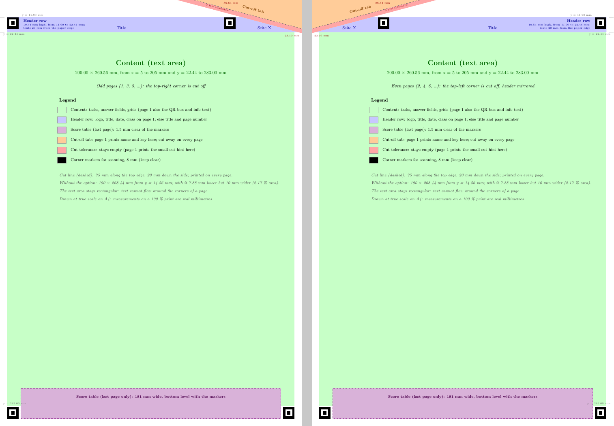
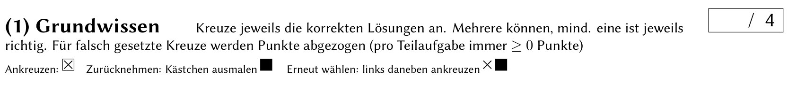
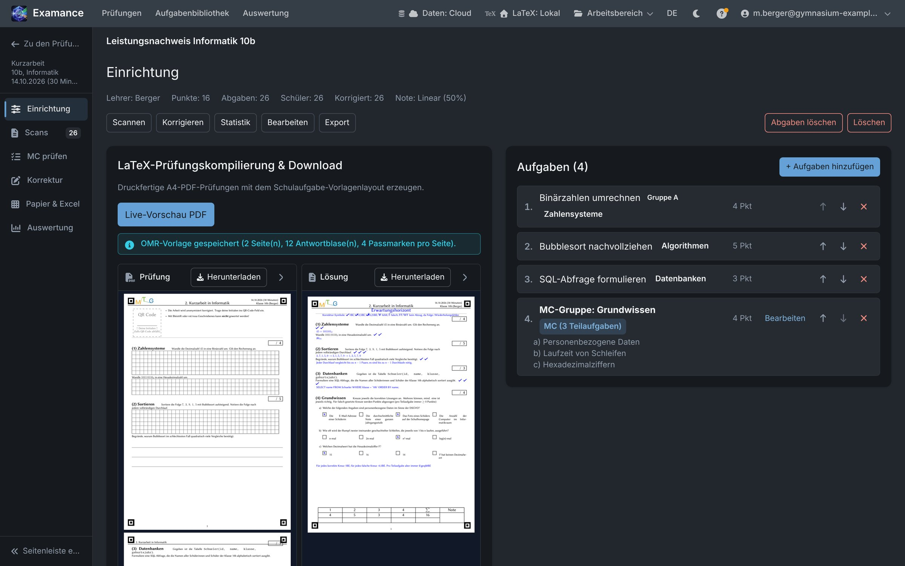
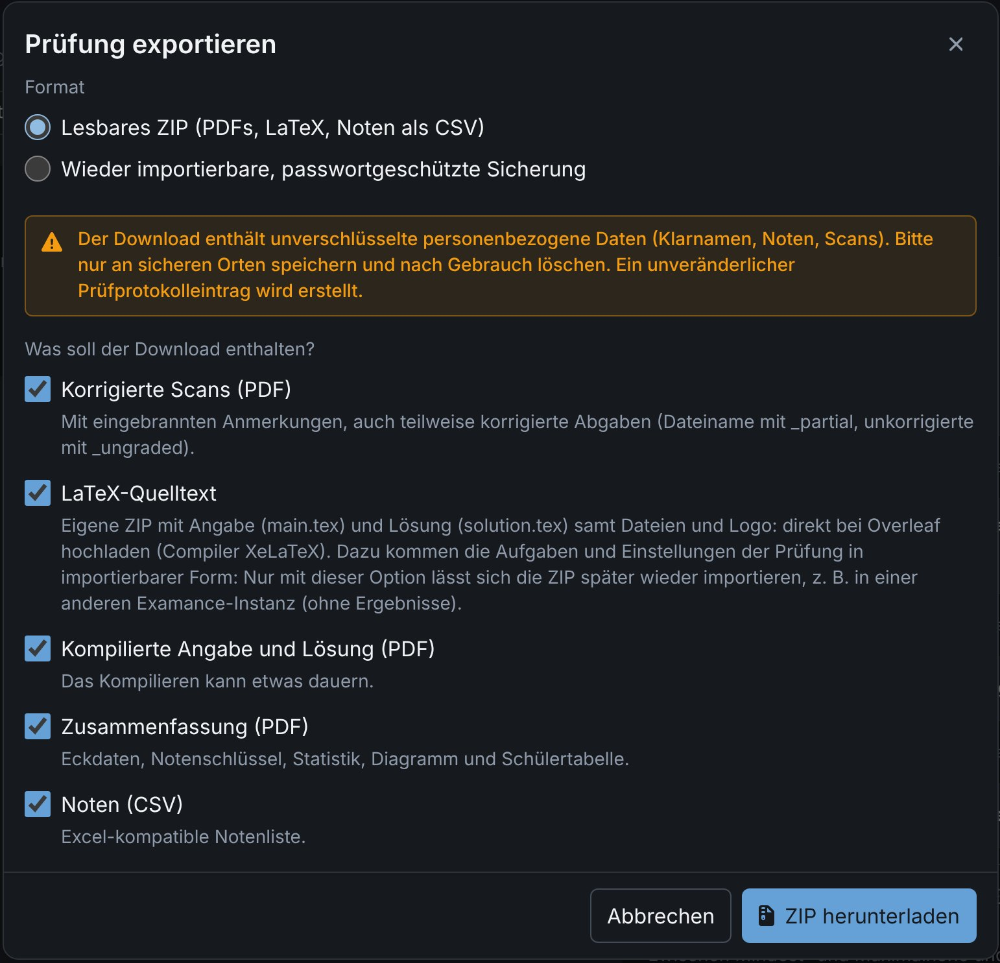

# Creating an exam

An exam is a selection of exercises from your library plus header data, a grading key and a few layout options. Examance typesets it as a print-ready PDF whose cover page has an empty **QR Code** box: each student sticks a QR name sticker into it (see [QR stickers](./students#qr-stickers)), so the scans can later be assigned automatically and anonymously.

## Create a new exam {#new-exam}

**New exam** (on the dashboard) asks only for the header data, creates the exam and opens it on the **Exam** step with the exercise library. Everything else (exercises, order, MC groups, layout, logo, packages, preview) is done there.

### Header data {#header}

**Subject**, **class**, **exam type**, **date** and **number** appear on the cover sheet. They are exam content and are therefore always printed in German, whatever language the interface is in.

The optional **topic** (for example "Recursion") organises your exams in the overview, where you can filter and search by it. It is never printed. The overview can also be sorted by date, title, grade or subject.

To change the header data later, edit them directly in the **Details** card on the **Overview** and choose **Save** (**Discard changes** goes back; leaving the page with unsaved changes asks first). The card holds only the exam's details: title, test type, grade/class, date, duration, number, subject, teacher, topic and the retention date. Layout settings are on the [Layout tab](#layout), the grading key under [Results](./results#grading-key).

## The exam's steps {#steps}

Each exam has a sidebar (on a phone: the menu) with numbered steps. Every step has a badge showing where you stand (hover it for what it counts): the number of exercises, students or scans, graded x/y, the printed **Print** jobs, open MC checks, shared results (in red, the number of result e-mails that did not arrive). The number before a step's name is only its place in the flow. On the exams list, every step of an exam is shown in its card and opens that step. Every step page ends with a **Next: …** button that leads to the following step.

| Step | What you do there |
|---|---|
| **Overview** | Details and key figures of the exam, see [below](#overview) |
| 1 **Exam** | Exercises, layout and preview, see [Assemble the exercises](#assemble) and [Layout options](#layout) |
| 2 **Students** | The class list, see [Student data](./students#student-data) |
| 3 **Print** | Create the PDFs and the QR codes, see [Print](#print) |
| 4 **Scans** | Import the scanned sheets, see [Scanning and assignment](./scanning) |
| 5 **Check MC** | Verify multiple choice detections, see [Verify MC detections](./scanning#mc-verification) |
| 6 **Grading** | Correct the submissions, see [Grading](./grading) |
| 7 **Enter paper grades** | Enter points for papers graded without scanning, see [Classes graded on paper](./grading#paper) |
| 8 **Results** | Tabs **Statistics**, **Send to students** and **Archive**, see [Results and analysis](./results) |

## Overview {#overview}

**Overview** (the first entry of the sidebar, unnumbered) shows the exam's details and key figures. **Continue: …** (followed by the step's name) opens the step you most likely need next. The **Details** card edits the header data in place, **Export** downloads the exam (see [Export](#export)), and the **⋯** menu (**More actions**) holds **Duplicate**, **Delete Submissions** and **Delete** (the exam).

## Assemble the exercises {#assemble}

On the **Exam** step, the **Exercises** tab lists the exam's exercises. **Add exercises** picks exercises from the library, with the variant you want for each. **New exercise** writes a new one right there; it is saved to your library and selected immediately.

- The arrows reorder the exercises.
- The total score is recalculated as you go.
- A long exercise simply continues on the next page; its heading always stays with its first lines.

### Page breaks between exercises {#page-breaks}

To start an exercise on a new page, use **Insert page break** between two exercises. The break belongs to the exercise below it and moves with it when you reorder. Page breaks *inside* an exercise are set in the exercise itself, see [Page breaks](./exercises#page-breaks).

If you change page breaks after you created the answer-sheet template for MC detection, create the template again.

### MC groups {#mc-groups}

Several tick-box exercises can be printed together as an **MC group**. Create and edit groups on the **Exercises** tab (**MC Groups**). An exam can hold any number of groups of any size; each question belongs to at most one group.

In the exercise dialog, tick the questions on the **MC Groups** tab and give the group a title. **Apply Exercises and MC Group** adds the group together with the other exercises. To build several groups in one go, click **Add MC group to exam** after each one.

Groups are layout only: grading and statistics stay strictly per question.

## Layout options {#layout}

Layout settings live on the **Layout** tab of the **Exam** step: info text, name line, cut-off corner hint, the multiple choice correction legend, logo and LaTeX packages. **Save** stores them, **Discard changes** returns to the saved state; leaving the page with unsaved changes asks first. Changes only show in the PDF after you compile again.

### Name line {#name-line}

With **Print a name line next to the QR code box** (when creating the exam or on the **Layout** tab), the title page gets a line for the student's name. The QR code box stays where it is, so scanning and assignment work as before; only the initials field inside the box is dropped.

### Cut-off corner {#cut-corner}

Every exam keeps each page's **outer top corner** free: top right on odd pages, top left on even ones. The header is mirrored on even pages. On the plain exam PDF the corner is empty and lightly tinted grey. When you print the QR codes [directly onto the exam copies](./students#printed-copies), page 1's corner carries name and personal key, and a dashed line with small scissors shows where to cut it off before handing out. For double-sided and booklet prints you can also cut the whole stack at once with a guillotine. All exams share this layout, so scanning always finds the corner markers in the same places, however the sheets were printed.

The text, and on page 1 the QR box and the information next to it, run out to the corner markers. Page 1's header shows the logo, then the title with course, date, duration and teacher in one line under it; the other pages show the title and "Seite X". The score table fills the strip between the bottom markers.

The sketch shows the usable space on odd and even pages: text area, header, score table, the cut-off tab with its tolerance, and the corner markers. The [PDF](../screenshots/guide/cut-corner-layout-en.pdf) is drawn at true scale on A4, so measurements on a 100 % print are real millimetres.

### Space for extra solutions {#extra-space}

**Space for extra solutions at the end** (below the exercise list) ends the student sheet with a grid area for additional solutions:

- a heading and a smaller note below it (prefilled with defaults, printed in German);
- a **minimum** and **maximum height** in cm. The area fills the rest of the last page; it starts a new page only when even the minimum height no longer fits.

The solution sheet does not include it.

### How to correct a cross {#mc-hint}

**Show how to correct a cross at every multiple-choice task** (when creating the exam, or on the **Layout** tab) prints one short line at the start of every multiple choice task, in the exam and in the solution:

- **cross** a box to choose an option;
- **fill** the box completely to withdraw a cross;
- **cross just left of** a filled box to choose it again.

MC detection reads exactly these marks, see [Verify MC detections](./scanning#mc-verification). Turning the option on or off rebuilds the answer-sheet template, so typeset and print the exam again afterwards.

### Logo and LaTeX packages {#logo-packages}

Every exam prints a logo at the top left of the first page. On the **Layout** tab you choose the logo from your settings, no logo, or a logo for this exam only (see [Logo on the exam](./settings#logo)). In the exam overview, every expanded exam shows which logo it prints.

On the same tab you can also add LaTeX packages for this exam only or leave out packages of your account (see [LaTeX packages](./exercises#packages)).

## Typeset {#typeset}

**Live Preview PDF** typesets the exam and the solution sheet. On wide screens the preview sits next to the exercises and the layout; on smaller screens it is a third tab, **Preview**, beside **Exercises** and **Layout**. The run produces a print-ready PDF. Its cover page has an empty **QR Code** box for the student's QR sticker, see [QR stickers](./students#qr-stickers). Examance never compiles on its own: after you change the exam, the last preview stays visible, marked as outdated, until you press **Live Preview PDF** again.

Depending on your settings and your account, the exam is typeset

- **in your browser**: nothing leaves your device, but the first run downloads the LaTeX environment and is slower;
- **on the server**: faster on weak hardware; the LaTeX source is sent to the server.

See [LaTeX compilation](./settings#latex). If something looks wrong, [report a layout problem](./exercises#layout-reports); if compiling fails, see [When compiling fails](./exercises#compile-errors).

### Preview from the overview {#preview}

In the exam overview, **Preview** in an expanded entry opens the last compiled PDF. If there is none, Examance asks, compiles the exam and shows it right in the window. The preview is kept only until the page is reloaded.

## Print {#print}

The **Print** step has the **print plan** on the left and the compiled exam on the right (on smaller screens below it), the same preview as on the **Exam** step: **Live Preview PDF** typesets the task sheet and solution and refreshes the scan template for MC detection.

In the print plan you choose how you print: **Plain copies and a QR sticker sheet**, or **Personalised copies with the QR code printed on** (one copy per student with QR code, name and personal key, see [QR stickers](./students#qr-stickers) and [printed copies](./students#printed-copies)), and whether the **solution** is printed too. **Ready to print?** checks automatically whether the exam has exercises, the student list is filled, the PDFs match the current state and, with MC questions, the scan template is up to date.

Below it are exactly the print jobs of your plan (exam copies and sticker sheet, or the personalised copies; plus the solution), each with its PDF and a **printed** tick. Only you set the ticks, and only once the job's PDF exists for the current state: for the task sheet and solution the current preview, for stickers and personalised copies a PDF made here. A tick goes away only when what it was set for changes: content or layout for the exam and solution, the student list for the stickers, both for personalised copies. The step's badge in the sidebar shows how many jobs are ticked.

Print the sheets **exactly as typeset**: no "fit to page", no scaling, no cropping. The QR sticker and the corner marks must stay readable, otherwise the scan cannot be assigned automatically and ticked boxes cannot be detected.

After the exam, continue with [Scanning and assignment](./scanning).

## Duplicate an exam {#duplicate}

**Duplicate** (in the exam list and in the **⋯** menu of the exam's **Overview**) creates a new exam with the same header, exercises, MC groups, grading key and settings, for example for a parallel class or the next school year. Students, scans and results are never copied; the copy starts without them.

## Export {#export}

**Export** on an exam (dashboard or the exam's **Overview**) downloads it either as a readable ZIP or as a password-protected backup, see [Exporting results](./results#export) and [Backup and transfer](./backup#exam-backup).

