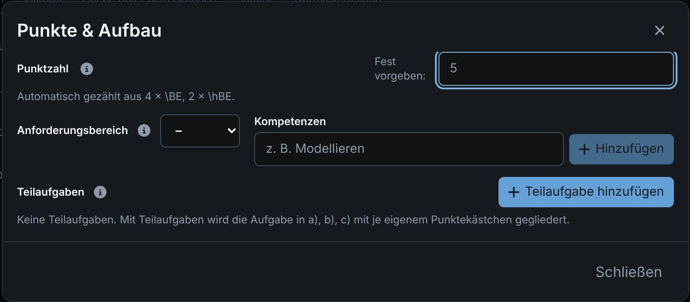
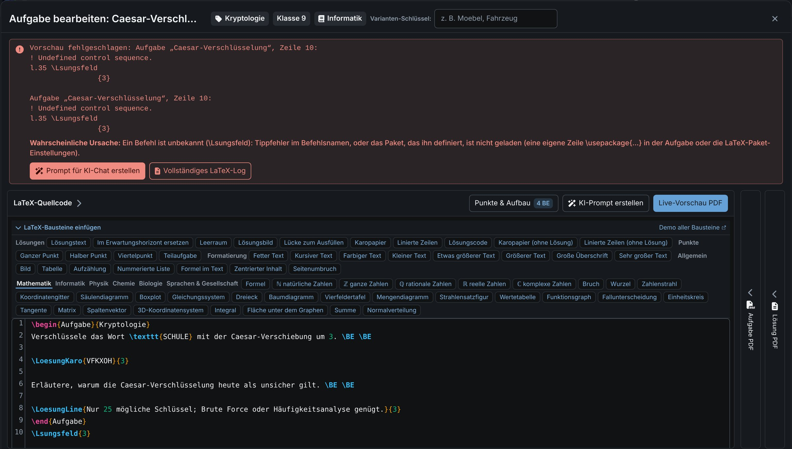
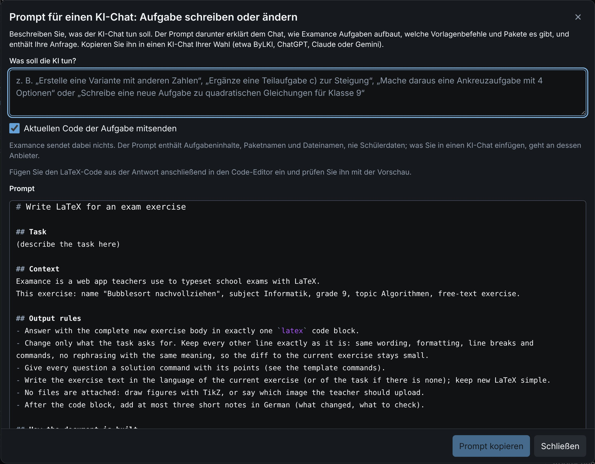

# Exercise library

Exercises live in your library, not inside an exam. You write each one once, tag it, and reuse it in as many exams as you like. Because every exam remembers which version of an exercise it used, you can keep improving an exercise without touching the analysis of past exams.

## Find and organise exercises {#library}

Every exercise is tagged with **grade**, **subject** and **topic**. The filters at the top narrow the library down:

- The numbers next to the topics count only what matches the other filters; topics without matches are hidden.
- **Sort by** orders the list by name, last change, points, grade or subject. Your browser remembers the choice.
- Expand an entry to see, per variant, which exams use the exercise. Click an exam for a short overview, from where you can open it in a new tab.
- **Preview** shows the last compiled PDF. If there is none yet, Examance asks whether to compile it now.

Exercise names are clickable almost everywhere in the app (on the exam page, while grading, in analytics) and open the exercise straight in the editor.

## The editor {#editor}

Each exercise is a LaTeX fragment with a live PDF preview next to the source. Name, topic, grade and subject sit in the header of the editor.

- **Ctrl + F** opens search, **Ctrl + H** search and replace (**⌘** on a Mac).
- **Live Preview PDF** compiles the exercise and shows the task sheet and the solution.

### Snippets and subject palettes {#snippets}

**Insert LaTeX snippets** above the source offers ready-made building blocks:

- **Generic**: solutions, scoring units, formatting, page breaks.
- **Subject tabs** for mathematics, computer science, physics, chemistry, biology and languages & humanities: for example tree diagrams, class diagrams, circuits, structural formulas or Punnett squares.

The exam template already loads the packages these snippets need (such as `chemfig`, `mhchem` and `circuitikz`), so you never have to add them yourself.

## Score {#score}

An exercise's score is counted from the **scoring units** in its source:

| Command | Counts |
|---|---|
| `\BE` | 1 point |
| `\hBE` | ½ point |
| `\qBE` | ¼ point |
| a correct option of a multiple choice question | 1 point |

Put a scoring unit where the solution earns the point: the solution sheet shows them as ticks, so whoever grades sees exactly where the points are.

The **Score & structure** button above the source shows the current score. It opens a dialog that explains how the score is made up and lets you **fix** it to a set value instead. Clear the field to go back to counting.

### Part exercises {#parts}

**Add part** splits an exercise into a), b), c). Each part gets its own subtitle and score box on the sheet. The parts add up to the exercise's score; a single part's score can be fixed as well (an empty field counts that part's scoring units). When grading, you can award the points per exercise or [part by part](./grading#parts).

### Requirement levels and competencies {#requirement-levels}

You can set a requirement level (AFB) and competencies for the whole exercise or for each part:

- **AFB I**: reproduction
- **AFB II**: reorganisation and transfer
- **AFB III**: reflection and problem solving

They are stored in the source (as `\AFB{…}` and `\Kompetenz{…}`), appear only on the solution sheet, and travel with the exercise into variants, copies and archives.

### Page breaks {#page-breaks}

Examance keeps related content together automatically:

- an exercise's title, introduction and pictures stay on one page with part a);
- a part is never split as long as it fits on one page;
- a picture stays with the text after it.

Pages break between parts. Where that doesn't suit you, `\Seitenumbruch` (in the **Generic** palette) forces a new page at that spot. Page breaks *between exercises* are set on the exam page, see [Creating an exam](./exams#page-breaks).

## Variants and versions {#variants}

- **Variants** are equivalent phrasings of the same exercise, for example for groups A and B. They share grading and statistics, so you can compare them later ([variant fairness](./results#variant-fairness)), but they make copying from the neighbour harder.
- **Versions** keep the revision history. Saving a reworked exercise creates a new version; exams that used the old version keep it, so their analysis stays valid.
- **Duplicate** creates a separate, unshared copy of the whole group: the current version of every variant, with its files. Use it to start a similar exercise without touching the original.

## Multiple choice {#multiple-choice}

An exercise can be **free text**, **single choice** or **multiple choice**. Tick-box exercises store their options, the correct answers and an optional **penalty** per wrongly ticked option (0 means no negative marking; an exercise never drops below zero points).

- Up to 26 options per question.
- **Answer option columns** sets how many columns (1–10) the options are printed in.
- **LaTeX code** opens the generated LaTeX for editing when the structured editor isn't enough. The options and the answer key are always read from that LaTeX.

Ticked boxes are detected automatically when you import the scans, see [MC verification](./scanning#mc-verification).

Several tick-box exercises can be combined into an **MC group** on the exam page. That is purely a layout choice for the printout, see [MC groups](./exams#mc-groups).

## Images and files {#files}

Attach the files your source references, for example figures for `\includegraphics`. PNG, JPEG and PDF work; **SVG is not supported**, convert it to PDF first.

A missing graphic does not abort the run: the PDF is still produced, and the missing file is reported. Check the preview before printing.

## LaTeX packages {#packages}

Packages come from three places, and Examance loads every package only once:

1. **The template** already loads a broad set, including TikZ libraries such as `arrows.meta`, `automata` and `positioning`. **Settings → LaTeX packages** lists them.
2. **Your account**: in the same settings section you add packages and TikZ libraries for every exam, and pass options to template packages (for example `dvipsnames` for `xcolor`).
3. **One exercise**: **Packages of this exercise** in the editor stores a `\usepackage` line at the top of the source, so the package travels with the exercise. You may also write such lines by hand.

Under **Edit Exam** you adjust the packages of a single exam, or leave out packages of your account for it.

Options are merged, so no option clashes occur. If two exercises set the same option differently, **Result** shows the conflict and which value applies.

Not supported:

- `inputenc` and `fontenc` (they only work with pdfLaTeX; Examance uses XeLaTeX),
- `paralist` (clashes with `enumitem`; `enumerate` is replaced by `enumitem` as well),
- options for `geometry`, `hyperref` and `eso-pic`, which the page layout and the answer-sheet recognition rely on.

You can upload your own packages as a `.sty` file attached to the exercise.

## When compiling fails {#compile-errors}

If the PDF cannot be produced, the error message names the **exercise** and its **line** in the exercise editor wherever possible. Below it:

- the **likely cause**, where Examance recognises it (an unknown command, a missing `$`, unbalanced braces, …);
- **Full LaTeX log**, to read, copy or download the whole log;
- **Create prompt for AI chat** (see below).

## Help from an AI chat {#ai-prompts}

Examance never sends anything to an AI service itself. It prepares a prompt that you copy into an AI chat of your choice:

- **After a compile error**, **Create prompt for AI chat** explains to the chat how Examance builds the document, which template commands exist and what the compiler reported. The code of the affected exercise is included only if you tick the box for it. Student data is never included.
- **While writing**, **Create AI prompt** in the header of the code editor opens a dialog. Describe what the AI should do (a variant with other numbers, an extra part, a new exercise on a topic, …). The prompt contains the template commands, the available packages, the names of the attached files and, while the box is ticked, the current exercise code. Paste the LaTeX from the answer back into the editor.

## Report a layout problem {#layout-reports}

If a PDF looks wrong or fails to compile although the code seems right, use **Report LaTeX layout problem** right below the PDF preview (in the exercise editor or on the exam page):

1. Briefly describe what is wrong and what it should look like.
2. With your consent, the LaTeX code, the PDFs and the files are sent **unencrypted** to the administrators of your installation.
3. A separate, optional tick decides whether the report may be published **without your name** as a public GitHub issue.

Once the problem is resolved, you get an e-mail, possibly with a note.

## Export and import (ZIP) {#export}

- **Export (ZIP)** on an exercise group downloads its current exercises as readable LaTeX: one folder per exercise with `exercise.tex` and its files, a document with all exercises of the group and a `manifest.json` with the metadata. Optionally add the bundled LaTeX files (`.sty`) and the compiled PDFs (task sheet and solution; compiling many exercises can take a few minutes).
- **Export library** downloads all your own exercise groups with their files and the bundled LaTeX files as one ZIP, without PDFs. You can upload the folder to Overleaf or compile it locally with XeLaTeX (see the included `README.txt`).

Both ZIPs can be read back with **Import** (workspace menu, dashboard or exercise library), also into another Examance installation. Exercises, variants and files are created; unchanged exercises that already exist are skipped, and the variants of a group stay together.

To back up exams and results as well, use a [workspace backup](./backup) instead.

## Sharing with colleagues {#sharing}

If your installation allows it, you can share exercises with all accounts of the installation, copy what others share, and propose improvements back. See [Sharing exercises](./sharing).
