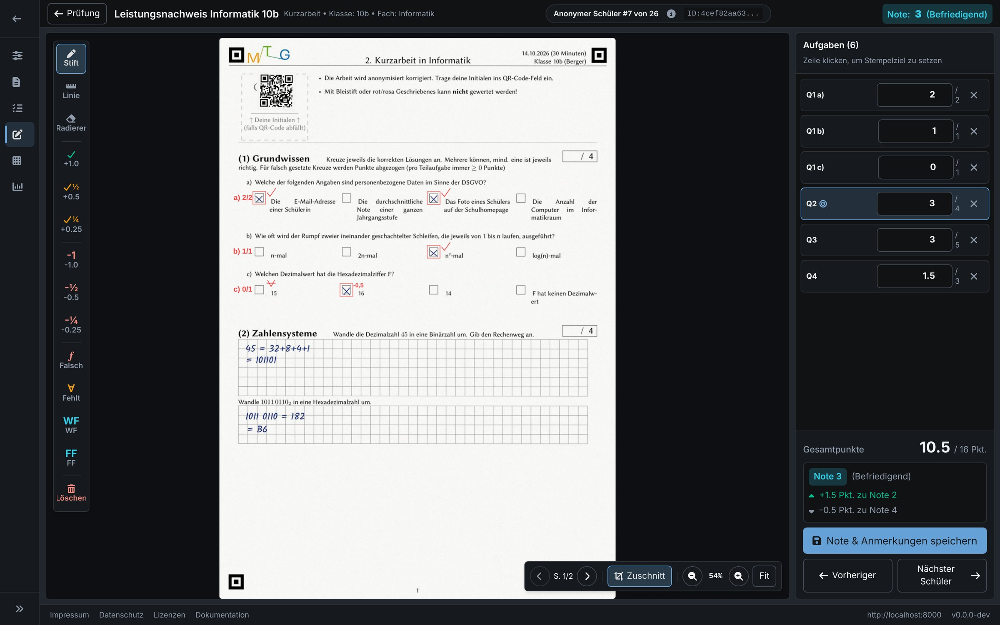
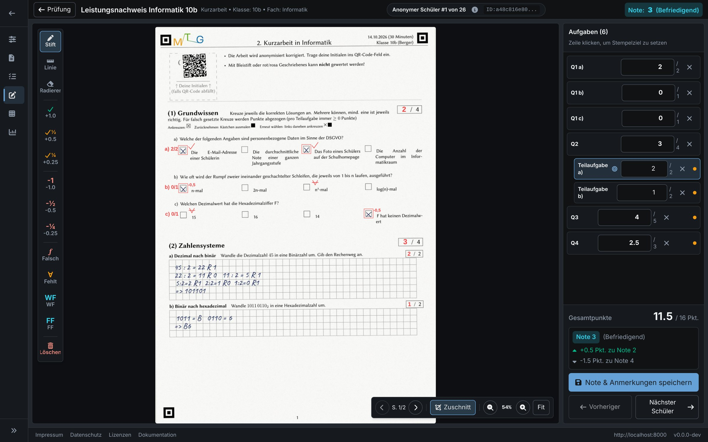
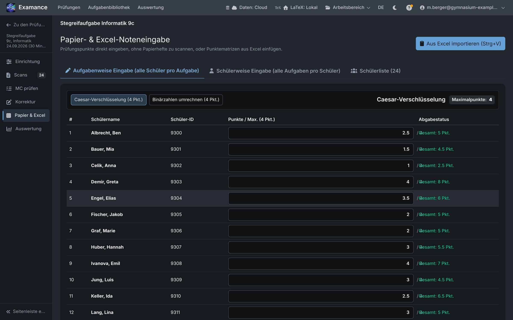

# Grading

Grading happens on the scan itself: you see the handwriting and the answers, mark them with a pen and stamps, and award points per exercise. Total and grade follow live from the grading key. Classes graded on paper are entered in a score grid instead.

## Grading blind {#blind}

During the grading pass you see **"Anonymous student #3 of 26"**, never a name. That is the core of the method: the assessment is made without knowing the person. Names come back only where you need them afterwards, for the grade list and the export.

## The grading view {#workspace}

- **Controls on the left:** from tablet width the toolbox, the **Scoring** card and the bottom bar float on the left of the scan, so a right hand writing on the scan covers none of them; the page sits beside them. Left-handed teachers move them to the right under [Settings → Grading view layout](settings.md#grading-layout). On phones the toolbox is a strip above the scan and the **Scoring** card a sheet below it.
- **Scoring card:** at the top the points so far, their percentage and the grade, marked *(prelim.)* until every exercise is scored. Below it the exercises ("1", "2 a)") and how many points the next better or worse grade is away. At the bottom, **Previous exercise** (˄) and **Next exercise** (˅) move the stamp target, part by part; so do **Alt + ↑/↓** and **Enter** in a score field. After the last exercise Examance asks whether to go on with the next submission (before the first: the previous one); the other submission starts at its first exercise. The arrow in the card's corner folds it up to the points and the current stamp target with its score field; the page then gets the room. This browser remembers the choice.
- **All pages of a submission are stacked.** Scroll through them with the mouse wheel or the scrollbar, or with your finger on a touch device.
- **Pen or finger:** a pen, and the mouse, always draw. On a device without a pen, one finger draws and two fingers scroll. As soon as you use a pen once, Examance remembers it on this device: from then on, fingers and a resting palm only scroll and zoom and never draw. While the pen touches the screen, and for half a second after, a resting palm also never selects text, presses a button or scrolls the scan. A short notice says so when the pen is first detected; to draw with a finger again, reset it under [Settings → Pen input](settings.md#pen-input).
- **Bottom bar:** **Undo** and **Redo**, the page in view (multi-page scans; scroll to move between pages), zoom out and in, and **Fit**, which fits the page to the view. **Ctrl + mouse wheel** or pinching zooms too.
- The arrows **Previous** and **Next student**, left and right of the anonymous student in the header, move through the submissions; an icon next to them shows whether everything is saved. The exercise labels in the **Scoring** panel are not links, so tapping one cannot open the exercise by accident.

The **Scoring** panel lists the exercises with their points. Click a row to make it the **stamp target**: stamps you place then count towards that exercise. The stamp target is the highlighted row with the thick bar on its left.

## Pen and stamps {#tools}

Correction marks are drawn on a separate layer above the scan. The original stays untouched and can be shown without annotations at any time.

The toolbox never scrolls: when the screen is too short for every button, the stamps fold into drawers (first **Plus**, **Minus** and **More**, then **Points** and **More**, at last one **Stamps** drawer). A drawer shows the stamp you picked from it; tap it to see the others.

| Tool | Does |
|---|---|
| **Pen**, **Line**, **Eraser** | Freehand marks in red, straight lines, erase |
| **+1.0**, **+0.5**, **+0.25** | Correct, half or quarter correct: adds the points to the stamp target |
| **−1.0**, **−0.5**, **−0.25** | Deductions |
| **Wrong**, **Missing** | Marks without points |
| **WF**, **FF** | Repeated error, follow-on error |
| **Undo**, **Redo** (bottom bar) | Step back and forward through your annotation changes (each stroke, stamp, eraser sweep, scribble or Clear is one step), also with Ctrl+Z and Ctrl+Shift+Z (Cmd on a Mac); the computed points follow. The history starts afresh for each student. |
| **Clear** | Removes every drawing and stamp of the submission at once and resets the computed points; a notice offers **Undo** |

**Erase by scribbling:** with the **Pen** tool (pen, mouse or finger), scribble quickly back and forth over pen marks, lines or stamps (at least five passes) to erase them without switching to the **Eraser**; stamps take their points with them. Only marks along the scribble's path go, a long mark it only crosses stays, and the scribble itself is never kept. The marks glow amber for half a second before they vanish, so a slip is easy to see, and a notice tells how many went and offers **Undo**. Switch it off under [Settings → Pen input](settings.md#pen-input).

You can also type an exercise's points directly. **Reset to ungraded** clears a row again.

## Points, total and grade {#scores}

Points are awarded **per exercise**. The total and the grade are recalculated continuously from the exam's [grading key](./results#grading-key). Next to the grade, Examance shows how many points are missing for the next better grade, and the buffer before the next worse one.

A submission counts as **partly graded** until every exercise has points. Partly graded submissions already appear in the statistics with a provisional value, see [partially graded submissions](./results#partial).

## Grading part by part {#parts}

For an exercise with [parts](./exercises#parts), the scoring panel shows one row per part (**Part a)**, **Part b)**, …) below the exercise. Click a part's row to make it the stamp target (the exercise's row picks its first part), so stamps count towards that part, or type its points.

- The exercise's own field cannot be typed into; it reads **Follows from the parts once all of them are graded**: the exercise counts as graded only when every part has points.
- Points outside the parts (for example a scoring unit in the introduction) are collected in the row **Outside the parts**, "Rest" in the stepper. If it gets more points than the exercise has outside its parts, the row warns you: probably a stamp landed without a part.

## Score boxes fill in by themselves {#score-boxes}

The exam prints a score box next to each exercise and each part, and a table at the end with every exercise, the total (Σ) and the grade. While you grade, Examance writes the points into these boxes on the scan, and into the graded PDF you export or hand back. An exercise's box is filled once it is graded; the total and the grade follow when the submission is complete. You never fill in the table by hand. If the exam was changed after its answer-sheet template was created, the boxes stay empty, because the printed sheet no longer matches.

## Multiple choice while grading {#multiple-choice}

For single and multiple choice questions the detected ticks are applied automatically, including the exercise's penalty for wrong ticks. You can review and correct them before saving.

The thorough way to check detections is the **Check MC** step, which lists unsure detections first, see [MC verification](./scanning#mc-verification). If a page could not be aligned, the grading view says so: grade that exercise by hand.

## Classes graded on paper {#paper}

Not every exam needs scans. On the **Paper grading** step you enter points directly:

- **Exercise-first entry**: all students for one exercise, then the next exercise.
- **Student-first entry**: all exercises of one student, then the next student.
- **Students**: the exam's students come from the [Students page](./students#student-data); add missing ones there.
- **Import from Excel (Ctrl+V)**: select the cells in Excel or Google Sheets, copy them and paste them here. Examance shows a preview and then fills the grid. Pasted rows that match no student on the Students page are skipped, with a hint.

Every score saves as soon as you leave its field or press Enter; next to it you see **Saving…**, **Saved** or why saving failed. **Previous** and **Next student** save before they switch.

These results take part in statistics, analytics and export like scanned ones.

## Saving {#saving}

Points and marks save themselves, encrypted, a few seconds after your last change. The icon next to **Next student** in the header shows whether it is saving or saved; if saving fails, the reason appears there. Switching to another student or leaving the page saves first. Only if that save fails does Examance ask whether to discard the changes.

If the connection drops, changes that could not be sent are queued in the browser and sent automatically later.
