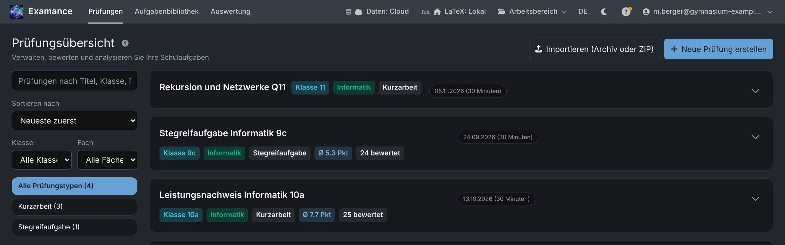
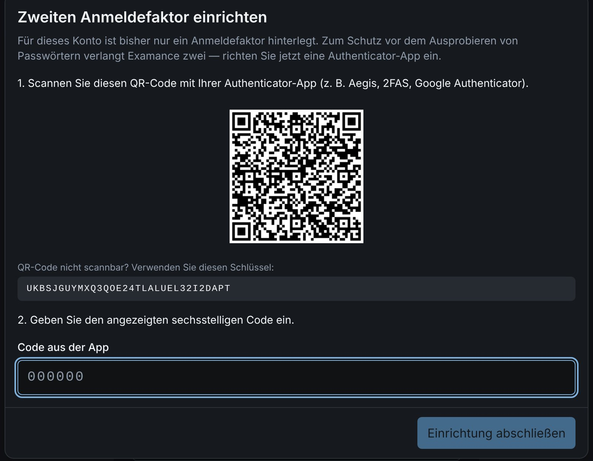
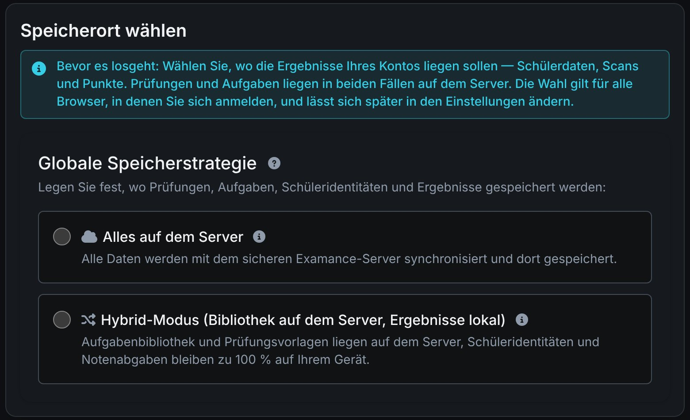

# Getting started

Examance covers an exam end to end: collect exercises, typeset the exam, import the scanned sheets, grade them anonymously and analyse the results. Everything sensitive (student names, scans, annotations, scores) is encrypted in your browser before it is stored. The key is derived from your password and never leaves your device, so not even whoever runs the server can read it.

This guide is an overview. Inside the app, the **?** buttons and the help page explain every screen in detail.

## 1. Get an account

Every user signs in with an account on an Examance server. There are three ways to get one:

- **Invitation**: an administrator of your installation invites your e-mail address; you follow the link and choose a password.
- **Request an account** on the sign-in page: enter your e-mail address, follow the confirmation link and choose a password. If your school's domain is on the installation's allowed list, the account is active right away; otherwise an administrator approves it first.
- **Set up by the operator** when the server is installed.

On your first sign-in you set up a second sign-in factor: a passkey (offered first) or an authenticator app. Examance also shows a **recovery code** exactly once. Keep it outside the browser, on paper or in a password manager: without your password or this code, your encrypted data cannot be recovered, not even by an administrator.

## 2. Choose where results are stored

On your first sign-in you choose a storage location for your account. There is no default; the choice applies in every browser you use.

| Mode | Exercises and exams | Results (students, scans, scores) |
|---|---|---|
| **All on the server** | on the server | on the server, encrypted; available in every browser of your account |
| **Hybrid** | on the server | only in the browser where you recorded them, encrypted in its local database |

In hybrid mode, back up your results regularly with a `.examance` archive (workspace menu → "Back up or share workspace"), because they exist only in that one browser. You can switch modes later in Settings; Examance moves the results exam by exam and checks that everything arrived before switching. Whether "All on the server" is offered depends on your installation.

## 3. Try it with example data

In the still empty exam overview, **Add example data** creates example exercises, two example exams and graded sheets of invented students, some of them scanned. They are stored and encrypted like your own data and can be deleted like any other exam.

## Next steps

- [From exercise to analysis](./workflow): the usual workflow, step by step.
- [Info material](./material): slide decks and posters with a screenshot tour and a detailed explanation of privacy and security, in German.
- [Data flow and security](../data_flow_and_security): how the encryption works, for the technically curious.
