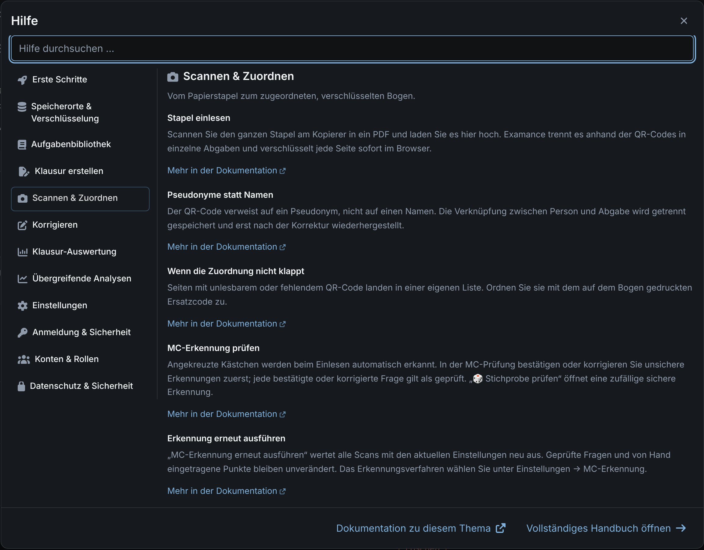

# Getting started

Examance covers an exam end to end: collect exercises, typeset the exam, import the scanned sheets, grade them anonymously and analyse the results. Everything sensitive (student names, scans, annotations, scores) is encrypted in your browser before it is stored. The key is derived from your password and never leaves your device, so not even whoever runs the server can read it.

This user guide explains every screen in detail. Inside the app, the **?** buttons (or **F1**) open a short help for the current page, with links to the matching section here.

## 1. Get an account {#account}

Every user signs in with an account on an Examance server. There are three ways to get one:

- **Invitation**: an administrator of your installation invites your e-mail address; you follow the link and choose a password.
- **Request an account** on the sign-in page: enter your e-mail address, follow the confirmation link and choose a password; only then is the account created. If your school's domain is on the installation's allowed list, the account is active right away. Otherwise an administrator approves it first: until then, signing in only reports "awaiting approval", and you get an e-mail once it is approved.
- **Set up by the operator** when the server is installed.

The request page deliberately does not reveal whether an address already has an account. If the e-mail does not arrive, look in your spam folder.

Your administrator also decides what your account may use (results on the server, LaTeX on the server, sharing exercises). Options you may not use show as "not enabled".

## 2. Set up a second factor {#second-factor}

On your first sign-in you set up a second sign-in factor: a **passkey** (offered first) or an **authenticator app**. Set up both, and a password, where you can: then losing one is merely inconvenient. Details: [Sign-in and security](./security#factors).

### Keep the recovery code {#recovery-code}

Examance shows a **recovery code** exactly once. Keep it outside the browser, on paper or in a password manager: without your password or this code, your encrypted data cannot be recovered, not even by an administrator. See [Forgot your password](./security#reset-password).

## 3. Choose where results are stored {#storage}

On your first sign-in you choose a storage location for your account. There is no default; the choice applies in every browser you use.

| Mode | Exercises and exams | Results (students, scans, scores) |
|---|---|---|
| **All on the server** | on the server | on the server, encrypted; available in every browser of your account |
| **Hybrid** | on the server | only in the browser where you recorded them, encrypted in its local database |

In hybrid mode, back up your results regularly with a [`.examance` archive](./backup), because they exist only in that one browser. You can switch modes later in [Settings](./settings#switching); Examance moves the results exam by exam and checks that everything arrived before switching. Whether "All on the server" is offered depends on your installation.

## 4. Try it with example data {#example-data}

In the still empty exam overview, **Add example data** creates example exercises, two example exams and graded sheets of invented students, some of them scanned. They are not shared, are stored and encrypted like your own data, and can be deleted like any other exam and exercise.

## Finding your way {#navigation}

- The **navigation bar** leads to the exams (dashboard), the exercise library, analytics, settings and the help panel. Language and colour scheme can be switched there too.
- Each exam has its own steps: **Setup & Exercises**, **Scans**, **Check MC**, **Grading**, **Paper & Excel**, **Statistics**.
- **Many names are clickable.** Exercises open straight in the editor everywhere (on the exam page, while grading, in analytics); exams in the library open as an overview with **Open in new tab**. Names marked with **↗**, such as students, open in a new tab, so unsaved work in the current tab stays where it is.
- The **workspace menu** holds import, backup and export of your whole workspace.

## Help and documentation {#help-and-docs}

- **?** next to a heading, or **F1**, opens the help for that screen. It gives a quick direction; **More in the documentation** leads to the matching section of this guide.
- **Open the full manual** at the bottom of the help panel shows all help topics on one page. It is also linked from the sign-in page.
- **Documentation** in the footer opens this guide.
- [Info material](./material): slide decks and posters with a screenshot tour and an explanation of privacy and security, in German.

## Next steps {#next-steps}

- [From exercise to analysis](./workflow): the usual workflow, step by step.
- [Exercise library](./exercises) and [Creating an exam](./exams) to prepare your first exam.
- [Data flow and security](../data_flow_and_security): how the encryption works, for the technically curious.
