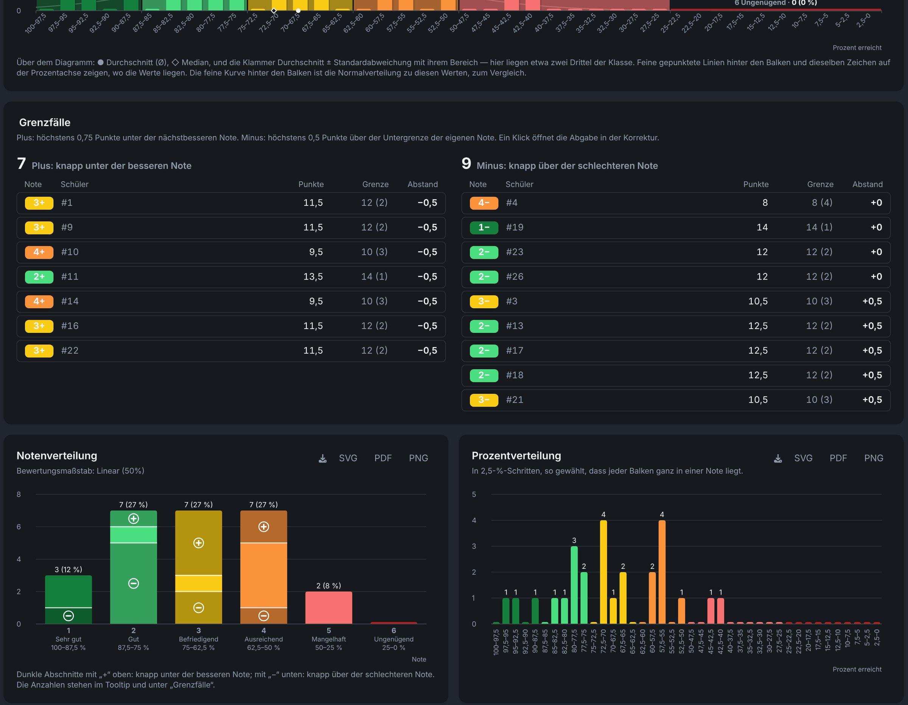

# Results and analysis

Each exam has a **Statistics** step with the grade distribution, key figures and borderline cases. **Analytics** in the navigation bar combines several exams. Both read the same encrypted results; nothing is computed on the server.

## Exam statistics {#distribution}

Three charts show how the class did. All of them read from the **best result on the left** to the worst on the right, and colour their bars by grade (1 dark green to 6 dark red).

1. **Grade distribution**: always the full scale 1 to 6, even where a grade does not occur. A grade nobody reached is information too. Borderline cases are set off in a darker shade: **"+"** at the top of a bar (just below the better grade), **"−"** at its foot (just above the worse grade).
2. **Percentage distribution**: every percentage range in equal steps of at most 5 %. The step follows the grading key, so every grade boundary falls on a bar boundary and no bar mixes two grades (for example 2.5 % steps for the standard key with boundaries such as 62.5 %). Ranges name the upper bound first (100–85 %), matching the axis.
3. **Combined chart**: the percentage bars in front of the grade bars, each grade bar captioned with grade, label, count and share. A strip above it marks the **average (●)** and the **median (◇)** and shows average ± standard deviation as a bracket; a faint curve behind the bars shows the normal distribution with these values for comparison.

Fixed labels (grades, grade names, ranges) are grey; values that change while you are still grading (counts, shares) are white. Where bars are too narrow to label, a label stays at every grade boundary and the tooltip shows the rest.

### Key figures {#figures}

The tiles above the charts show the class **average grade**, the **pass rate**, the **average score** and the **mean**, **median** and **standard deviation** of the percentages. The **ⓘ** on each tile explains the figure. Average grade, average points, average percentage and median are tinted in the colour of the grade they correspond to.

### Borderline cases {#borderline}

The **Borderline** tile counts the close calls, and a table below the combined chart lists every submission close to a grade boundary:

- **+** means at most **0.75 points** short of the next better grade;
- **−** means at most **0.5 points** above the lower boundary of its own grade (exactly on the boundary counts as −).

Each row gives the points achieved, the boundary in points and the distance to it. Clicking a row opens the submission in grading, still anonymous, under the same number. Useful for a second look before you hand back the exams.

### Partially graded submissions {#partial}

Submissions where not every exercise is graded yet are included with a **provisional percentage**, computed over the exercises graded so far. Those portions are drawn in a lighter tone, so a half-corrected class does not read as a finished result. In the borderline table, the points of the exercises graded so far count.

### Download charts {#charts-download}

The **SVG**, **PDF** and **PNG** buttons download each chart with a transparent background and dark text, ready for a light page or a slide. SVG and PDF are vector graphics; PNG is rendered at 8K (7680 × 4320).

## Export results {#export}

The **CSV export** of the grades, for example for the school's grade management, contains pseudonym, fallback code, name, score, maximum points, percentage and grade.

**Export** on an exam (dashboard or exam page) with the format **Readable ZIP** bundles one exam into a single ZIP. Pick the parts you need:

| Part | Contains |
|---|---|
| **Graded scans (PDF)** | each submission with the corrections drawn in and the [score boxes filled in](./grading#score-boxes); partly graded ones too (file name with `_partial`, ungraded with `_ungraded`) |
| **LaTeX source** | a separate ZIP with exam and solution, their files and logo, ready for Overleaf (compiler XeLaTeX); only with this part can the ZIP be imported again later (without results) |
| **Compiled exam and solution (PDF)** | the task and solution sheets (compiling may take a while) |
| **Summary (PDF)** | metadata, grading key in points and percent, average, the combined chart and the student list with points and grades, partly graded ones highlighted |
| **Grades (CSV)** | Excel-compatible grade list |

::: warning Real names, unencrypted
CSV and ZIP contain **real names** and are **not encrypted**. Store them only in safe places and delete them after use. Every ZIP export is logged.
:::

For an encrypted copy that can be imported again, choose **Re-importable, password-protected backup** instead, see [Backup and transfer](./backup#exam-backup).

## Analytics across exams {#analytics}

**Analytics** combines several exams and shows how results develop over time, across grades and across subjects.

The **overall score histogram** sorts all fully graded submissions into 5 % ranges by the share of their exam's maximum points. Like an exam's statistics it shows grade bands, mean, median, standard deviation and a normal curve. Because the exams may use different grading keys, colours and bands follow one reference key (linear, pass mark 40 %).

### Topics and knowledge gaps {#topics}

The **topic heatmap** shows where points are lost repeatedly, independently of any single exam: a hint for what to repeat in class.

### Variant fairness {#variant-fairness}

For exercises with [variants](./exercises#variants), analytics compares whether one phrasing was systematically harder than the other. That is the basis for reworking an unfair variant.

