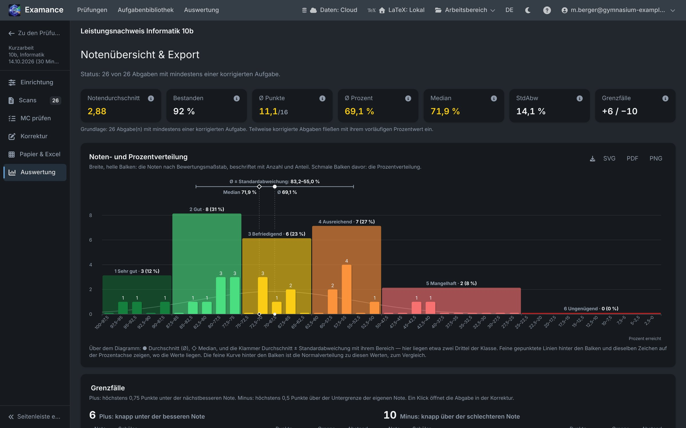
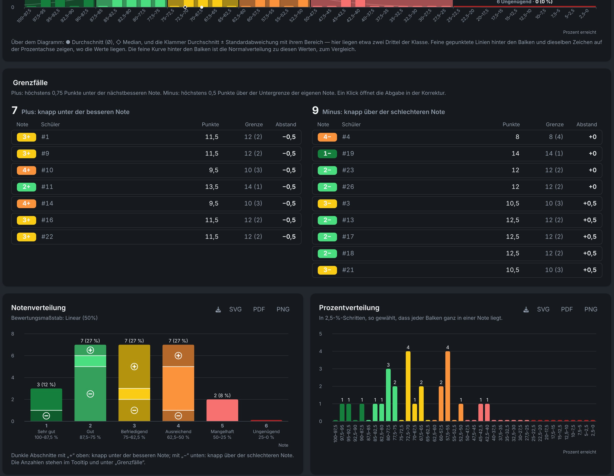
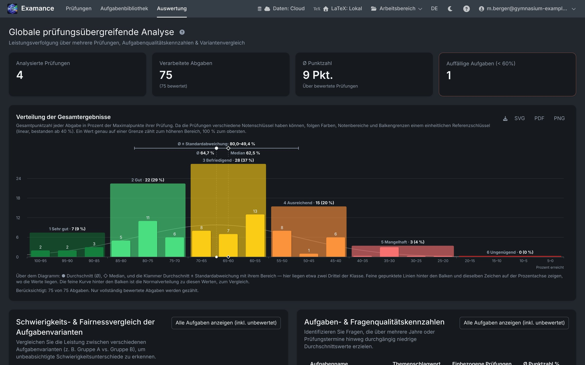
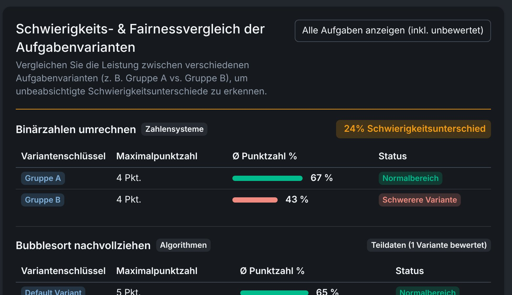

# Results and analysis

Each exam has a **Results & Export** step (the last one in the sidebar) with three tabs: **Statistics** shows the grade distribution, key figures and borderline cases, **Send to students** hands the graded exams to the students, see [Share results](#share), and **Archive** exports the overview sheet, graded exams and more for your records, see [Archive an exam](#archive). **Analytics** in the navigation bar combines several exams. Both read the same encrypted results; nothing is computed on the server.

## Grading key {#grading-key}

The grading key decides which percentage earns which grade (1 to 6). You edit it on **Results & Export → Statistics**, above the distribution; changes show in the charts immediately and are stored with **Save**, which appears once you change something. Choose a preset or set your own thresholds:

| Preset | Grade 4 from |
|---|---|
| **Standard** | 50 % |
| **Upper secondary** | 40 % |
| **Even split** | evenly spaced thresholds |
| **Custom** | your own minimum percentage per grade |

While grading, the current grade and the points to the next grade are shown live. The statistics use the same key.

## Exam statistics {#distribution}

Three charts show how the class did. All of them read from the **best result on the left** to the worst on the right, and colour their bars by grade (1 dark green to 6 dark red).

1. **Grade distribution**: always the full scale 1 to 6, even where a grade does not occur. A grade nobody reached is information too. Borderline cases are set off in a darker shade: **"+"** at the top of a bar (just below the better grade), **"−"** at its foot (just above the worse grade).
2. **Percentage distribution**: every percentage range in equal steps of at most 5 %. The step follows the grading key, so every grade boundary falls on a bar boundary and no bar mixes two grades (for example 2.5 % steps for the standard key with boundaries such as 62.5 %). Ranges name the upper bound first (100–85 %), matching the axis.
3. **Combined chart**: the percentage bars in front of the grade bars, each grade bar captioned with grade, label, count and share. A strip above it marks the **average (●)** and the **median (◇)** and shows average ± standard deviation as a bracket; a faint curve behind the bars shows the normal distribution with these values for comparison.

Fixed labels (grades, grade names, ranges) are grey; values that change while you are still grading (counts, shares) are white. Where bars are too narrow to label, a label stays at every grade boundary and the tooltip shows the rest.

### Key figures {#figures}

The tiles above the charts show the class **average grade**, the **pass rate**, the **average score** and the **mean**, **median** and **standard deviation** of the percentages. The **ⓘ** on each tile explains the figure. Average grade, average points, average percentage and median are tinted in the colour of the grade they correspond to.

### Borderline cases {#borderline}

The **Borderline** tile counts the close calls, and a table below the combined chart lists every submission close to a grade boundary:

- **+** means at most **0.75 points** short of the next better grade;
- **−** means at most **0.5 points** above the lower boundary of its own grade (exactly on the boundary counts as −).

Each row gives the points achieved, the boundary in points and the distance to it. Clicking a row opens the submission in grading, still anonymous, under the same number. Useful for a second look before you hand back the exams.

### Partially graded submissions {#partial}

Submissions where not every exercise is graded yet are included with a **provisional percentage**, computed over the exercises graded so far. Those portions are drawn in a lighter tone, so a half-corrected class does not read as a finished result. In the borderline table, the points of the exercises graded so far count.

### Download charts {#charts-download}

The **SVG**, **PDF** and **PNG** buttons download each chart with a transparent background and dark text, ready for a light page or a slide. SVG and PDF are vector graphics; PNG is rendered at 8K (7680 × 4320).

## Export results {#export}

The **CSV export** of the grades, for example for the school's grade management, contains pseudonym, fallback code, name, score, maximum points, percentage and grade.

**Back up / transfer** on an exam (the menu of its card on the dashboard, or the exam's **Overview**) with the format **Readable ZIP** bundles one exam into a single ZIP. Pick the parts you need:

| Part | Contains |
|---|---|
| **Graded scans (PDF)** | each submission with the corrections drawn in and the [score boxes filled in](./grading#score-boxes); partly graded ones too (file name with `_partial`, ungraded with `_ungraded`); the student's name is printed in red at the top of every page |
| **LaTeX source** | a separate ZIP with exam and solution, their files and logo, ready for Overleaf (compiler XeLaTeX); only with this part can the ZIP be imported again later (without results) |
| **Compiled exam and solution (PDF)** | the task and solution sheets (compiling may take a while) |
| **Summary (PDF)** | metadata, grading key in points and percent, average, the combined chart and the student list with points and grades, partly graded ones highlighted |
| **Grades (CSV)** | Excel-compatible grade list |

::: warning Real names, unencrypted
CSV and ZIP contain **real names** and are **not encrypted**. Store them only in safe places and delete them after use. Every ZIP export is logged.
:::

The ZIP has no Mebis option: feedback files for Mebis come only from [Share results](#share).

For an encrypted copy that can be imported again, choose **Re-importable, password-protected backup** instead, see [Backup and transfer](./backup#exam-backup).

## Share results {#share}

The **Send to students** tab of **Results & Export** gives each student their graded exam. It is a page with four numbered steps: 1 the students, 2 the channel (slips to hand out, e-mail, Artemis or Mebis files) with its setup and the language of the message, 3 protection and options (link protection, key or code in the message, sample solution, validity), 4 preview and send; the send button stays visible at the bottom. Below, the active links are listed and can be revoked, with **Revoke all** for all of them. Details: [Share graded exams with students](./students#share-results).

## Archive an exam {#archive}

The **Archive** tab of **Results & Export** collects what you may want to keep for your records. The **results overview sheet** (exam details, grading key, statistics and every student's result) is shown as a preview and can be downloaded as a PDF on its own. Every card has the same icons in its header (hover them for their name): the download arrow, greyed out until the file exists, and the looped arrows to create or refresh it. Next to it, **All graded papers (print PDF)** puts every graded scan with its annotations into one file sorted by name, ready to print for your files; with **Start every paper on a new sheet** each paper begins on a front page when printing two-sided. It is created when you click **Create PDF**, because it reads every scan. Last, tick what should go into a ZIP: graded exams (one file each and/or all in one print PDF), LaTeX code, compiled PDFs, the overview sheet and the grades as CSV. The ZIP contains personal data of your students, so store it as carefully as the exam itself.

## Analytics across exams {#analytics}

**Analytics** combines several exams and shows how results develop over time, across grades and across subjects.

The **overall score histogram** sorts all fully graded submissions into 5 % ranges by the share of their exam's maximum points. Like an exam's statistics it shows grade bands, mean, median, standard deviation and a normal curve. Because the exams may use different grading keys, colours and bands follow one reference key (linear, pass mark 40 %).

### Topics and knowledge gaps {#topics}

The **topic heatmap** shows where points are lost repeatedly, independently of any single exam: a hint for what to repeat in class.

### Variant fairness {#variant-fairness}

For exercises with [variants](./exercises#variants), analytics compares whether one phrasing was systematically harder than the other. That is the basis for reworking an unfair variant.

