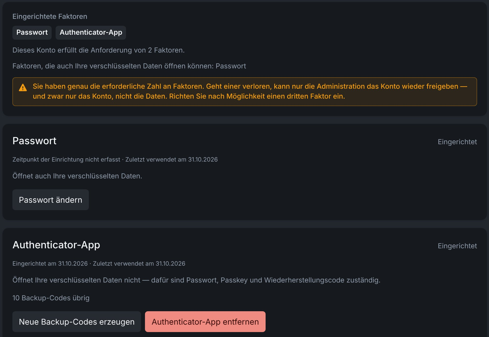

# Sign-in and security

Examance protects two things separately: **access to your account** (sign-in factors) and **access to your data** (the encryption key, which only you hold). This page explains both, and what to do when a password, phone or device is lost.

## Sign-in factors {#factors}

You sign in with a **passkey on its own**, or with **two of three factors**:

| Factor | Alone enough? | Can open your encrypted data? |
|---|---|---|
| **Password** | no | yes |
| **Authenticator app** (six-digit codes) | no | no: its secret lives on the server, and six digits carry no entropy to derive a key from |
| **Passkey** (fingerprint, face or device PIN) | yes | depends on the device, see below |

A guessed password alone gets nowhere. On your first sign-in you set up the second factor: a passkey (offered first) or an authenticator app.

**Enrol all three where you can.** Then losing one is merely inconvenient. With exactly two, losing one means only an administrator can get you back in, and only to the account, not to the encrypted data.

### Settings → Sign-in & security {#security-page}

The **Sign-in & security** section of the settings shows for every factor whether it is set up, when it was last used and whether it can also open your encrypted data. Here you add and remove factors, change your password and replace your codes.

## Passkeys {#passkeys}

A passkey signs you in with a fingerprint, your face or a device PIN, without a password. Because the device itself checks you, it is enough on its own. After a password sign-in, the passkey prompt opens automatically as the second factor; cancel it to use the authenticator app instead.

Whether a passkey can also **open your encrypted data** depends on the device and the passkey provider. The **Sign-in & security** section shows this per passkey; **Enable data access** sets it up there, without the password. Passkeys stored in Bitwarden currently cannot. Where a passkey cannot, your password and recovery code are responsible for data access.

## Change your password {#change-password}

You can change your password under **Settings → Sign-in & security** directly, without "forgot password". Your data key is re-wrapped in the browser and stored with the new password: nothing is re-encrypted, and you stay signed in. Other devices are signed out; your passkeys and your recovery code stay valid.

## Backup codes and the recovery code {#codes}

Two different kinds of codes:

- **Backup codes** stand in for the **authenticator app** when your phone is not at hand. Each works exactly once. Generate new ones while you are still signed in.
- The **recovery code** opens your **encrypted data** if you forget your password. It is shown exactly once: when your key is first stored, and again after every reset. You can replace it under **Sign-in & security**; the previous one stops working.

Keep both **outside the browser**: on paper, or in a password manager.

## Remove a factor {#remove-factor}

A factor can only be removed while **two remain** afterwards and **at least one of them can open your data**. If a removal is refused, the message says which of the two rules it hit.

## Forgot your password {#reset-password}

**Forgot password** on the sign-in page resets it:

1. confirm with a second factor (passkey or authenticator app);
2. choose a new password;
3. enter your **recovery code** once, so your existing encrypted data becomes readable again.

Nothing is re-encrypted.

### Key copy changed on another device {#key-copy}

Your encrypted key copy on the server changes whenever you change or reset your password, create a new recovery code, or add or remove a passkey. Every other browser you use notices this at the next sign-in and asks whether you made the change yourself:

- **If you did**, choose **I changed this myself — accept the new key**. That browser remembers the new key copy and does not ask again.
- **If you did not change anything**, cancel and do not sign in. Tell your administrator: the server may have been tampered with, and accepting would let a forged key copy in.

### Without password and recovery code {#recovery-code}

There is no back door. Without your password and without the recovery code, exams, student data and grading that are already encrypted stay **permanently unreadable**. Your administrator cannot restore them either, because the server never knows the key. Anything you create afterwards is unaffected.

In hybrid mode this includes the results that live only in your browser, so back them up regularly as a [`.examance` archive](./backup).

## Too many failed attempts {#lockout}

After several wrong passwords the account is locked briefly. The wait grows with each further failure and ends by itself. If you see this without having caused it, somebody else is trying to sign in to your account: tell your administrator.

## How your data is encrypted {#encryption}

- Your data key is unlocked **in the browser** with your password, passkey or recovery code (Argon2id, HKDF-SHA-256) and is never transmitted.
- Everything sensitive is encrypted with AES-256-GCM **before** it is stored or sent: student data and names, scans, annotations and per-exercise scores. The server stores only ciphertext, which stays unreadable even if the server database were breached.
- Pseudonyms are stored only as a code keyed **per exam** with your data key: the server cannot try out names or link a student across exams.
- Every encrypted record is bound to its own place, so ciphertext cannot be swapped between records unnoticed.
- While a tab is unlocked, its session key is kept sealed with a key that cannot leave that tab.
- Stored unencrypted: exercises and exams (their LaTeX source), technical fields such as ids and ordering, and in "All on the server" mode the total score per pseudonym.

The technical details are in [Data flow and security](../data_flow_and_security).

## Retention {#retention}

Exams carry a retention period, after which they can be removed. Student-related data can be deleted individually without losing the exam's statistics, see [Deleting data](./settings#deletion). The retention periods of your installation are listed in its privacy policy (**Privacy** in the footer).

## Moving to a new address {#domain-move}

When your installation moves to a new address (for example from `examance.valentin-herrmann.com` to `examance.de`), the old address shows a notice with the date it stops working and a **How to move** checklist. Until that date both addresses work with the same account. Your exams and exercises are on the server and appear on the new address straight away. Go through these steps once on every device:

1. **Hybrid mode only: take your results along.** Results stored only in this browser belong to the old address and do not move. Switch **Global Data Storage Strategy** to **All Server** before you leave and back on the new address, or create a [workspace backup](./backup#workspace-backup) and [import](./backup#import) it there.
2. **Sign in on the new address** with the same e-mail address. Your password manager has the password saved under the old address, so look it up there if it is not suggested.
3. **Passkeys belong to their address.** On the new address, **Use a passkey of the old address** signs you in with your existing passkey in Chrome, Edge and Safari, and opens your data as before. Firefox cannot do this: sign in with your password and authenticator code instead, and set up whichever of the two you lack on the old address first.
4. **Add a new passkey** on the new address under [Sign-in & security](#security-page). New passkeys cannot be added on the old address any more. Until a new one exists, the new address reminds you.
5. **Renew bookmarks and the installed app.** Settings that only the browser keeps (such as the theme) need to be set once more.
6. **After the date**, remove the passkeys marked "old address" and the old entry in your password manager.
