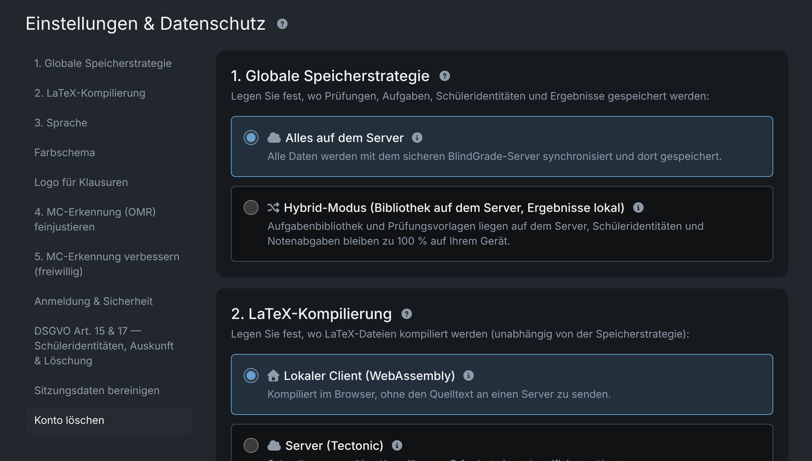

# Settings

**Settings** (the **Data** label in the navigation bar leads there) is grouped into **General**, **Workspace** and **Account & privacy**. Some settings belong to your account and apply in every browser; others are stored only in the browser you are using. Each section below says which.

## Storage location {#storage}

*Belongs to your account.* Decides where the **results** (student data, submissions with scans, scores) are stored. Exercises and exams always live on the server.

| Mode | Results are stored | Good for |
|---|---|---|
| **All on the server** | on the server, encrypted in your browser first; available in every browser of your account | working on several devices |
| **Hybrid** | only in the browser where you recorded them, encrypted in its local database | keeping results on one device |

You choose on your first sign-in; there is no default. Which modes your account may use is decided by your administrator ("not enabled" marks a mode you may not use).

In both modes the server cannot read your results: they are encrypted with a key derived from your password. See [Encryption](./security#encryption).

### Switching modes {#switching}

You can switch at any time. The switch **moves the results directly**, exam by exam, and checks that every record arrived before your account's mode changes; then the page reloads. No export and re-import is needed, but the dialog offers a `.examance` backup beforehand.

- **Changes not yet sent** must be sent first (**Send now**), otherwise the switch is refused.
- **Other open tabs** are blocked while it runs and reload afterwards.
- **The old copy**: Examance asks whether to keep or delete it. Switching to Hybrid marks the server copy for deletion (with a 7-day grace period); switching to "All on the server" clears the local copy for every exam that arrived completely. An exam that could not be moved keeps its local copy.

If an administrator turns off "student data on the server" for your account, the app asks you to move your results into the browser the next time it opens. Nothing is lost.

### Notices about local data {#notices}

- A browser in "All on the server" mode that still holds local results (for example from earlier hybrid use) offers to **upload** them.
- In hybrid mode, a browser without results says so: the results live only in the browser where they were recorded.
- A browser's local storage belongs to exactly **one account on one server**. Data of another account is not opened; the notice explains how to sign in with the matching account or reset the storage.
- Data from the former purely local mode (without an account) can no longer be opened. You can delete it and carry on; it is not migrated.

## LaTeX compilation {#latex}

*Stored in this browser.* Decides where exams and exercises are typeset, independently of the storage location:

- **Local Client (WebAssembly)**: in your browser; the LaTeX source never leaves your device. The engine downloads once in the background after sign-in (or when you switch to this option); until then the first run takes longer. If that first run fails with a message about a missing `.sty` file, retry once the download has finished.
- **Server**: faster on weak hardware; the LaTeX source is sent to the server. Available only if your account allows it.

## Language and colour scheme {#language}

*Stored in this browser.* The interface is available in German and English; the colour scheme can be light, dark or **Match system**. Both can also be switched from the navigation bar. Neither affects the printed exam, which is always in German.

## Exam logo {#logo}

*Belongs to your account.* A logo is printed at the top left of the first page of every exam. Under **Exam logo** you can upload your own (PNG, JPEG or PDF, at most 2 MB), choose **No logo**, or reset to the default logo. Without a logo the spot stays empty; the page layout and the position of the answer boxes do not change.

A single exam can override the logo under **Edit Exam**, see [Logo and LaTeX packages](./exams#logo-packages).

## LaTeX packages {#packages}

*Belongs to your account.* Lists the packages the template loads, and lets you add packages, TikZ libraries and options for all your exams. See [LaTeX packages](./exercises#packages) for how account, exam and exercise packages combine.

## Fine-tuning MC detection {#mc-detection}

*Stored in this browser.* Choose the detection method (v4 or v2, see [Detection method](./scanning#detection-methods)) and adjust the thresholds, for example when a scanner produces very light or very dark scans. The defaults suit most scanners.

- Changes apply only to **future** detection runs (new scans or **Re-run MC detection**). Detected and verified results do not change.
- Every run records the values it used, so the verification view can compare them.
- **Reset to defaults** restores the built-in values.

## Help improve MC detection (optional) {#donation}

*Stored in this browser, off by default.* When you switch it on, the browser sends a small crop for every box of a tick-box question you **verified or corrected**: 80 × 48 pixels, grayscale, only the box and its correction field, no question text. Along with it go your decision (ticked or not), the original detection and a few measurements, to the server of your installation.

Never sent: names, pseudonyms, exam, submission or question identifiers, timestamps. Each box carries only a random id, so a later correction replaces the earlier label. You must be signed in to donate (that only guards against abuse; your account is not stored with the crops).

The goal is a shared, better detector, so new installations get good detection from the start. Switching the option off stops everything immediately, including crops already prepared.

## Session lock {#session}

The session **locks itself** after a period of inactivity; afterwards the content is reachable only with your password (or passkey) again. Lock it yourself when you leave the computer: no decrypted data stays in memory afterwards.

## Deleting data {#deletion}

- **Single students**: erase a student record, for example for a GDPR access or erasure request. A subject access export is available before you erase. The exam's statistics stay intact.
- **Session data hygiene**: clears everything cached in this browser.

Deletion is final and cannot be undone.

### Delete your account {#delete-account}

**Delete account** sends you an e-mail with a confirmation link; nothing is deleted before you open it and confirm. Then everything stored with the account on the server goes (exams, results, sign-in factors), and the browser you confirm in is cleared. Other browsers keep their local copy, which can no longer be read without the account.

With **Keep my exercises on the server**, your exercises stay on the server without your name, so they can be shared later. Administrators can delete other accounts with the same option.

## Updates and maintenance {#maintenance}

Before an update or a maintenance window, Examance reminds you twice (usually 5 minutes and 1 minute before) to save your work. **I've saved my work** tells the administrators you are ready. From the second reminder, new sign-ins are paused briefly. If the maintenance is cancelled, Examance says so explicitly.

Keep the tab open during the interruption: what you saved is there as usual afterwards, and changes that did not get through in the meantime are sent automatically.

After an update, a **What's new** notice summarises the changes.
