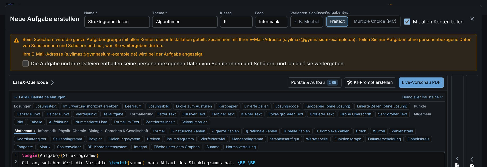
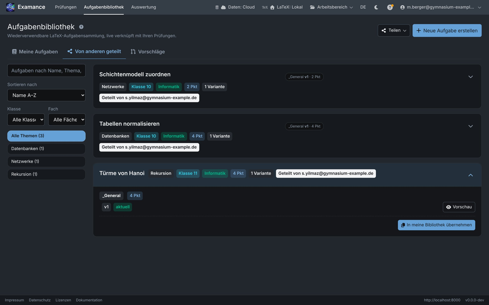
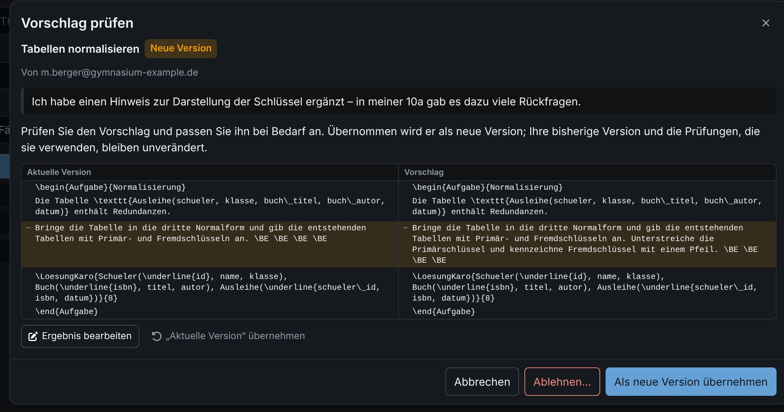

# Sharing exercises

Colleagues on the same Examance installation can share exercises with each other, copy them and propose improvements back to the original. Whether your account may share is decided by the administrators of your installation; if it may not, the sharing buttons are not shown.

Sharing concerns **exercises only**. Exams, students and results are never shared.

## Share an exercise {#share}

**Share…** on an exercise group makes the group, with all its current variants and files, visible to **every account of this installation**, together with your e-mail address. Others can view and copy it, but never change it.

You can also share:

- right after saving: when you save an exercise of your own that is not shared yet, Examance asks **once** whether to share it (see below);
- or all at once from the **Sharing** menu of the library, which also stops sharing everything.

### The question after saving {#ask-after-save}

After you save a new exercise, or an own exercise that was never shared and never asked about, a short question opens: it explains that the exercise becomes visible to all accounts, that others can copy it and keep their copies, and that your e-mail address is shown next to it.

- **Yes, share** needs the same tick as the sharing dialog (no personal data of pupils, you may pass it on).
- **No, keep it private** keeps it to yourself; you are not asked again for this exercise.
- Closing the question without an answer asks again the next time you save it.
- **Remember my decision** skips the question from then on. You can change the remembered choice in [Settings](./settings#share-default).

Exercises you copied from others are never asked about.

**Pause sharing** hides everything you share for a while without forgetting your choices.

Before you confirm, check two things: the exercise contains **no personal data of pupils**, and you are **allowed to pass it on** (for example, no copyrighted textbook material).

## Copy a shared exercise {#copy}

The **Shared by others** view of the library lists what colleagues share. It is read-only and needs a connection to the server. **Copy to my library** puts an exercise into your own library:

- you get your **own copy** to edit freely and use in exams;
- changes or deletion by the person who shared it never affect your exams;
- if the original is no longer shared, your copy stays.

Exercises you copied from others are never shared again as your own.

## Take over updates {#updates}

When the original changes, your copy shows **Update available**. **Update…** shows the differences between your version and the original:

- choose which variants to take over;
- edit the result right in the dialog;
- the result is saved as a **new version** of your copy. Your previous version, and every exam that uses it, stay unchanged.

**Unlink from source** keeps your copy as it is but stops the update notices for good.

## Propose a change to the original {#proposals}

If you improved your copy or added a variant, **Propose to original…** suggests it to the person who shares the exercise:

- changed variants are proposed as a **new version**, added ones as a **new variant**;
- your e-mail address is shown to them;
- you can withdraw an open proposal at any time.

Exercises with an open proposal carry a tag in the library that leads straight to the proposal; from there, **Open in library** opens the exercise.

## Review proposals {#reviewing-proposals}

Proposals for exercises you share appear under **Proposals**, and you get a short e-mail notice (without the content). For each proposal:

1. compare it with your current version;
2. edit it if needed;
3. **accept** or **reject** it.

Accepting always adds a new version or variant; existing versions and exams stay unchanged. A PDF preview is available only after accepting.

Accepted changes reach the proposer's copy through **Update…**. If you accepted the proposal unchanged, their copy is automatically back in sync with the original; only an edited acceptance shows **Update available** to them.

### How long proposals are kept {#proposal-retention}

| What | Deleted |
|---|---|
| Content of a decided proposal | right after the decision |
| The entry of a decided proposal | after 30 days |
| An open proposal nobody decided on | after 180 days |
