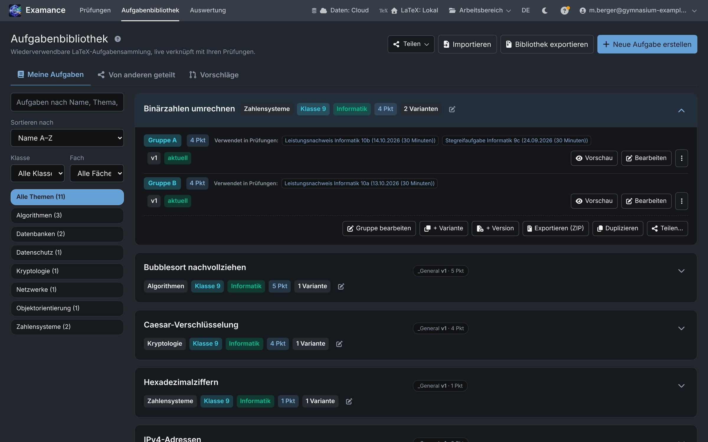
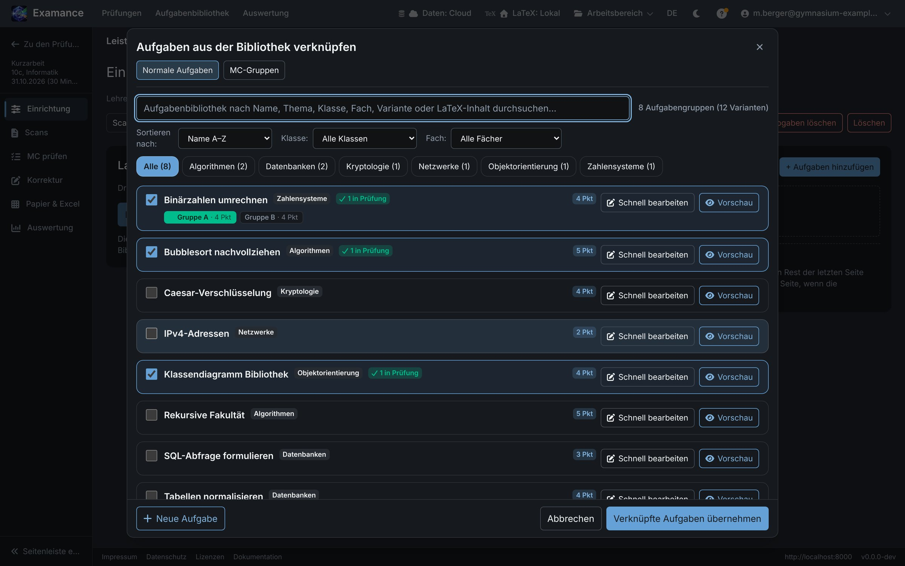
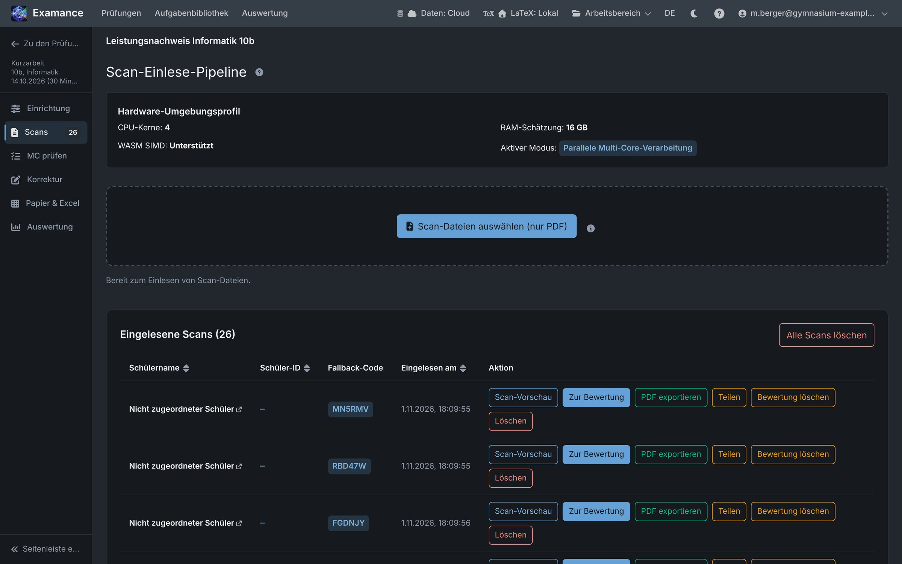
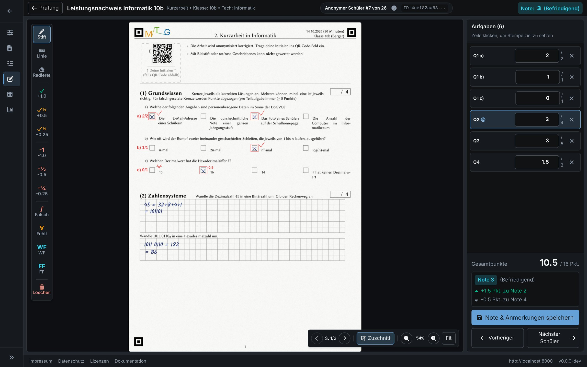
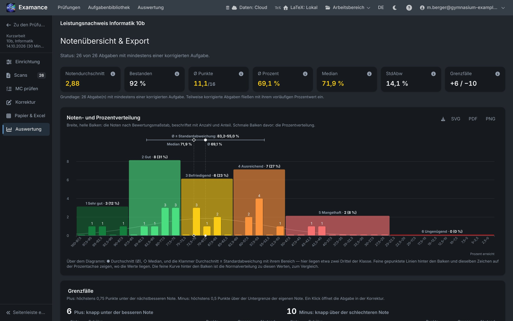

# From exercise to analysis

The usual path of an exam through Examance, in six stages. Each stage links to its detailed page. Inside an exam, the sidebar lists the steps in this order: **Exam**, **Students**, **Print**, **Scans**, **Check MC**, **Scan grading**, **Paper grading**, **Results**; each has a status badge and ends with a **Next: …** button, see [The exam's steps](./exams#steps).

## 1. Collect exercises in the library {#library}

Exercises live in your library, tagged by grade, subject and topic, so you reuse them instead of copying. Each exercise is a LaTeX fragment with a live preview; its score is counted from the source automatically.

- **Variants** are equivalent phrasings of the same exercise (for example groups A and B); they are analysed together.
- **Versions** keep the revision history: a reworked exercise does not invalidate the analysis of past exams.
- **Multiple choice**: single and multiple choice exercises store their options and answer key, and are detected automatically on the scans.
- **Sharing** (if your installation allows it): share an exercise with all accounts of the installation, copy exercises others shared, and propose improvements back to the original.

More: [Exercise library](./exercises), [Sharing exercises](./sharing).

## 2. Assemble and typeset the exam {#exam}

**New exam** asks for the header data (subject, class, exam type, date), then opens the **Exam** step, where you pick exercises from the library, order them, group multiple choice questions and set the layout. The grading key is set later, under **Results → Statistics**. The class list belongs to the **Students** step. Typesetting produces a print-ready PDF in your browser or on the server; its cover page has an empty QR Code box for the student's [QR sticker](./students#qr-stickers).

**Duplicate** creates a new exam with the same exercises and settings, for example for a parallel class; students and results are never copied. Deleted an exam by mistake? [The trash](./trash) keeps it for 7 days.

More: [Creating an exam](./exams).

## 3. Print, write, scan {#print}

Print the sheets exactly as typeset (no scaling); the QR sticker must stay readable. Print the stickers beforehand on the **Print** step, card **QR codes for students** ([QR stickers](./students#qr-stickers)); every student sticks theirs into the QR Code box on the cover page. Or print the codes [directly onto the exam copies](./students#printed-copies) and snip off the name corner before handing out. After the exam, scan the whole stack into one PDF on the school copier.

More: [Print](./exams#print), [Scan the stack](./scanning#scan).

## 4. Import the scan {#scan}

Upload the PDF on the exam's **Scans** step. Examance splits it into submissions along the QR stickers and encrypts every page in the browser right away. The QR sticker points at a pseudonym, not a name. Pages with unreadable stickers are assigned by typing in the sticker text.

Ticked multiple choice boxes are detected during import. Students withdraw a cross by filling the box completely and choose a filled box again by crossing just left of it; the exam option "Show how to correct a cross at every multiple-choice task" prints this as one short line on each multiple choice task. In the MC verification view you confirm or correct uncertain detections.

More: [Scanning and assignment](./scanning).

## 5. Grade blind {#grade}

While grading you see the handwriting and the answers, but not the name. Correction marks are drawn on a layer above the scan (the original stays untouched), points are awarded per exercise or per part (a), b), …), and total and grade follow from the grading key. The score boxes printed on the exam, next to each exercise and part and in the table at the end, fill in automatically on the scan and in the graded PDF. Papers graded without scanning are entered in a score grid or pasted from Excel.

More: [Grading](./grading).

## 6. Results, analysis and export {#results}

- **Share with students**: **Results → Send to students** gives every student their graded exam through an encrypted link, by e-mail, Artemis or Mebis files, see [Share graded exams](./students#share-results).

- **Exam statistics**: grade and percentage distributions, average, pass rate, borderline cases, per-exercise analysis and variant comparison.
- **Analytics across exams**: topic heatmaps, exercise quality and variant fairness over time, grades and subjects.
- **Export**: CSV for the school's grade management (it contains real names), or a readable ZIP with the graded submissions as PDFs with the corrections drawn in, the LaTeX source and a statistical summary.
- **Backup**: a password-protected `.examance` archive backs up or moves a whole workspace.

More: [Results and analysis](./results), [Backup and transfer](./backup).

