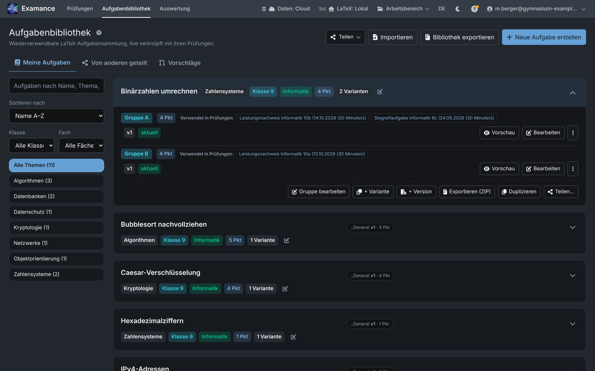
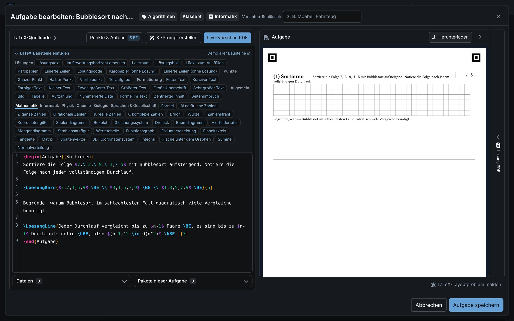
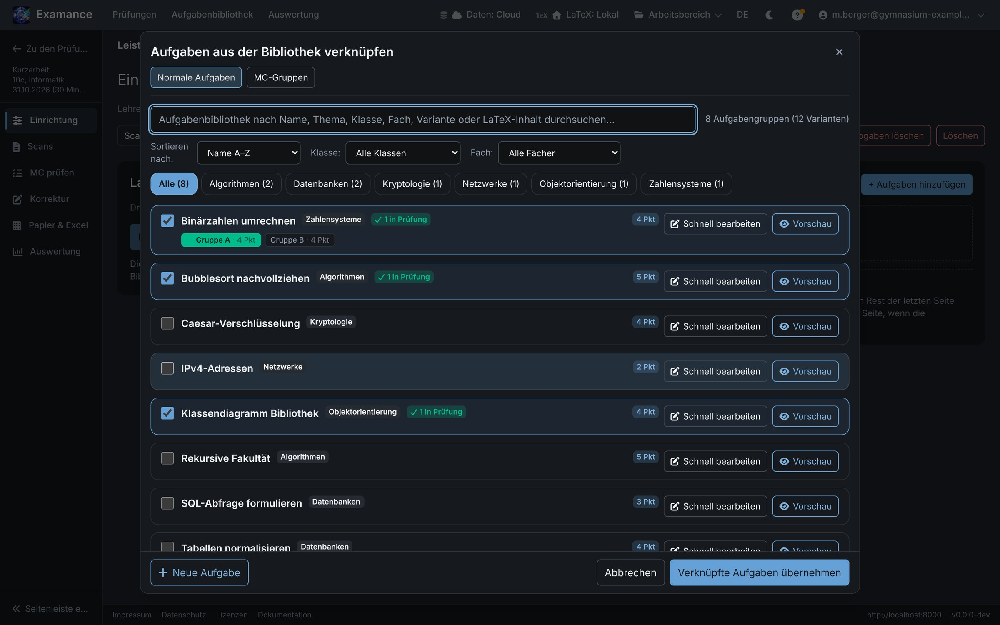
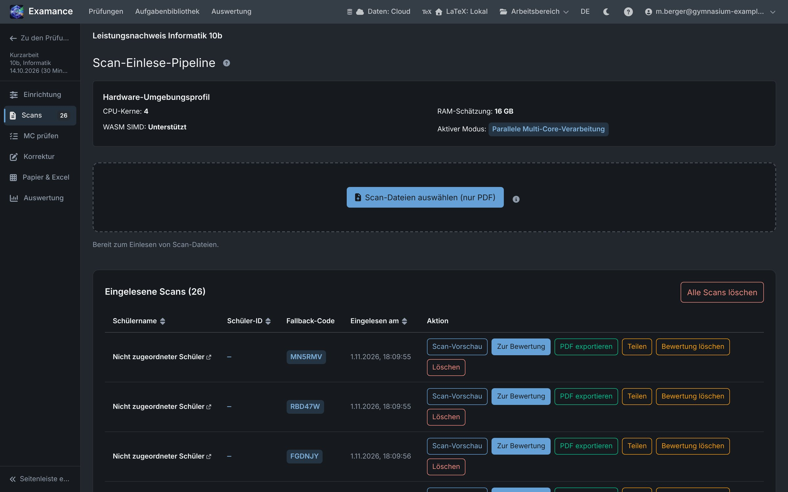
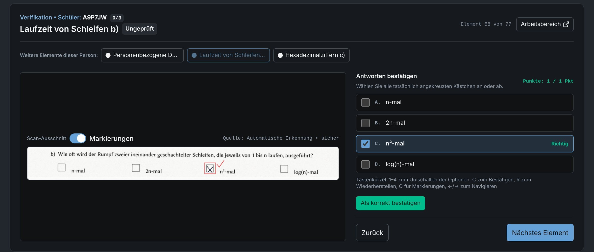
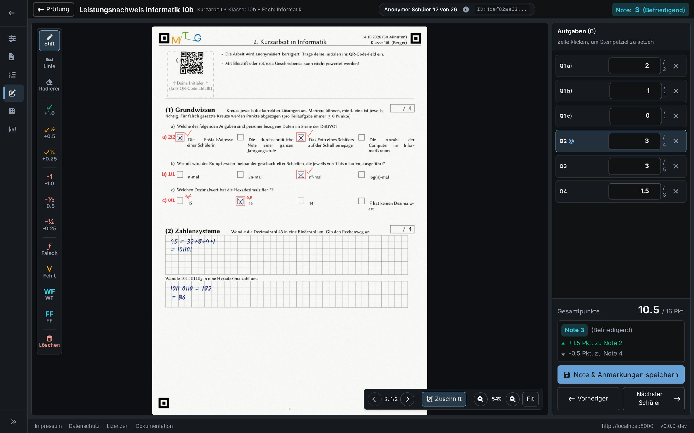
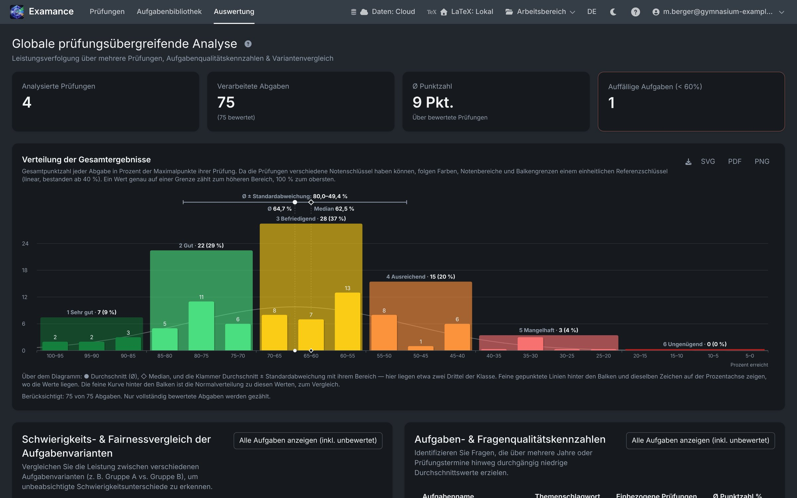

# From exercise to analysis

The usual path of an exam through Examance. Each step has its own help topic in the app (the **?** buttons).

## 1. Collect exercises in the library

Exercises live in your library, tagged by grade, subject and topic, so you reuse them instead of copying. Each exercise is a LaTeX fragment with a live preview; its score is read from the source automatically.

- **Variants** are equivalent phrasings of the same exercise (for example groups A and B); they are analysed together.
- **Versions** keep the revision history: a reworked exercise does not invalidate the analysis of past exams.
- **Multiple choice**: single and multiple choice exercises store their options and answer key, and are detected automatically on the scans.
- **Sharing** (if your installation allows it): share an exercise with all accounts of the installation, copy exercises others shared, and propose improvements back to the original.

## 2. Assemble and typeset the exam

**New exam** asks for the header data (subject, class, exam type, date), then opens the exam page, where you pick exercises from the library, order them, group multiple choice questions and set the grading key (linear, upper-secondary points or your own cutoffs). Typesetting produces a print-ready PDF with QR codes, one per exam, variant and student slot. Depending on your installation, it is typeset in your browser or on the server.

**Duplicate** creates a new exam with the same exercises and settings, for example for a parallel class; students and results are never copied.

## 3. Print, write, scan

Print the sheets exactly as typeset; the QR codes must stay readable. After the exam, scan the whole stack into one PDF on the school copier.

## 4. Import the scan

Upload the PDF on the exam's scan page. Examance splits it into submissions along the QR codes and encrypts every page in the browser right away. The QR code points at a pseudonym, not a name. Pages with unreadable codes land in a verification view where you assign them by hand or enter the fallback code printed on the sheet.

Ticked multiple choice boxes are detected during import. In the MC verification view you confirm or correct uncertain detections.

## 5. Grade blind

While grading you see the handwriting and the answers, but not the name. Correction marks are drawn on a layer above the scan (the original stays untouched), points are awarded per exercise, and total and grade follow from the grading key. Progress is saved continuously. Papers graded without scanning can be entered in a score grid.

## 6. Results, analysis and export

- **Exam results**: grade and percentage distributions, average, pass rate, per-exercise analysis and variant comparison.
- **Analytics across exams**: topic heatmaps, exercise quality and variant fairness over time, grades and subjects.
- **Export**: CSV for the school's grade management (it contains real names), or a readable ZIP with the graded submissions as PDFs with the corrections drawn in, the LaTeX source and a statistical summary. A password-protected `.examance` archive backs up or moves a whole workspace.

